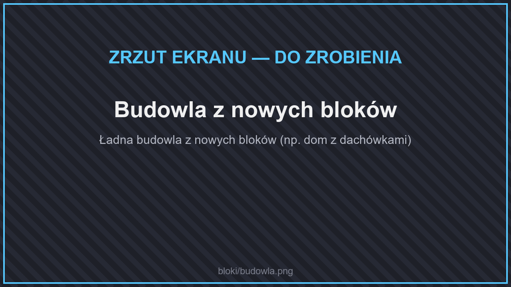
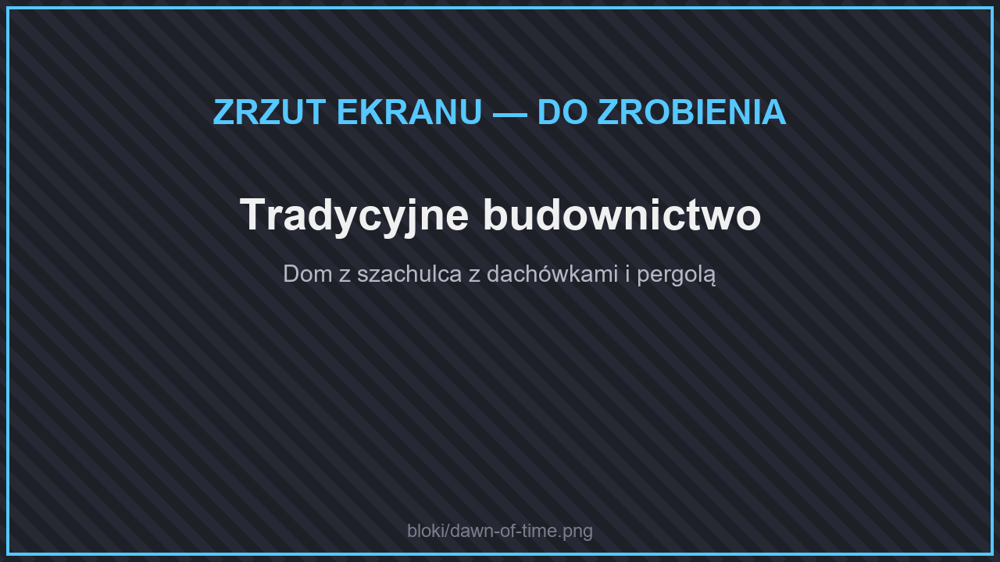
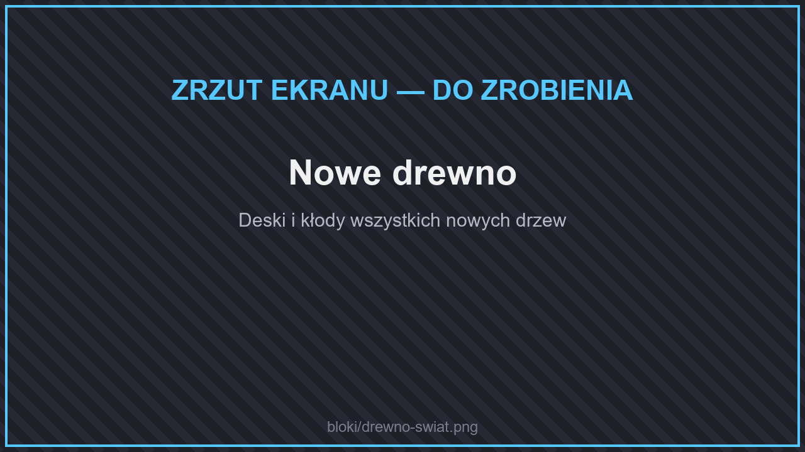
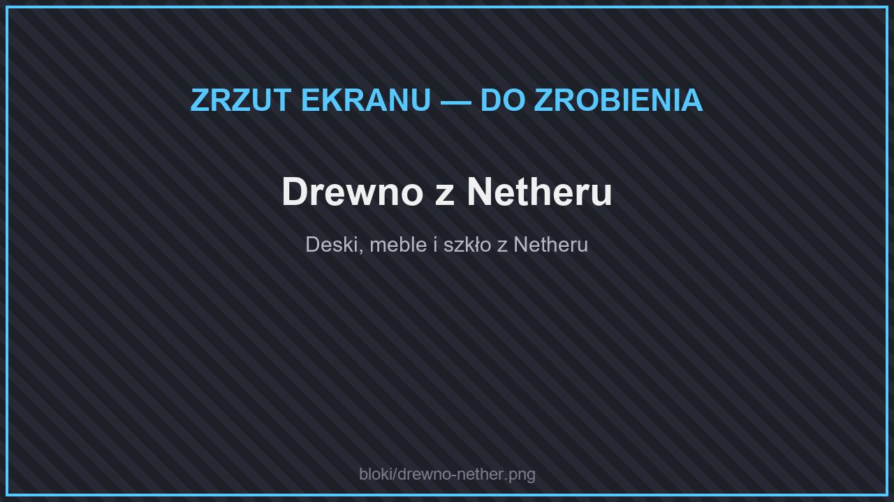

# 🧱 Bloki budowlane

<figure><figcaption>
Budowla z nowych bloków
</figcaption></figure>

Na serwerze jest **ponad tysiąc nowych bloków** do budowania. Prawie każdy materiał ma komplet kształtów: **blok, schody, płytę, murek**, a drewno także **płot, furtkę, drzwi, klapę, przycisk i płytę naciskową**. Schody łączą się w narożniki, płoty i murki łączą się z sąsiadami — tak jak w zwykłym Minecrafcie.


Wszystkie bloki przejrzysz w menu przedmiotów (**`/nova items`**) w zakładkach **Bloki budowlane** i **Bloki naturalne**. Większość powstaje w stole rzemieślniczym albo w **przecinarce do kamienia**.


## Tradycyjne budownictwo

<figure><figcaption>
Tradycyjne budownictwo
</figcaption></figure>

Bloki do budowli historycznych — od europejskich miasteczek, przez Rzym i Persję, po Japonię i Majów:

* **dachówki** (ceramiczna, płaska, zielona, łupki dachowe) — jako bloki, schody, płyty i murki, oraz **strzecha** (słomiana, bambusowa) — jako bloki, schody i płyty,
* **szachulec** i **ramy szkieletowe** z drewna (proste, skrzyżowane, kwadratowe),
* **otynkowany i malowany kamień** w kilku kolorach, **wapień**, **wapień Puuc**, **marmur**, **mozaiki Moraq** i **rzymskie freski**,
* **ubita ziemia**, kamienie ścieżki, grabiony żwir,
* **zwęglone** i **woskowane** drewno z deskami, belkami, płotami, drzwiami i oknami,
* dekoracje w zakładce **Bloki funkcjonalne**: pergole, balustrady, kolumny, belki, okiennice, kominy i kominki, baseny i fontanny, latarnie, emblematy.

## Płoty, mury i bramy

**Ponad 170 płotów, murków, bram i żywopłotów** w każdym rodzaju drewna i kamienia: płoty sztachetowe, palisady, płoty dla koni, płoty z drutu, metalowe ogrodzenia, wysokie i łukowe bramy, murki z filarem lub z trawą. Łączą się z sąsiadami jak zwykłe płoty, a bramy się otwierają. Więcej w [Meblach](meble.md).

## Drewno i kamienie z nowych biomów

### Świat Główny

<figure><figcaption>
Nowe drewno
</figcaption></figure>

Nowe drzewa z [biomów](../wymiary/swiat-glowny/biomy.md) dają pełne zestawy drewna (kłody, deski, schody, płyty, płoty, furtki, drzwi, klapy, przyciski, płyty naciskowe, tabliczki): **baobab, czarnodrzew, cyprys, martwe drewno, eukaliptus, juka, kapok, modrzew, magnolia, klon, palma, sosna, sekwoja, sokotra, wierzba, glicynia**, **klasyczne drewno**, a także świecące **biogrzyby** z jaskiń (niebieskie, zielone, różowe, żółte).

* **Malowane deski** w 16 kolorach — z deskami, schodami i płytami.
* Nowe kamienie: **kreda** z białych klifów (także cegły, filar i polerowana kreda), do tego dziesiątki nowych **kwiatów, krzewów i traw**.
* Z każdego nowego drewna zrobisz też **meble**: krzesła, stoły, łóżka, szafki, szuflady i inne — zobacz [Meble](meble.md).


Wiszące pnącza z nowych biomów (np. glicynii) zachowują się jak zwykłe pnącza: gdy zniszczysz jeden fragment, **odpadnie też cała część poniżej**.


### Nether

<figure><figcaption>
Drewno z Netheru
</figcaption></figure>

Nowe biomy Netheru dają drewno **żarodrzewne** i **kobaltowe** z pełnym zestawem kształtów.

### End

Biomy Endu dają drewno: **smocze, lotosowe, galaretnikowe, lakugrowe, omszałe świetlakowe, pytadendronowe, tenaneowe i parasolowe**. Z każdego zrobisz też krzesło, taboret, hoker, półkę, drabinę i skrzynię.

* Nowe kamienie: **flawolit**, **fiolecyt** i **umbralit** — z cegłami, płytkami, filarami i polerowaną wersją, a także popękane i zwietrzałe cegły z kamienia Endu.
* Bloki z metali Endu (**talas**, **terminit**, **eternium**), latarnie z żarówką w 16 kolorach, żyrandole i piedestały.

## Inne

* **Bloki z rud**: Blok Duszmitu, Blok Wulkanitu, Blok Enderytu, Blok Kresum, Blok Perłytu i Blok Promethium.
* **Faliste metalowe** drzwi, klapa, płot, furtka, schody i płyta.
* **Bloki akwarium** (zwykłe, miedziane, żelazne i złote).
