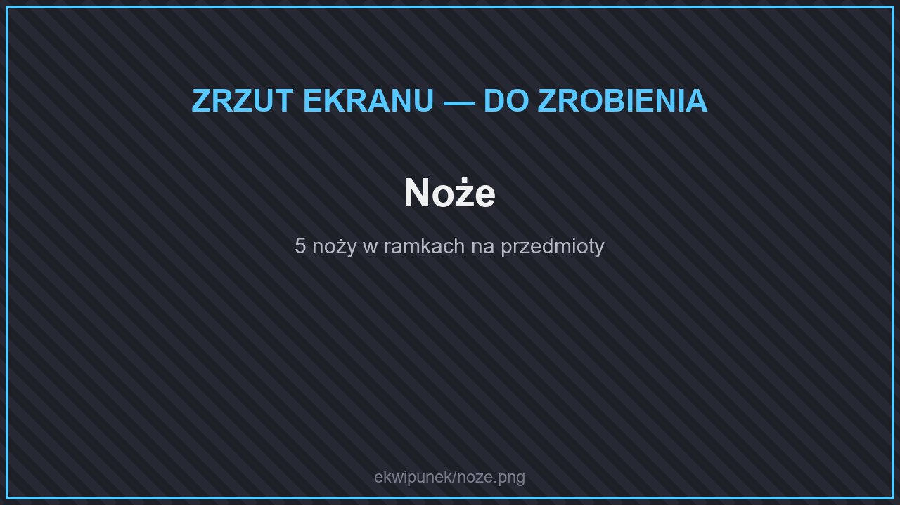
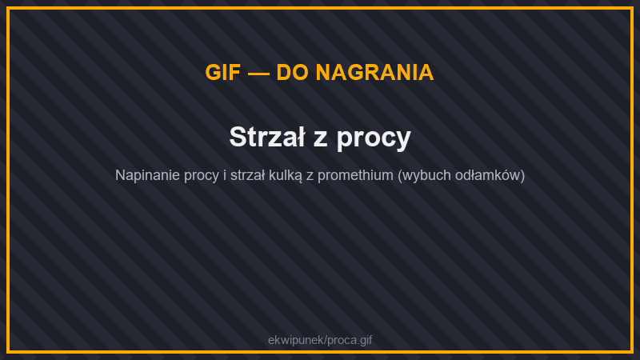
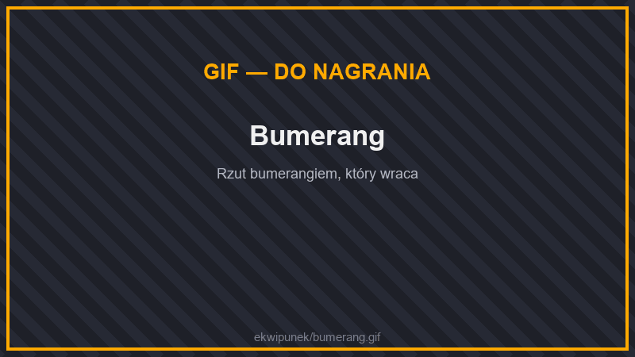
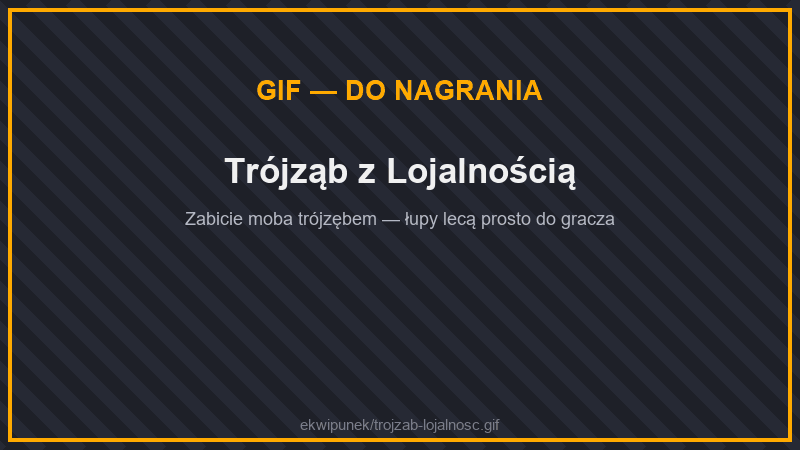

# 🗡️ Broń

Miecze i topory z rzadkich rud opisuje strona [Zestawy z rud](zestawy-rud.md). Tutaj znajdziesz pozostałą broń.

## Noże

<figure><figcaption>
Noże
</figcaption></figure>

Noże z [kuchni](../gotowanie.md) to też szybka broń. Zwierzęta zabite nożem upuszczają więcej mięsa.

| Nóż | Obrażenia | Szybkość ataku |
| --- | --- | --- |
| Złoty | 1,5 | 2,0 |
| Krzemienny | 2,5 | 2,0 |
| Żelazny | 3,5 | 2,0 |
| Diamentowy | 4,5 | 2,0 |
| Netherytowy | 5,5 | 2,0 |

## Proce

<figure><figcaption>
Strzał z procy
</figcaption></figure>

Proce napinasz jak łuk. Strzelają **kulkami** z twojego ekwipunku.

| Proca | Cecha |
| --- | --- |
| **Żelazna proca** | Podstawowa proca. Z żelaza, nici i skóry. |
| **Neptunowa proca** | Kulki lecą swobodnie przez wodę. Z muszli łodzika, nici i skóry. |
| **Proca z promethium** | Strzela seriami. Ze sztabek promethium, nici i skóry. |

| Kulka | Obrażenia |
| --- | --- |
| Kamienna | 3 |
| Żelazna | 5 |
| Neptunowa | 5, leci przez wodę |
| Z promethium | 5, wybucha odłamkami |

Neptunowe kulki zrobisz z pryzmarynu i gliny, a promethium zdobędziesz [łowiąc w lawie](../wedkarstwo.md#lowienie-w-lawie).

## Bumerangi

<figure><figcaption>
Bumerang
</figcaption></figure>

Rzucasz je PPM — wracają do ciebie po locie. Są drewniane, żelazne, złote, diamentowe, magmowe, grawitacyjne i netherytowe (netherytowy powstaje w stole kowalskim z diamentowego).

## Trójzęby

<figure><figcaption>
Trójząb z Lojalnością
</figcaption></figure>

Trójzęby działają lepiej niż w zwykłym Minecrafcie:

* Trójząb z **Lojalnością** wraca nawet z pustki pod światem i trafia z powrotem do tego samego miejsca w ekwipunku.
* Gdy zabijesz moba trójzębem z Lojalnością, łupy i doświadczenie trafiają **prosto do ciebie**.
* **Przebicie** rani wszystkie moby w wodzie i w deszczu, nie tylko morskie.
* **Starszy Strażnik** upuszcza **fragment trójzębu**. Z 3 fragmentów i 2 odłamków pryzmarynu stworzysz trójząb.

## Włócznie

Włócznie z [zestawów z Netheru](zbroje.md#zestawy-z-netheru-betternether) (cincinnasite i netherowy rubin) to broń o większym zasięgu.
