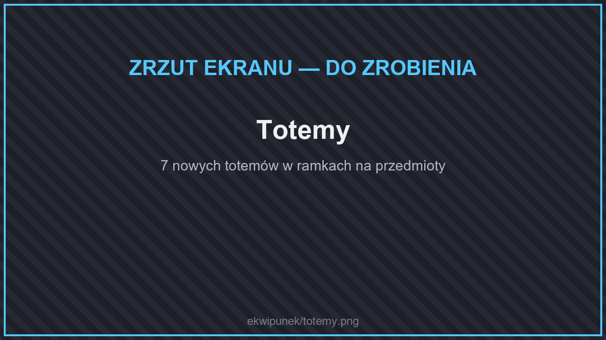
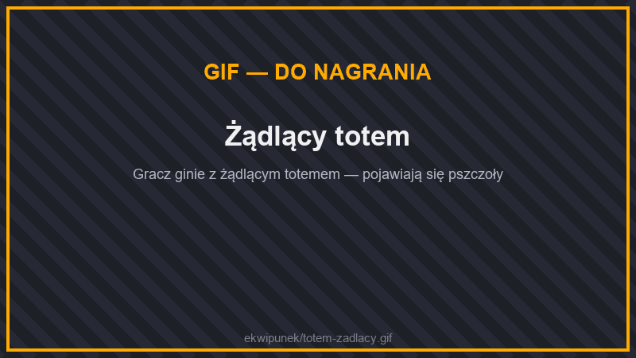
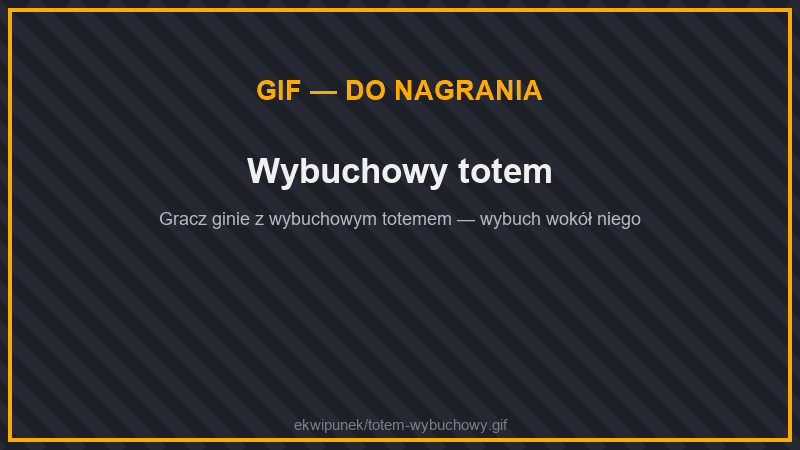

# 🗿 Totemy

<figure><figcaption>
Totemy
</figcaption></figure>

<figure><figcaption>
Żądlący totem
</figcaption></figure>

<figure><figcaption>
Wybuchowy totem
</figcaption></figure>

Oprócz zwykłego totemu nieśmiertelności istnieje 7 nowych totemów. Każdy **ratuje przed śmiercią** jak zwykły totem (trzymany w ręce), a do tego daje dodatkowy efekt. Stworzysz je w stole rzemieślniczym: **zwykły totem na środku, a dookoła 8 sztuk składnika** z tabeli.

| Totem | Składnik (8×) | Dodatkowy efekt |
| --- | --- | --- |
| **Wybuchowy** | proch | Pod tobą odpala się dynamit, a ty dostajesz Odporność IV, która osłania cię przed wybuchem. |
| **Żądlący** | blok miodu | Przywołuje 6 pszczół, które bronią właściciela. |
| **Teleportujący** | 4 perły Kresu + 4 oczy Kresu | Przenosi cię do punktu odrodzenia. Działa też, gdy **wpadniesz w pustkę**. |
| **Upiorny** | łza ghasta | Unosi cię w górę i daje odporność na ogień. |
| **Szkieletowy** | kość | Efekt **Snajper**: twoje pociski zadają podwójne obrażenia. |
| **Mackowaty** | torbiel z atramentem | Efekt **Głowonóg**: oślepiasz tych, których atakujesz, i tych, którzy atakują ciebie. |
| **Gnijący** | zgniłe mięso | Przywołuje 4 zombie, które walczą po twojej stronie, i daje efekt **Martwica**: trucizna zamiast ranić — leczy cię. |


Efekty Snajper, Głowonóg i Martwica widzisz jako pasek u góry ekranu, dopóki działają.

