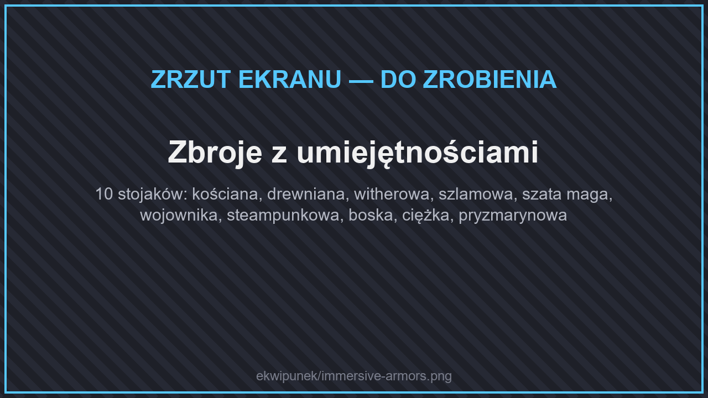
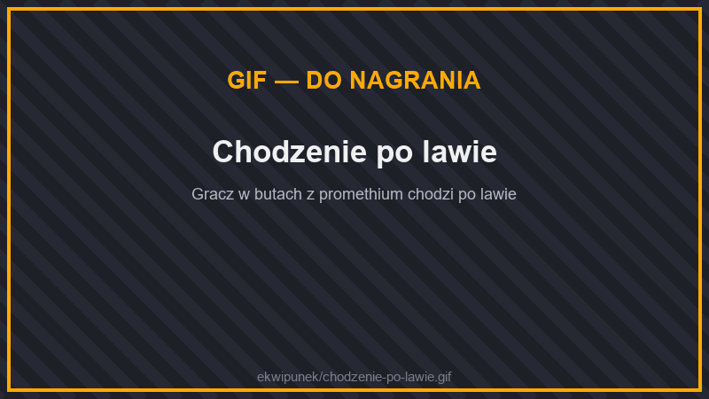
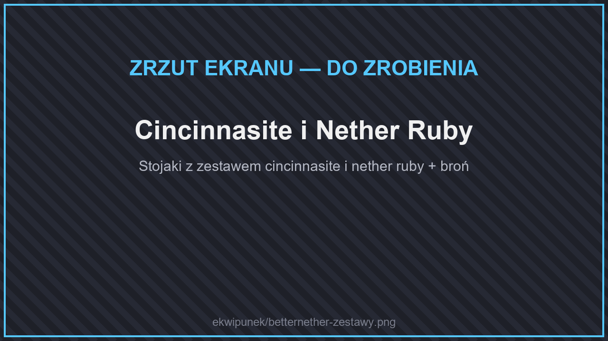

# 🛡️ Zbroje specjalne

## Zbroje z umiejętnościami

<figure><figcaption>
Zbroje z umiejętnościami
</figcaption></figure>

<figure><figcaption>
Szlamowa zbroja — Odbicie
</figcaption></figure>

Dziesięć zbroi o własnym wyglądzie. Wiele z nich ma **umiejętność**, która działa, gdy masz na sobie choć jedną część. Wszystkie stworzysz w stole rzemieślniczym.

| Zbroja | Pancerz (hełm / napierśnik / nogawice / buty) | Właściwości | Z czego |
| --- | --- | --- | --- |
| **Kościana** | 1 / 3 / 2 / 1 | −5% obrażeń od pocisków za część | kości |
| **Drewniana** | 1 / 3 / 2 / 1 | −15% obrażeń od pocisków za część | kłody drewna |
| **Witherowa** | 2 / 4 / 3 / 2 | **Uschnięcie:** 25% szans na nałożenie uschnięcia na atakującego; −3% od pocisków | kościana zbroja + netherowe cegły |
| **Szlamowa** | 3 / 5 / 4 / 2 | **Odbicie:** 25% szans na odrzucenie atakującego; −10% obrażeń od upadku, odporność na odrzut | kulki szlamu |
| **Szata Maga** | 2 / 3 / 2 / 1 | **Płomienie:** podpala atakującego na 1 s; −25% od ognia, −20% od magii | wełna + proszek płomyka |
| **Wojownika** | 2 / 6 / 5 / 2 (+1 wytrzymałości) | **Szał:** +5% obrażeń, gdy masz mniej niż połowę zdrowia | skórzana zbroja + żelazo |
| **Steampunkowa** | 3 / 6 / 3 / 2 (+1 wytrzymałości) | nogawice: **Skok I**; buty: **brak obrażeń od upadku** | złoto, zegar, kompas, tłok |
| **Boska** | 3 / 7 / 5 / 3 | **Boska Ochrona:** raz na minutę blokuje cały cios | szata maga + złoto + **totem nieśmiertelności** |
| **Ciężka** | 4 / 6 / 5 / 3 (+4 wytrzymałości) | duża odporność na odrzut, −2,5% szybkości ruchu za część | bloki żelaza |
| **Pryzmarynowa** | 3 / 8 / 6 / 3 | **Kolce:** rani atakującego; pełny zestaw: **Gracja delfina** | odłamki pryzmarynu + serce morza |

## Zbroja z promethium

<figure><figcaption>
Zbroja z promethium
</figcaption></figure>

<figure><figcaption>
Chodzenie po lawie
</figcaption></figure>

Promethium zdobędziesz [łowiąc w lawie](../wedkarstwo.md#lowienie-w-lawie). Każda część zmniejsza obrażenia od ognia o **25%**, a w gorącu (w ogniu, w lawie albo w Netherze) daje dodatkową moc:

| Część | W gorącu |
| --- | --- |
| Hełm | Wyraźniejszy widok w lawie i ogniu |
| Napierśnik | Powolne leczenie |
| Nogawice | Szybszy ruch |
| Buty | Chodzenie po lawie |

## Zestawy z Netheru (BetterNether)

<figure><figcaption>
Cincinnasite i Nether Ruby
</figcaption></figure>

W nowych biomach Netheru znajdziesz rudy **cincinnasite** i **netherowego rubinu**. Z nich zrobisz pełny ekwipunek (nazwy w grze są po angielsku):

| Zestaw | Moc | Co zawiera |
| --- | --- | --- |
| **Cincinnasite** | jak żelazny | zbroja, miecz, włócznia, kilof, topór, łopata, motyka, nożyce |
| **Nether Ruby** | jak diamentowy | zbroja, miecz, włócznia, kilof, topór, łopata, motyka |

## Inne

**Parkę** (hełm, napierśnik, nogawice, buty) i **tarczę shulkera** stworzysz w stole rzemieślniczym — receptury znajdziesz w menu przedmiotów, w zakładce **Walka**.
