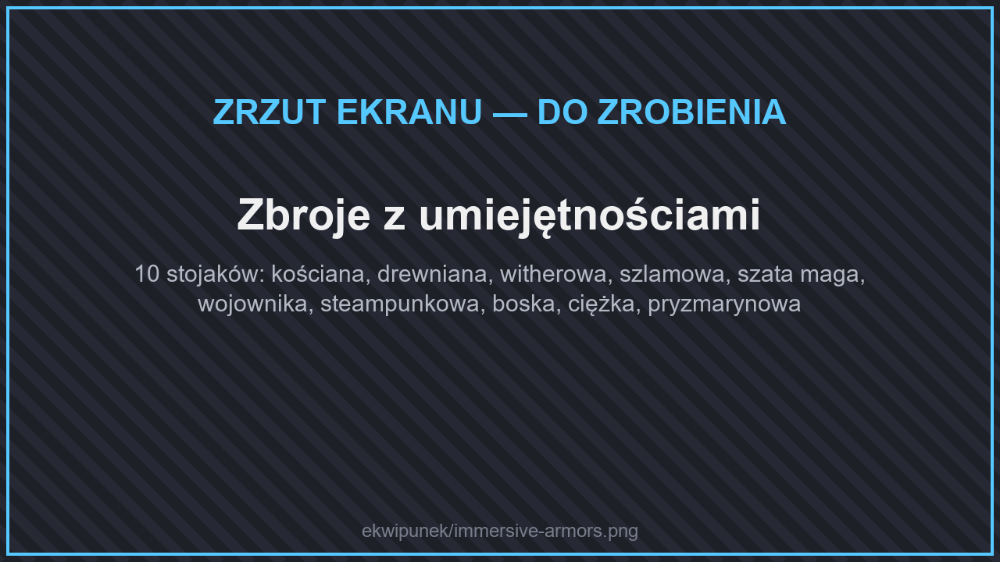
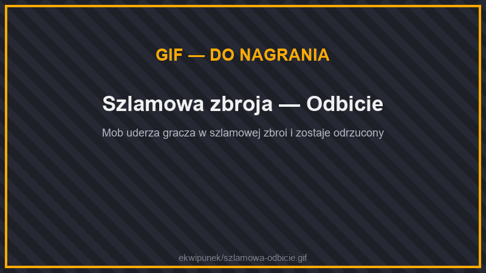
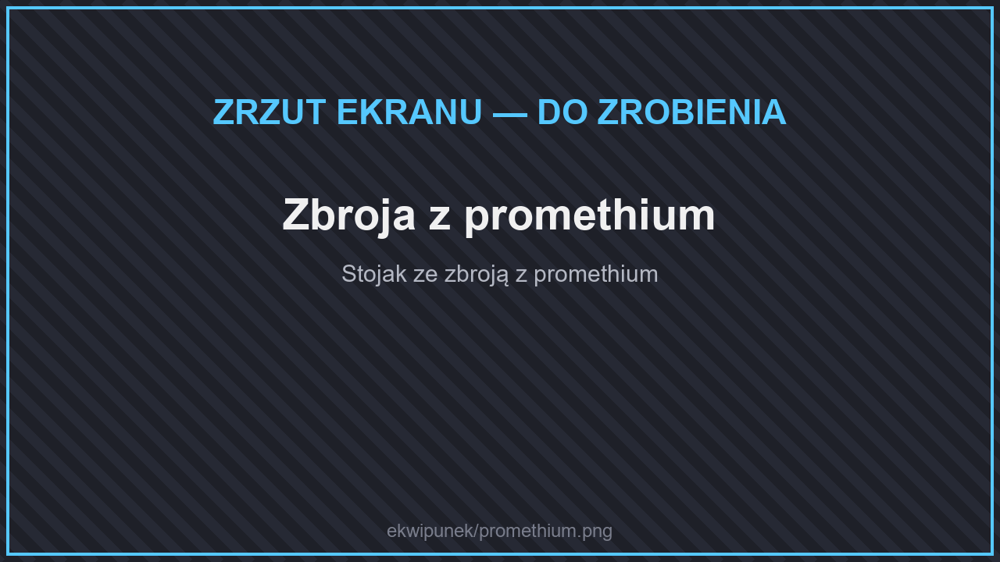
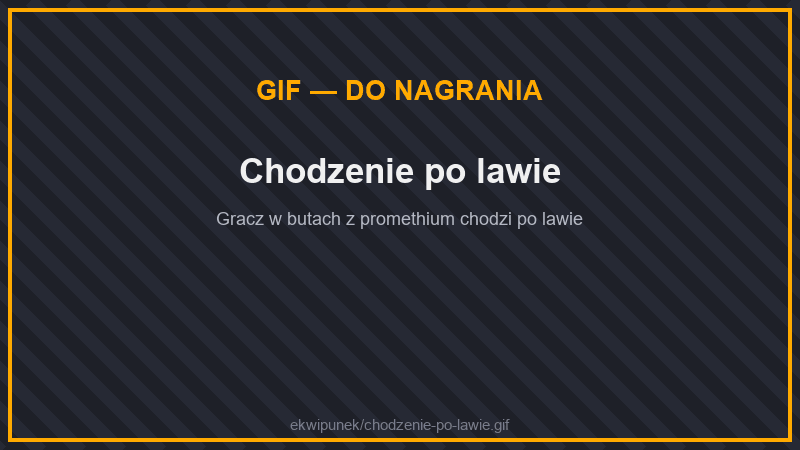

# 🛡️ Zbroje specjalne

## Zbroje z umiejętnościami

<figure><figcaption>
Zbroje z umiejętnościami
</figcaption></figure>

<figure><figcaption>
Szlamowa zbroja — Odbicie
</figcaption></figure>

Dziesięć zbroi o własnym wyglądzie. Wiele z nich ma **umiejętność**, która działa, gdy masz na sobie choć jedną część. Wszystkie stworzysz w stole rzemieślniczym.

| Zbroja | Pancerz (hełm / napierśnik / nogawice / buty) | Właściwości | Z czego |
| --- | --- | --- | --- |
| **Kościana** | 1 / 3 / 2 / 1 | −5% obrażeń od pocisków za część | kości |
| **Drewniana** | 1 / 3 / 2 / 1 | −15% obrażeń od pocisków za część | kłody drewna |
| **Witherowa** | 2 / 4 / 3 / 2 | **Uschnięcie:** 25% szans na nałożenie uschnięcia na atakującego; −3% od pocisków | kościana zbroja + netherowe cegły |
| **Szlamowa** | 3 / 5 / 4 / 2 | **Odbicie:** 25% szans na odrzucenie atakującego; −10% obrażeń od upadku, odporność na odrzut | kulki szlamu |
| **Szata Maga** | 2 / 3 / 2 / 1 | **Płomienie:** podpala atakującego na 1 s; −25% od ognia, −20% od magii | wełna + proszek płomyka |
| **Wojownika** | 2 / 6 / 5 / 2 (+1 wytrzymałości) | **Szał:** +5% obrażeń, gdy masz mniej niż połowę zdrowia | skórzana zbroja + żelazo |
| **Steampunkowa** | 3 / 6 / 3 / 2 (+1 wytrzymałości) | nogawice: **Skok I**; buty: **brak obrażeń od upadku** | złoto, zegar, kompas, tłok |
| **Boska** | 3 / 7 / 5 / 3 | **Boska Ochrona:** raz na minutę blokuje cały cios | szata maga + złoto + **totem nieśmiertelności** |
| **Ciężka** | 4 / 6 / 5 / 3 (+4 wytrzymałości) | duża odporność na odrzut, −2,5% szybkości ruchu za część | bloki żelaza |
| **Pryzmarynowa** | 3 / 8 / 6 / 3 | **Kolce:** rani atakującego; pełny zestaw: **Gracja delfina** | odłamki pryzmarynu + serce morza |

## Zbroja z promethium

<figure><figcaption>
Zbroja z promethium
</figcaption></figure>

<figure><figcaption>
Chodzenie po lawie
</figcaption></figure>

Promethium zdobędziesz [łowiąc w lawie](../wedkarstwo.md#lowienie-w-lawie). Każda część zmniejsza obrażenia od ognia o **25%**, a w gorącu (w ogniu, w lawie albo w Netherze) daje dodatkową moc:

| Część | W gorącu |
| --- | --- |
| Hełm | Wyraźniejszy widok w lawie i ogniu |
| Napierśnik | Powolne leczenie |
| Nogawice | Szybszy ruch |
| Buty | Chodzenie po lawie |

## Ekwipunek z łupów potworów

Z materiałów, które wypadają z nowych zwierząt i potworów (zobacz [Łupy z potworów](../lupy-z-potworow.md)), zrobisz hełmy i napierśniki z **własnymi umiejętnościami**. Hełmy mają trójwymiarowy wygląd na głowie. Wszystkie stworzysz w stole rzemieślniczym.

| Przedmiot | Pancerz | Wytrzymałość pancerza | Wytrzymałość | Umiejętność |
| --- | --- | --- | --- | --- |
| **Czapka Trapera** (hełm) | 3 | 2,5 | 187 | Szybsze skradanie się (kucanie) |
| **Hełm Mroźnego Łowcy** | 3 | 0,5 | 99 | Mroźni Łowcy cię nie atakują, chodzą za tobą jak za przywódcą stada i atakują twoich wrogów; brak obrażeń od zamarzania |
| **Okracznytowy Hełm** | 2 | 1 | 165 | Ochrona przed gorącem (niżej); sam hełm nie spłonie w lawie ani ogniu |
| **Krokodyli Napierśnik** | 7 | 1 | 352 | Szybsze pływanie |
| **Skalisty Napierśnik** | 7 | 0,5 | 320 | Toczenie się (niżej) |

**Okracznytowy Hełm:**

* bloki magmy nie zadają ci obrażeń,
* płoniesz o połowę krócej,
* gdy wejdziesz do lawy, dostajesz **Odporność na ogień na 10 sekund** (najwyżej raz na minutę).

**Skalisty Napierśnik:** gdy **zaczynasz sprintować**, zwijasz się w kulę i toczysz przed siebie przez 1,5 sekundy. Toczona kula rani (3 obrażenia) i odrzuca stwory, w które wpadniesz. Między toczeniami jest sekunda przerwy.

### Receptury

| Przedmiot | Składniki |
| --- | --- |
| Czapka Trapera | skórzany hełm na środku, 5 × Niedźwiedzie Futro (górny rząd i boki środkowego rzędu), Ogon Szopa w dolnym rzędzie. Zamiast futra możesz użyć 5 skór królika. |
| Hełm Mroźnego Łowcy | Róg Mroźnego Łowcy na górze, pod nim 5 × zbity lód ułożony jak hełm |
| Okracznytowy Hełm | 3 × Okracznyt (na górze i po bokach) i 2 × nić w dolnych rogach |
| Krokodyli Napierśnik | 8 × Łuska Krokodyla, ułożone jak napierśnik |
| Skalisty Napierśnik | 8 × Skalista Skorupa, ułożone jak napierśnik |

### Inne przedmioty z umiejętnościami

| Przedmiot | Jak zrobić | Działanie |
| --- | --- | --- |
| **Marakas** | 3 × deski, Grzechotka Grzechotnika i patyk | Graj nim (PPM). Gracze w promieniu 8 kratek dostają **Szybkość I** i **Zwiększony skok I** na 10 sekund. Grzechotniki w pobliżu przestają cię atakować. |
| **Napar z Rogu Gazeli** | Róg Gazeli + szklana butelka + cukier | Po wypiciu: **Szybkość II** na 60 sekund. |
| **Tran** | 4 × Blobfish + szklana butelka (czasem wypada też z kaszalota) | Po wypiciu przez 60 sekund jesteś **naoliwiony**: w wodzie i w deszczu wypycha cię w górę (chyba że kucasz) i wolniej spadasz. |
