# 💎 Zestawy z rzadkich rud

Z każdej rzadkiej rudy zrobisz pełny zestaw: **miecz, topór, kilof, łopatę, motykę** i **cztery części zbroi**. Receptury są takie jak dla zwykłych narzędzi i zbroi — zamiast diamentów używasz sztabek albo klejnotów z danej rudy.

* **Miecz i topór** mają specjalną zdolność, która działa przy ataku.
* **Zbroja** daje premię za noszenie 2 i 4 części zestawu.
* Narzędzia **magmowe i wulkanitowe przetapiają** wykopane rudy od razu w sztabki.
* Narzędzia **duszmitowe, topazowe i perłytowe** kopią nieco szybciej niż diamentowe, a **enderytowe** — dużo szybciej.

## Przegląd

<figure>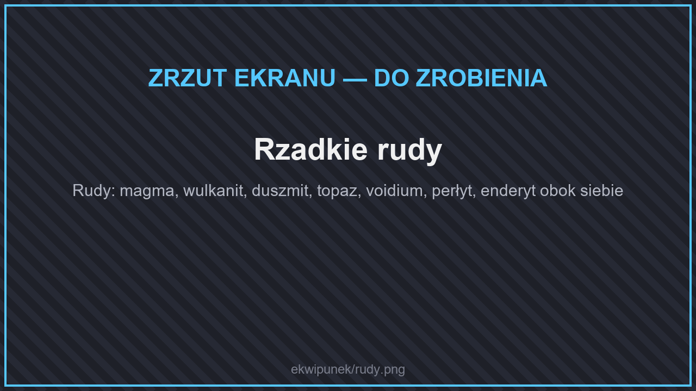<figcaption>
Rzadkie rudy
</figcaption></figure>

| Zestaw | Ruda — gdzie szukać | Materiał | Moc |
| --- | --- | --- | --- |
| [Magmowy](#magmowy) | Nether, klastry w blokach magmy (Y 20–40) | Kawałek magmy | jak żelazo |
| [Shulkera](#shulkera) | Kres — z shulkerów | Skorupa shulkera | między żelazem a diamentem |
| [Wulkanitowy](#wulkanitowy) | Nether, w netherracku (Y 40–187) | Sztabka wulkanitu | jak diament |
| [Kresowy (voidium)](#kresowy-voidium) | Kres, w kamieniu Kresu | Sztabka voidium | jak diament |
| [Duszmitowy](#duszmitowy) | Nether, w netherracku (Y 4–160) | Duszmit | lepszy niż netheryt |
| [Topazowy](#topazowy) | Świat Główny, w łupku (Y −61 do −30) | Topaz | lepszy niż netheryt |
| [Perłytowy](#perlytowy) | Kres, w kamieniu Kresu (Y 8–70) | Sztabka perłytu | lepszy niż netheryt |
| [Enderytowy](#enderytowy) | Kres, bardzo rzadko | Enderyt | **najmocniejszy** |

## Broń i narzędzia

| Zestaw | Miecz | Topór | Wytrzymałość |
| --- | --- | --- | --- |
| Magmowy | 6 | 9 | 500 |
| Shulkera | 6,5 | 9 | 1000 |
| Wulkanitowy | 7 | 9 | 1561 |
| Kresowy | 7 | 9 | 1561 |
| Duszmitowy | 8,5 | 10,5 | 2300 |
| Topazowy | 8,5 | 10,5 | 2300 |
| Perłytowy | 8,5 | 10,5 | 2300 |
| Enderytowy | 9,5 | 11,5 | 3000 |

Liczby to obrażenia ataku. Dla porównania diamentowy miecz zadaje 7, a netherytowy 8.

## Zbroja

| Zestaw | Hełm | Napierśnik | Nogawice | Buty | Wytrzymałość pancerza (za część) | Inne (za część) |
| --- | --- | --- | --- | --- | --- | --- |
| Magmowy | 2 | 6 | 5 | 2 | 0,5 | −3% obrażeń od ognia |
| Shulkera | 2 | 7 | 5 | 2 | 1 | buty: bezpieczny upadek z 2 kratek wyżej |
| Wulkanitowy | 3 | 8 | 6 | 3 | 2 | −5% obrażeń od ognia |
| Kresowy | 3 | 8 | 6 | 3 | 2 | |
| Duszmitowy | 3 | 8 | 6 | 3 | 3,5 | odporność na odrzut, −6% obrażeń od ognia |
| Topazowy | 3 | 8 | 6 | 3 | 3,5 | odporność na odrzut |
| Perłytowy | 3 | 8 | 6 | 3 | 3,5 | odporność na odrzut; buty: bezpieczny upadek z 3 kratek wyżej |
| Enderytowy | 4 | 9 | 7 | 4 | 4 | odporność na odrzut, −6% obrażeń od pocisków |

## Magmowy

<figure>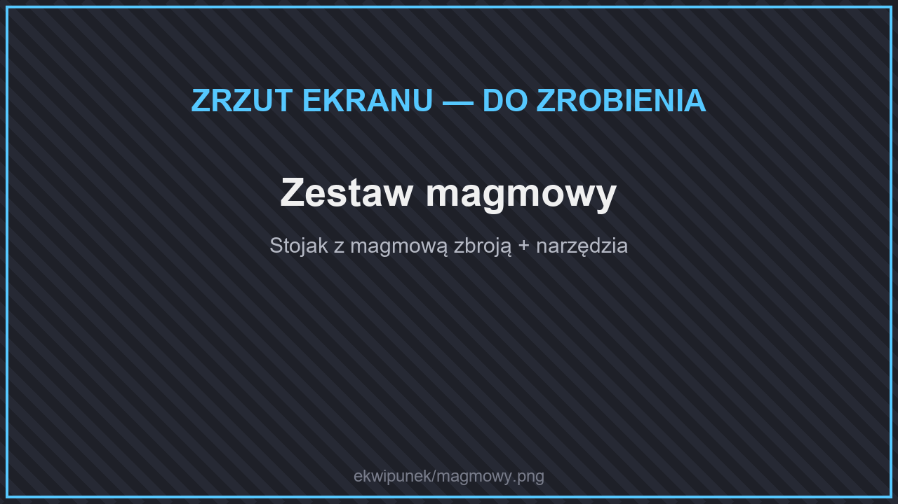<figcaption>
Zestaw magmowy
</figcaption></figure>

* **Żar** (miecz, topór): 20% szans na podpalenie celu.
* **4 części:** Odporność na ogień.
* Kilof i łopata przetapiają wykopane bloki.

## Shulkera

<figure>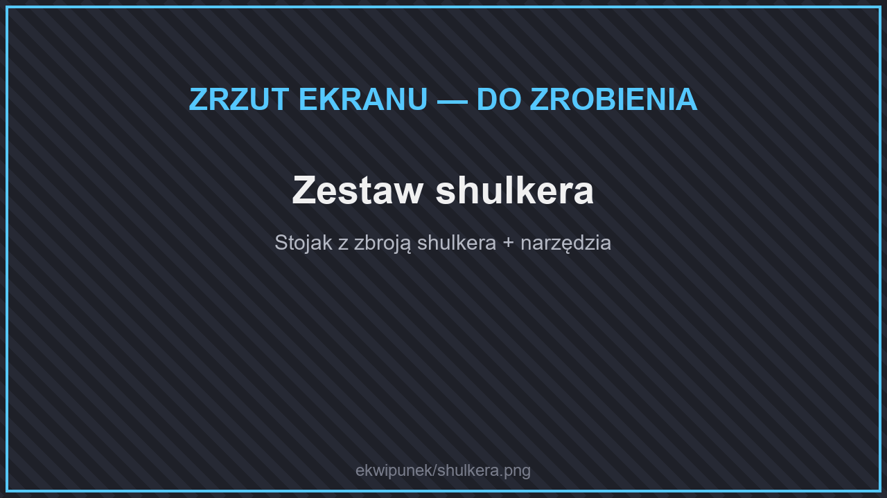<figcaption>
Zestaw shulkera
</figcaption></figure>

<figure>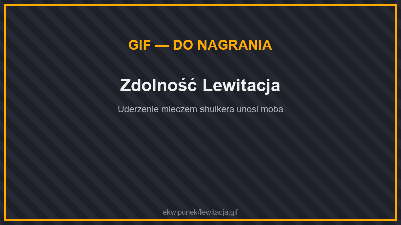<figcaption>
Zdolność Lewitacja
</figcaption></figure>

* **Lewitacja** (miecz, topór): 15% szans na uniesienie celu w powietrze.
* **2 części:** −20% obrażeń od upadku.
* **4 części — Skorupa:** 25% szans, że atakujący zostanie uniesiony w powietrze.

## Wulkanitowy

<figure>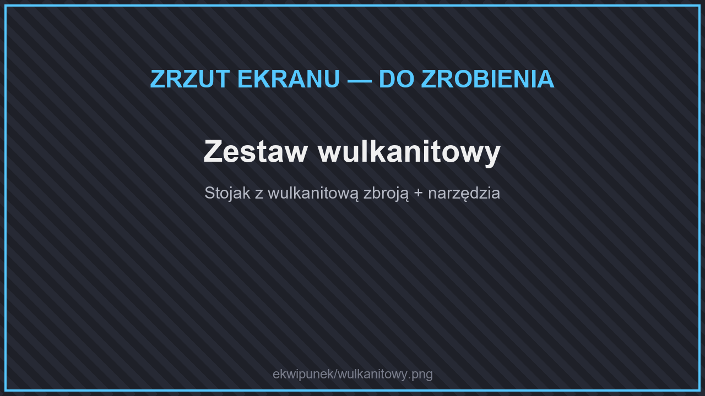<figcaption>
Zestaw wulkanitowy
</figcaption></figure>

<figure>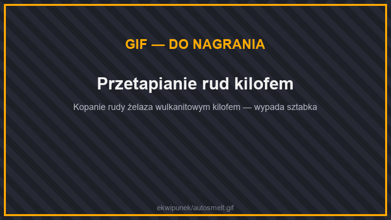<figcaption>
Przetapianie rud kilofem
</figcaption></figure>

* **Wulkaniczne Ostrze** (miecz, topór): 35% szans na podpalenie celu na 4 sekundy.
* **2 części:** Odporność na ogień.
* **4 części — Lawowa Skóra:** 30% szans na podpalenie atakującego.
* Kilof i łopata przetapiają wykopane bloki.


W skrzyniach w Netherze zamiast diamentowego ekwipunku trafiają się przedmioty z wulkanitu.


## Kresowy (voidium)

<figure>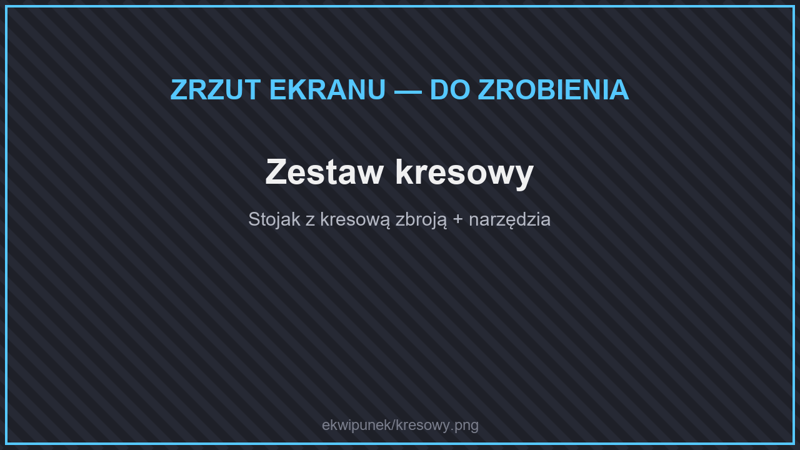<figcaption>
Zestaw kresowy
</figcaption></figure>

* **Pustka** (miecz, topór): 15% szans na oślepienie celu.
* **2 części:** −15% obrażeń od upadku.
* **4 części:** Widzenie w ciemności.

## Duszmitowy

<figure>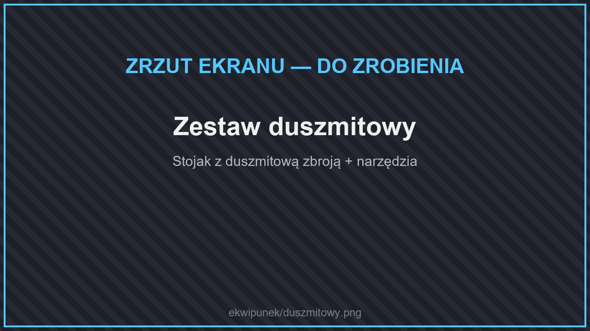<figcaption>
Zestaw duszmitowy
</figcaption></figure>

* **Żniwiarz Dusz** (miecz, topór): zabicie moba leczy cię o 1 serce.
* **2 części:** Odporność na ogień.
* **4 części:** Szybkość I.

## Topazowy

<figure>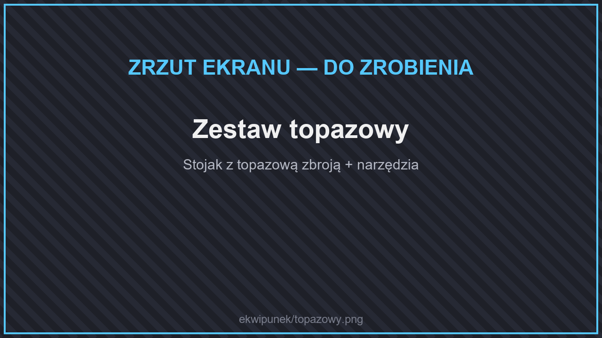<figcaption>
Zestaw topazowy
</figcaption></figure>

* **Topazowy Rozbłysk** (miecz, topór): 15% szans na +50% obrażeń.
* **2 części:** Szczęście I.
* **4 części:** Pośpiech I.

## Perłytowy

<figure>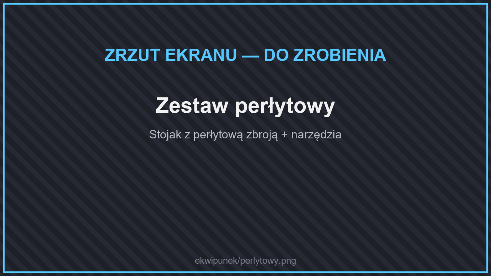<figcaption>
Zestaw perłytowy
</figcaption></figure>

<figure>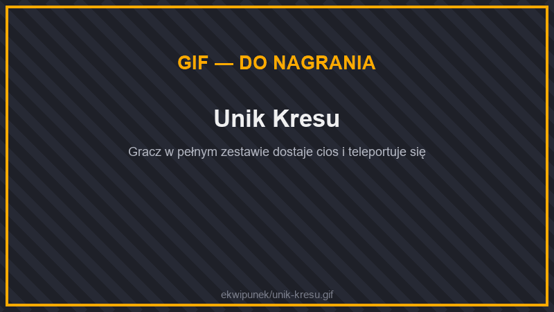<figcaption>
Unik Kresu
</figcaption></figure>

* **Perłowy Odłamek** (miecz, topór): 20% szans na +30% obrażeń i spowolnienie celu.
* **2 części:** −25% obrażeń od upadku.
* **4 części — Unik Kresu:** 15% szans, że po otrzymaniu ciosu teleportujesz się kilka kratek dalej.

## Enderytowy

<figure>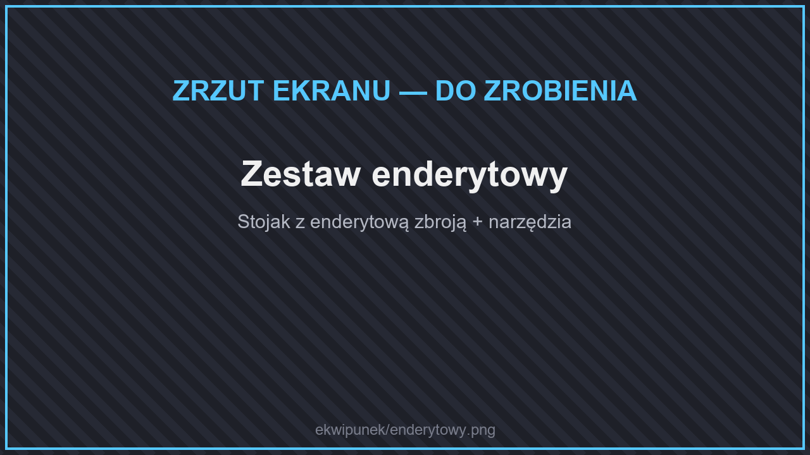<figcaption>
Zestaw enderytowy
</figcaption></figure>

<figure>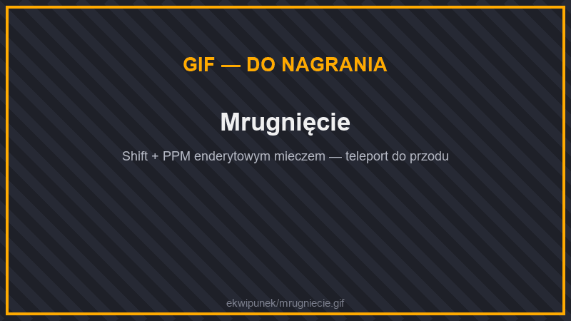<figcaption>
Mrugnięcie
</figcaption></figure>

* **Rozdarcie Endu** (miecz, topór): 20% szans na +60% obrażeń.
* **Mrugnięcie** (miecz, Shift + PPM): teleport do 8 kratek przed siebie, raz na 10 sekund.
* **2 części:** Widzenie w ciemności.
* **4 części:** Odporność I.
