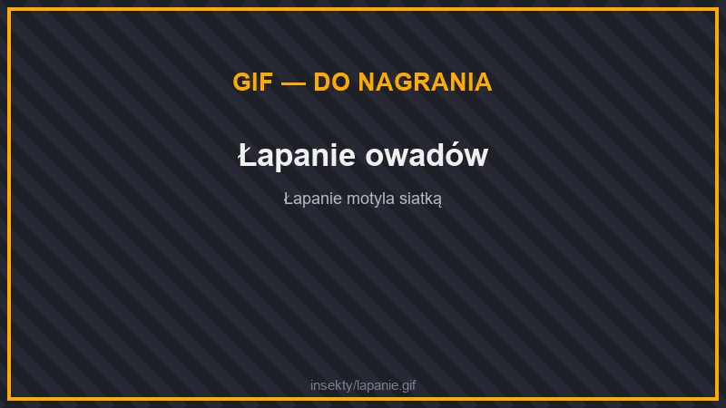
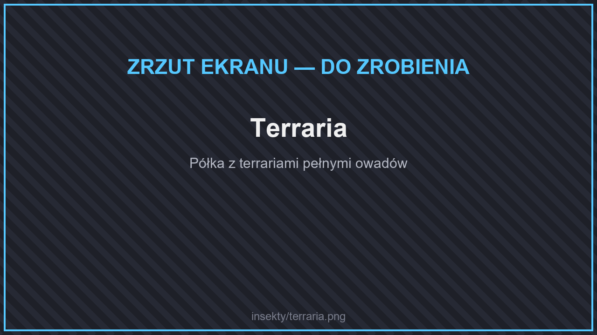

# 🦋 Insekty

W świecie żyją owady. Możesz je łapać, trzymać w **terrariach** jako dekorację albo przerobić na przydatne surowce.

## Siatka na Owady

<figure><figcaption>
Łapanie owadów
</figcaption></figure>

**Siatkę na Owady** stworzysz w stole rzemieślniczym z **3 nici i 2 patyków**:

| | | |
| --- | --- | --- |
| | nić | nić |
| | patyk | nić |
| patyk | | |

Trzymając siatkę, **uderz owada**. Zwykle go złapiesz (nad owadem pojawi się napis **CAUGHT!**), a owad wpadnie ci do ekwipunku jako przedmiot. Czasem jednak chybisz (**MISSED!**) — wtedy spróbuj jeszcze raz.

**Mrówki** żyją w **mrowiskach**. Gdy podejdziesz do mrowiska albo je uderzysz, wybiegnie z niego 5 mrówek — złap je siatką.

## Gdzie szukać owadów

Owady pojawiają się w Świecie Głównym, pod gołym niebem, na trawie, ziemi i kamieniu.

| Owad | Kiedy | Gdzie |
| --- | --- | --- |
| **Motyle** (6 kolorów) | w dzień | prawie wszędzie: lasy, równiny, łąki, góry, pustynie, dżungle, tajgi |
| **Mrowisko** (mrówki) | zawsze | prawie wszędzie, także w biomach śnieżnych |
| **Biedronka**, **Modliszka**, **Ślimak** | w dzień, rzadko | tam, gdzie motyle |
| **Żuk Gnojarz** | w dzień | sawanny, prerie, zarośla, badlandy, wietrzne wzgórza i góry |
| **Ćma Atlas** | w dzień, rzadko | tylko **mroczny las** |
| **Świetlik** | w nocy | wszędzie poza zimnymi, śnieżnymi biomami |
| **Ptasznik** | w nocy, rzadko | dżungle, lasy bambusowe, lasy deszczowe, łąki i pola kwiatów |

## Złapane owady

Każdego złapanego owada możesz włożyć do [terrarium](#terraria) albo przerobić w stole rzemieślniczym:

| Owad (przedmiot) | Przerobisz na |
| --- | --- |
| Mrówka | 2 × mączka kostna |
| Błękitny Motyl | 2 × jasnoniebieski barwnik |
| Indygowy Motyl | 2 × niebieski barwnik |
| Czerwony Motyl | 2 × czerwony barwnik |
| Fioletowy Motyl | 2 × fioletowy barwnik |
| Biały Motyl | 2 × biały barwnik |
| Żółty Motyl | 2 × żółty barwnik |
| Biedronka | 1 × czerwony barwnik |
| Modliszka | 2 × jasnozielony barwnik |
| Ćma Atlas | 2 × pomarańczowy barwnik |
| Żuk Gnojarz | 4 × mączka kostna |
| Świetlik | 2 × jasnopył |
| Ślimak | 1 × kulka szlamu |
| Ptasznik | 3 × nić |

## Terraria

<figure><figcaption>
Terraria
</figcaption></figure>

Terraria to dekoracje, które stawiasz jak meble. Najpierw zrób **Puste Terrarium**:

| | | |
| --- | --- | --- |
| szyba | szyba | szyba |
| szyba | | szyba |
| drewniana płyta | drewniana płyta | drewniana płyta |

Szyby to zwykłe **szklane szyby**, a płyty mogą być z dowolnego drewna.

Potem połącz w stole rzemieślniczym **Puste Terrarium + złapanego owada** (w dowolnym układzie) — dostaniesz terrarium z tym owadem. Jest **14 rodzajów** terrariów:

| Owad | Terrarium |
| --- | --- |
| Mrówka | Terrarium z Mrówkami |
| Błękitny Motyl | Terrarium z Niebieskim Motylem |
| Indygowy Motyl | Terrarium z Indygowym Motylem |
| Czerwony Motyl | Terrarium z Czerwonym Motylem |
| Fioletowy Motyl | Terrarium z Fioletowym Motylem |
| Biały Motyl | Terrarium z Białym Motylem |
| Żółty Motyl | Terrarium z Żółtym Motylem |
| Biedronka | Terrarium z Biedronką |
| Modliszka | Terrarium z Modliszką |
| Ślimak | Terrarium ze Ślimakiem |
| Świetlik | Terrarium ze Świetlikiem |
| Żuk Gnojarz | Terrarium z Żukiem Gnojowym |
| Ćma Atlas | Terrarium z Ćmą Atlas |
| Ptasznik | Terrarium z Tarantulą |
