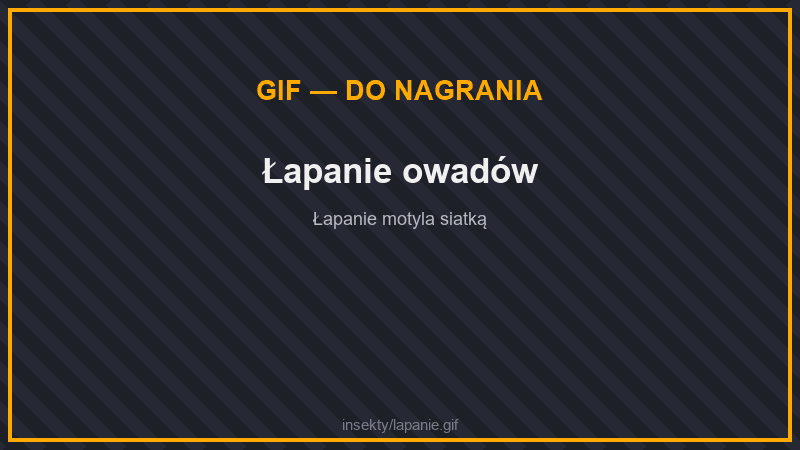
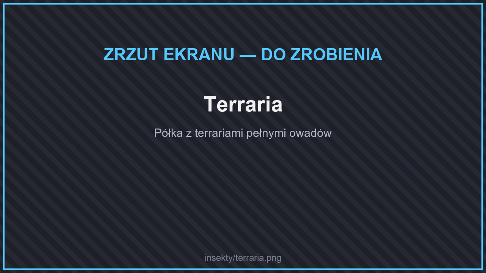

# 🦋 Insekty

W świecie żyją owady. Możesz je łapać i kolekcjonować.

## Siatka na owady

<figure><figcaption>
Łapanie owadów
</figcaption></figure>

Siatkę stworzysz z **3 nici i 2 patyków**. Kliknij nią owada, aby go złapać.

## Owady

| Owad | |
| --- | --- |
| Motyle | niebieski, indygowy, czerwony, fioletowy, biały, żółty |
| Mrówka | |
| Modliszka | |
| Świetlik | |
| Żuk gnojowy | |
| Ślimak | |
| Biedronka | |
| Ćma Atlas | |
| Tarantula | |
| Robak, prosionek, wij | |

## Terraria

<figure><figcaption>
Terraria
</figcaption></figure>

Złapanego owada umieścisz w **terrarium** i postawisz jako dekorację. Świetlika trzyma się w słoiku. Zacznij od **pustego terrarium**.
