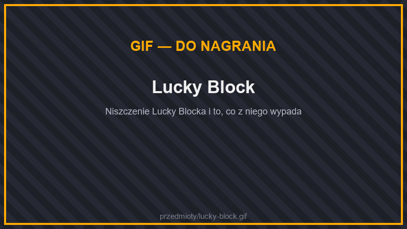

# 🍀 Lucky Bloki

<figure><figcaption>
Lucky Block
</figcaption></figure>

**Lucky Blok** to blok-niespodzianka. Zniszcz go, a wylosujesz jeden wynik: skarb, zestaw zbroi, zwierzaka, budowlę… albo pułapkę i hordę potworów. Każdy rodzaj ma inne wyniki i inny **poziom** — im wyższy poziom, tym lepsze łupy (i groźniejsze pułapki).


Lucky Bloki najszybciej zniszczysz **siekierą**. Świecą w ciemności, więc łatwo je dostrzec w jaskiniach.


## Rodzaje

| Lucky Blok | Poziom | Gdzie pojawia się w świecie | Charakter |
| --- | --- | --- | --- |
| **Lucky Blok** | 1 | Świat Główny: na powierzchni i w jaskiniach | wszystkiego po trochu |
| **Dobry Lucky Blok** | 2 | Świat Główny: na trawie | prawie same dobre wyniki |
| **Lucky Blok Łupów** | 2 | Świat Główny: w jaskiniach | łupy ze skrzyń, lochy ze skrzynią |
| **Lucky Blok Mobów** | 2 | Świat Główny: głęboko w jaskiniach; Nether | zwierzaki, sojusznicy i hordy potworów |
| **Lucky Blok Budowli** | 3 | na piasku, piaskowcu i terakocie (pustynie, plaże, badlandy) | domki, słupy rud, drzewa, klatki |
| **Niebezpieczny Lucky Blok** | 3 | Nether | głównie pułapki — ale czasem świetne łupy |
| **Ostateczny Lucky Blok** | 4 | wyspy Endu; głęboko pod ziemią w Świecie Głównym (Y −60 do −30) | najlepsze łupy w grze, ale też Strażnik |

Gdy ktoś rozbije **Ostateczny Lucky Blok**, cały serwer dostaje ogłoszenie.

## Skąd wziąć Lucky Bloki

* **Świat** — rzadko generują się w nowo odkrywanych terenach (patrz tabela wyżej).
* **Losowo obok ciebie** — co 15 minut masz **20% szans**, że 16–48 kratek od ciebie pojawi się Lucky Blok. Działa to w każdym świecie do przetrwania (Świat Główny, Nether, End i inne), ale nie na spawnie. Dostajesz wtedy wiadomość. Nierozbity blok znika po **45 minutach**.
* **Okolica spawnu Świata Głównego** — co 20 minut w kwadracie 500 × 500 kratek wokół punktu odrodzenia pojawiają się 3 Lucky Bloki (cały serwer dostaje ogłoszenie). Nierozbite znikają po **2 godzinach**.
* **Weekendowe łowy** — w soboty i niedziele od 16:00 do 22:00 nowe Lucky Bloki pojawiają się w okolicy spawnu **co 30 minut**. Zobacz [Wydarzenia](../informacje/osiagniecia.md#wydarzenia).
* **Skrzynie w strukturach** — rzadko, pasujący rodzaj (np. Budowli w ruinach i na pustyniach, Niebezpieczny w Netherze, Ostateczny w Endzie i starożytnych miastach). Zobacz [Łupy w strukturach](../wymiary/swiat-glowny/struktury.md#lupy-w-strukturach).
* **Piniata** i **skrzynie** — Lucky Bloki są wśród nagród. Zobacz [Skrzynie i Piniata](../informacje/skrzynki.md).
* **Stół rzemieślniczy** — receptury niżej.

### Jakie Lucky Bloki pojawiają się obok ciebie

| Gdzie jesteś | Lucky Blok | Dobry | Łupów | Mobów | Budowli | Niebezpieczny | Ostateczny |
| --- | --- | --- | --- | --- | --- | --- | --- |
| Świat Główny, na powierzchni | 51% | 15% | 15% | 10% | 8% | — | 1% |
| Świat Główny, pod ziemią | 38% | — | 33% | 27% | — | — | 2% |
| Nether | — | — | 17% | 23% | — | 57% | 2% |
| End | — | — | 38% | — | — | 46% | 15% |

W okolicy spawnu pojawiają się Lucky Bloki w takich samych proporcjach jak na powierzchni Świata Głównego.

## Receptury

Każdy Lucky Blok ma w środku **podajnik** (jak w modzie Lucky Block). Lepsze rodzaje robisz ze zwykłego Lucky Bloka.

| Lucky Blok | Górny rząd | Środkowy rząd | Dolny rząd |
| --- | --- | --- | --- |
| **Lucky Blok** | 3 × sztabka złota | sztabka złota, podajnik, sztabka złota | 3 × sztabka złota |
| **Dobry Lucky Blok** | 3 × szmaragd | szmaragd, podajnik, szmaragd | szmaragd, Lucky Blok, szmaragd |
| **Lucky Blok Łupów** | blok złota, skrzynia, blok złota | skrzynia, podajnik, skrzynia | blok złota, Lucky Blok, blok złota |
| **Lucky Blok Mobów** | kość, nić, kość | zgniłe mięso, podajnik, zgniłe mięso | proch, Lucky Blok, proch |
| **Lucky Blok Budowli** | cegły, kamienne cegły, cegły | kamienne cegły, podajnik, kamienne cegły | cegły, Lucky Blok, cegły |
| **Niebezpieczny Lucky Blok** | TNT, proszek płomyka, TNT | proszek płomyka, podajnik, proszek płomyka | TNT, Lucky Blok, TNT |
| **Ostateczny Lucky Blok** | blok diamentów, gwiazda Netheru, blok diamentów | odłamek netherytu, podajnik, odłamek netherytu | blok diamentów, Lucky Blok, blok diamentów |

## Zmiana i podwójne szczęście

Zanim wylosujesz wynik, Lucky Blok może cię zaskoczyć:

* **8% szans** — blok **zmienia się w inny rodzaj** Lucky Bloka i staje w tym samym miejscu. Najczęściej w zwykły Lucky Blok, rzadziej w lepsze rodzaje, a najrzadziej w Ostateczny.
* **5% szans** — **podwójne szczęście**: zamiast wyniku dostajesz **2 Lucky Bloki tego samego rodzaju**.

## Co może się stać

**Łupy** to przedmioty ze skrzyń ze struktur — im wyższy poziom, tym lepsze struktury:

| Poziom | Łupy jak ze skrzyń z… |
| --- | --- |
| 1 | lochów, kopalni, wraków, igloo, kowali w wioskach |
| 2 | piramid, świątyń w dżungli, posterunków rozbójników, skarbów, rezydencji, zrujnowanych portali |
| 3 | fortec Netheru, bastionów, twierdz, komnat prób |
| 4 | skarbców bastionów, starożytnych miast, miast Endu, złowieszczych komnat prób |

Szanse poniżej dotyczą rzutu po tym, jak blok się nie zmienił ani nie podwoił.

### Lucky Blok (poziom 1)

| Dobre | Szansa | Złe | Szansa |
| --- | --- | --- | --- |
| Trochę łupów | 15% | TNT (1–2) | 8% |
| Diamenty (1–3) | 9% | Zombie (3–4) | 7% |
| Doświadczenie | 9% | Szkielety (2–3) | 4% |
| Żelazny zestaw | 7% | Pajęczyny | 3% |
| Złoto (4–10 sztabek) | 7% | Creeper | 3% |
| Złoty zestaw | 5% | Spadające kowadła | 3% |
| Jedzenie (pieczona wołowina, złote marchewki) | 5% | Rybiki | 2% |
| Szybkość II i Pośpiech na 2 minuty | 4% | Wystrzelenie w górę | 2% |
| Słup rud | 3% | | |
| Oswojony wilk | 3% | | |

### Dobry Lucky Blok (poziom 2)

| Dobre | Szansa | Złe | Szansa |
| --- | --- | --- | --- |
| Skarb (łupy) | 21% | TNT | 5% |
| Żelazny zestaw | 12% | Zombie (2–3) | 5% |
| Złote jabłka (2–4) | 10% | Czarownica | 2% |
| Regeneracja II, Siła i Szybkość II | 10% | | |
| Diamentowy zestaw | 7% | | |
| Butelki doświadczenia (12–24) | 7% | | |
| Szmaragdy (8–16) | 6% | | |
| Pośpiech II i Widzenie w ciemności na 5 minut | 6% | | |
| Oswojony wilk i kot | 5% | | |
| Wyjątkowo dobre łupy (poziom 3) | 5% | | |

### Lucky Blok Łupów (poziom 2)

| Dobre | Szansa | Złe | Szansa |
| --- | --- | --- | --- |
| Łupy | 33% | Strażnicy skarbu (3 szkielety w kolczugach) | 7% |
| Podwójne łupy | 17% | Pułapka na złodzieja (2 × TNT) | 6% |
| Loch ze skrzynią | 11% | Strzały | 3% |
| Bloki złota (1–3) | 7% | Pusto — tylko kurz | 2% |
| Diamenty (2–5) | 7% | | |
| Wyjątkowo dobre łupy (poziom 3) | 7% | | |
| Legendarne łupy (poziom 4) | 2% | | |

### Lucky Blok Mobów (poziom 2)

| Dobre | Szansa | Złe | Szansa |
| --- | --- | --- | --- |
| Oswojony wilk | 12% | Horda zombie (4–6 + małe zombie) | 12% |
| Oswojony kot | 7% | Szkielety (3–4) | 9% |
| Oswojona papuga | 7% | Pająki i pająki jaskiniowe | 7% |
| Żelazny golem | 7% | Naładowany creeper | 6% |
| Krowy i owce | 7% | Czarownice (2) | 5% |
| Osadnik | 6% | Zombie w diamentowej zbroi | 3% |
| Koń | 5% | 2 rozbójników i obrońca | 3% |
| Aksolotl | 3% | Rybiki | 2% |

### Lucky Blok Budowli (poziom 3)

| Dobre | Szansa | Złe | Szansa |
| --- | --- | --- | --- |
| Słup rud | 15% | Uwięzienie w klatce z bruku | 8% |
| Domek z wioski (równiny albo pustynia) | 16% | Wieża ze szkieletami | 6% |
| Słup bloków rud | 8% | Uwięzienie w klatce z obsydianu | 5% |
| Wielkie drzewo | 8% | Wybuchowy fundament (2–3 × TNT) | 5% |
| Loch ze skrzynią | 8% | | |
| Igloo | 6% | | |
| Skrzynia budowniczego (łupy) | 6% | | |
| Zrujnowany portal | 5% | | |
| Wielki grzyb | 5% | | |

### Niebezpieczny Lucky Blok (poziom 3)

| Złe | Szansa | Dobre | Szansa |
| --- | --- | --- | --- |
| TNT (3–5, krótki lont) | 15% | Łupy | 9% |
| Lawa | 8% | Legendarne łupy (poziom 4) | 3% |
| Piorun | 8% | | |
| Brutalne pigliny (1–2) | 8% | | |
| Witherowe szkielety (2) | 8% | | |
| Ognista kula | 6% | | |
| Spadające kowadła | 6% | | |
| Strzały | 6% | | |
| Klatka z obsydianu i TNT | 6% | | |
| Naładowane creepery (2) | 5% | | |
| Płomyki (2–3) | 5% | | |
| Niszczyciel | 4% | | |
| Klątwa (Uschnięcie, Spowolnienie, Zmęczenie) | 4% | | |

### Ostateczny Lucky Blok (poziom 4)

| Dobre | Szansa | Złe | Szansa |
| --- | --- | --- | --- |
| Legendarne łupy | 21% | Strażnik (Warden) | 4% |
| Podwójne legendarne łupy | 11% | Wielkie TNT (6–8) | 4% |
| Netherytowy zestaw | 10% | 3 witherowe szkielety w netherycie | 3% |
| Diamentowy zestaw | 9% | | |
| Zaklęte złote jabłka (1–2) | 9% | | |
| Totem nieśmiertelności | 6% | | |
| Sztabki netherytu (1–3) | 6% | | |
| Elytra | 5% | | |
| Buzdygan z ciężkim rdzeniem | 4% | | |
| Gwiazda Netheru | 4% | | |
| Bloki diamentów (2–4) | 3% | | |


Zanim rozbijesz Niebezpieczny albo Ostateczny Lucky Blok, przygotuj się do walki — i nie rób tego obok swojego domu.


Za rozbijanie Lucky Bloków są też [osiągnięcia](../informacje/osiagniecia.md) i [zadania](../informacje/zadania.md).
