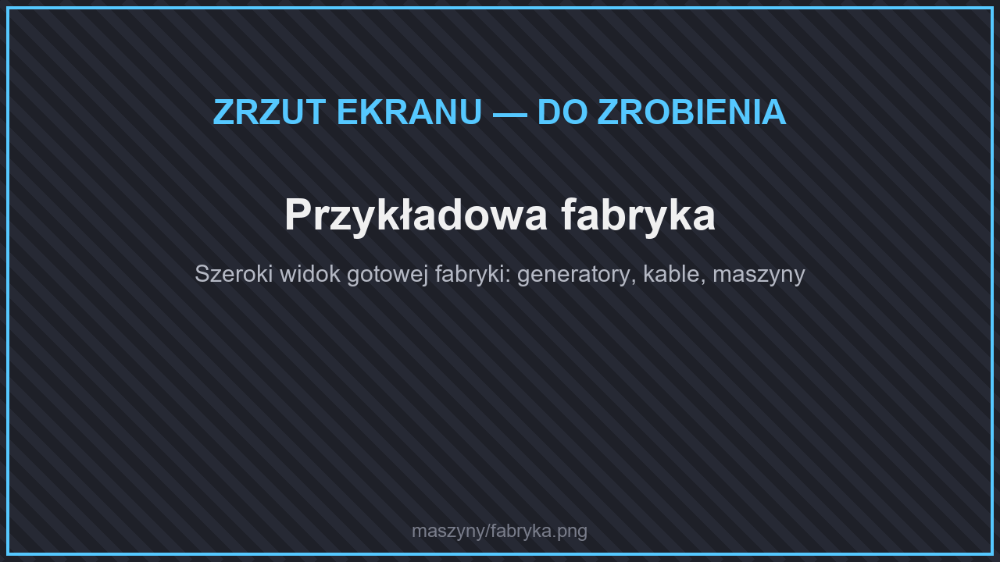
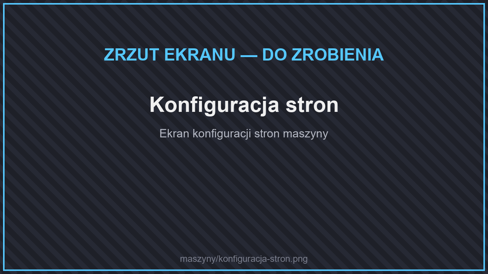

# ⚙️ Maszyny

<figure><figcaption>
Przykładowa fabryka
</figcaption></figure>

Na serwerze zbudujesz całą fabrykę: generatory wytwarzają energię, kable ją przesyłają, a maszyny kopią, przetapiają, uprawiają pola i hodują zwierzęta za ciebie.

<table data-view="cards"><thead><tr><th></th><th></th><th data-hidden data-card-target data-type="content-ref"></th></tr></thead><tbody><tr><td><strong>⚡ Generatory</strong></td><td>Panele słoneczne, turbiny, generatory pieca i lawy.</td><td><a href="generatory.md">generatory.md</a></td></tr><tr><td><strong>🏭 Przetwarzanie</strong></td><td>Prasa, rozdrabnianie rud, piec elektryczny, warzenie mikstur.</td><td><a href="przetwarzanie.md">przetwarzanie.md</a></td></tr><tr><td><strong>🌾 Farmy</strong></td><td>Sadzarka, żniwiarka, hodowca, zabójca mobów, rybiarka.</td><td><a href="farmy.md">farmy.md</a></td></tr><tr><td><strong>⛏️ Wydobycie</strong></td><td>Kamieniołom, niszczyciel bloków, pompa, ładowarka chunków.</td><td><a href="wydobycie.md">wydobycie.md</a></td></tr><tr><td><strong>🔌 Logistyka</strong></td><td>Kable, ogniwa, zbiorniki, filtry i magazyny.</td><td><a href="logistyka.md">logistyka.md</a></td></tr></tbody></table>

## Energia

* Energię mierzy się w **J** (dżulach). Wartości „na tick” podajemy jako **J/t** — sekunda to 20 ticków.
* Każda maszyna ma **własny magazyn energii**. Generatory i maszyny łączysz [kablami](logistyka.md#kable).
* Nadmiar energii przechowasz w [ogniwach zasilających](logistyka.md#ogniwa-zasilajace).
* Przedmioty na energię (np. [jetpacki](../pojazdy.md#jetpacki)) naładujesz w **ładowarce** albo **ładowarce bezprzewodowej**.

## Menu maszyny

<figure><figcaption>
Menu maszyny
</figcaption></figure>

<figure><figcaption>
Konfiguracja stron
</figcaption></figure>

Kliknij maszynę PPM, aby otworzyć jej menu. W menu zobaczysz:

* **pasek energii** i postęp pracy,
* sloty na przedmioty wejściowe i wyjściowe,
* **konfigurację stron** — ustawiasz, z której strony maszyna przyjmuje przedmioty, płyny i energię, a z której je oddaje (do kabli, lejków i innych maszyn),
* sloty na **ulepszenia** (jeśli maszyna je obsługuje),
* przyciski zasięgu i podglądu obszaru pracy (przy maszynach działających na obszarze).

Maszynę zabierzesz, niszcząc ją — **zachowuje zawartość i energię**.

## Ramy maszyn i podzespoły

<figure><figcaption>
Ramy maszyn
</figcaption></figure>

Do budowy maszyn potrzebne są ramy i części, które wytwarzasz w [prasie mechanicznej](przetwarzanie.md#prasa-mechaniczna) i [rozdrabniaczu](przetwarzanie.md#rozpryskiwacz):

| Część | Do czego |
| --- | --- |
| **Podstawowa rama maszyny** | Z żelaza i czerwonego kamienia. Najprostsze maszyny. |
| **Zaawansowana rama maszyny** | Z podstawowej ramy, złota i jasnopyłu. |
| **Elite Machine Frame** | Z zaawansowanej ramy, złota i **gwiezdnego pyłu**. |
| **Ultimate Machine Frame** | Z elitarnej ramy, diamentów i **gwiezdnego pyłu**. Najmocniejsze maszyny. |
| **Płytki** (żelazna, złota, miedziana, diamentowa, szmaragdowa, netherytowa, redstone'owa, lazurytowa) | Z prasy — obudowy maszyn. |
| **Koła zębate** (z tych samych materiałów) | Z prasy — mechanizmy. |
| **Pyły** (żelaza, złota, miedzi, diamentu, szmaragdu, netherytu, węgla, lazurytu) | Z rozdrabniacza — przetopisz je na sztabki. |
| **Ogniwo słoneczne** | Panele słoneczne. |
| **Wiertło z netherytu** | Kamieniołom. |


Dokładne receptury wszystkich maszyn i części zobaczysz w grze w menu przedmiotów (**`/nova items`**, zakładka **Mechanizmy**). Kliknij przedmiot, aby zobaczyć jak go stworzyć, albo PPM, aby zobaczyć do czego służy.


## Gwiezdne odłamki

<figure><figcaption>
Ruda gwiezdnych odłamków
</figcaption></figure>

**Ruda gwiezdnych odłamków** występuje wysoko w górach — **powyżej Y 120** w Świecie Głównym. Z odłamków powstaje **gwiezdny pył**, a z bloku gwiezdnego pyłu w **krystalizatorze** — **gwiezdny kryształ**. Z nich zrobisz [gwiezdne narzędzia i zbroję](../ekwipunek/README.md#gwiezdny-ekwipunek). Gwiezdny pył zbiera też maszyna [Star Collector](wydobycie.md#star-collector).

## Ulepszenia maszyn

<figure><figcaption>
Ulepszenia maszyn
</figcaption></figure>

Ulepszenia wkładasz w menu maszyny. Każdego rodzaju możesz włożyć **do 10 sztuk**.

| Ulepszenie | Co daje | 1 szt. | 5 szt. | 10 szt. |
| --- | --- | --- | --- | --- |
| **Aktualizacja prędkości** | Szybsza praca | ×1,91 | ×5,55 | ×10 |
| **Zwiększenie wydajności** | Mniejsze zużycie energii | ×1,25 | ×4,75 | ×9,75 |
| **Modernizacja energetyczna** | Większy magazyn energii | ×1,9 | ×5,5 | ×10 |
| **Aktualizacja płynu** | Większy zbiornik płynów | ×1,9 | ×5,5 | ×10 |
| **Aktualizacja zasięgu** | Większy obszar pracy | +1 kratka | +5 kratek | +10 kratek |


Ulepszenie prędkości zwiększa też zużycie energii — łącz je z ulepszeniami wydajności.


## Klucz

<figure><figcaption>
Ustawianie kabla kluczem
</figcaption></figure>

**Klucz** stworzysz z 4 sztabek żelaza. Kliknij nim PPM kabel w miejscu, gdzie łączy się z maszyną, aby otworzyć **ustawienia połączenia**: czy kabel wkłada, czy wyjmuje przedmioty i płyny, z jakim priorytetem i na którym **kanale** (kanały pozwalają poprowadzić kilka niezależnych linii jednym kablem).
