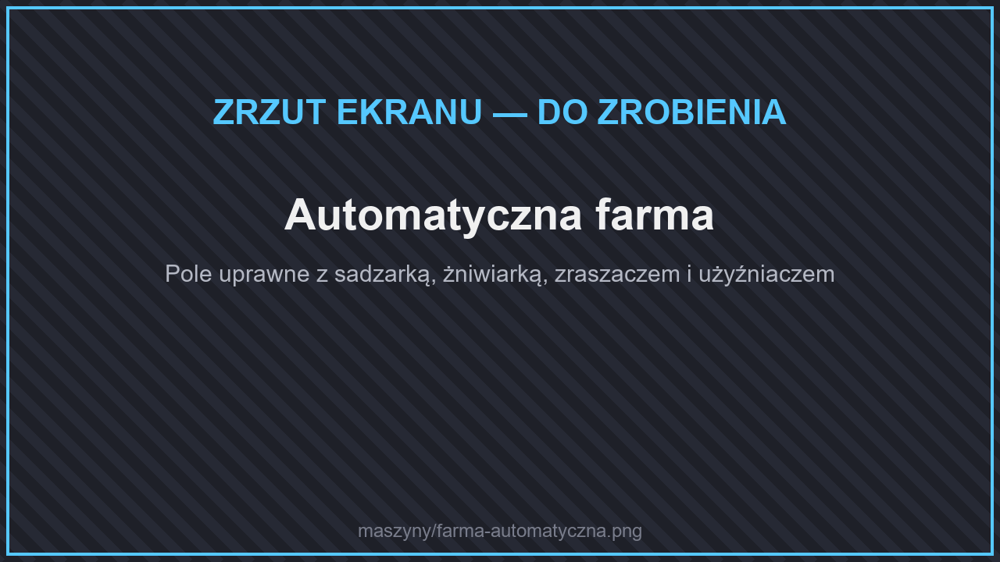

# 🌾 Farmy

<figure><figcaption>
Automatyczna farma
</figcaption></figure>

Maszyny farmerskie pracują na obszarze wokół siebie. **Zasięg** ustawiasz w menu maszyny, a [ulepszenia zasięgu](README.md#ulepszenia-maszyn) go powiększają. W menu możesz też podświetlić obszar pracy.

| Maszyna | Zasięg (domyślnie) | Zużycie | Rama |
| --- | --- | --- | --- |
| [Sadzarka](#sadzarka) | 3 | 2 J/t + 20 J za posadzenie | elitarna |
| [Żniwiarka](#zniwiarka) | 5 | 2 J/t + 40 J za zebranie | elitarna |
| [Użyźniacz gleby](#uzyzniacz-gleby) | 3 | 2 J/t + 30 J za użycie | elitarna |
| [Zraszacz](#zraszacz) | 5 | woda | — |
| [Fabryka Drzew](#fabryka-drzew) | — | 70 J/t | ostateczna |
| [Hodowca](#hodowca) | 3 | 10 J/t + 100 J za rozmnożenie | elitarna |
| [Zabójca mobów](#zabojca-mobow) | 4 | 10 J/t + 150 J za cios | elitarna |
| [Duplikator mobów](#zbieracz-mobow-i-duplikator-mobow) | — | 300 J/t | ostateczna |
| [Automatyczna rybiarka](#automatyczna-rybiarka) | — | 20 J/t | elitarna |

## Sadzarka

<figure><figcaption>
Sadzarka
</figcaption></figure>

Sadzi nasiona, sadzonki i grzyby z własnego ekwipunku na obszarze przed sobą. Jeśli włożysz do niej **motykę**, sama zaorze ziemię.

## Żniwiarka

<figure><figcaption>
Żniwiarka
</figcaption></figure>

Zbiera dojrzałe uprawy, ścina drzewa i liście, strzyże zwierzęta. Do pracy potrzebuje narzędzi włożonych do menu: **siekiery**, **motyki** i **nożyc** (zużywają się). Zebrane przedmioty trafiają do jej ekwipunku — wyjmiesz je lejkiem albo kablem.

## Użyźniacz gleby

<figure><figcaption>
Użyźniacz gleby
</figcaption></figure>

Rozsypuje **mączkę kostną** z ekwipunku na rośliny w zasięgu.

## Zraszacz

<figure><figcaption>
Zraszacz
</figcaption></figure>

Nawadnia pola uprawne wokół siebie (do 5 kratek). Potrzebuje tylko **wody** — doprowadź ją rurą z [pompy](wydobycie.md#pompa) albo [Nieskończonego Źródła Wody](wydobycie.md#nieskonczone-zrodlo-wody).

## Fabryka Drzew

<figure><figcaption>
Fabryka drzew
</figcaption></figure>

Hoduje drzewo **wewnątrz maszyny**. Włóż sadzonkę (albo grzyb), a fabryka co chwilę wyda drewno, sadzonki, jabłka itp. — bez wycinania czegokolwiek w świecie.

## Hodowca

<figure><figcaption>
Hodowca
</figcaption></figure>

Karmi zwierzęta w zasięgu jedzeniem z ekwipunku, aby się rozmnażały (do 5 par naraz).

## Zabójca mobów

<figure><figcaption>
Zabójca mobów
</figcaption></figure>

Zadaje 10 obrażeń mobom w zasięgu (do 3 naraz). Łupy wypadają na ziemię — zbierz je **skrzynią próżniową** ([Logistyka](logistyka.md#skrzynia-prozniowa)).

## Zbieracz mobów i Duplikator mobów

<figure><figcaption>
Duplikator mobów
</figcaption></figure>

* **Zbieracz mobów** — kliknij nim moba, aby go złapać do przedmiotu (co 10 s). Działa na zwierzęta i większość potworów (bez bossów).
* **Duplikator mobów** — włóż do niego zbieracz ze złapanym mobem, a maszyna co 20 sekund tworzy jego kopię obok siebie (kopia z zachowanymi danymi moba trwa dłużej i kosztuje więcej energii). Wokół duplikatora może być najwyżej 100 mobów.

## Automatyczna rybiarka

<figure><figcaption>
Automatyczna rybiarka
</figcaption></figure>

Łowi ryby jak gracz z wędką. Postaw ją **nad wodą** i włóż **wędkę** (zużywa się — zaklęcia wędki działają). Łowi co ok. 30 sekund.
