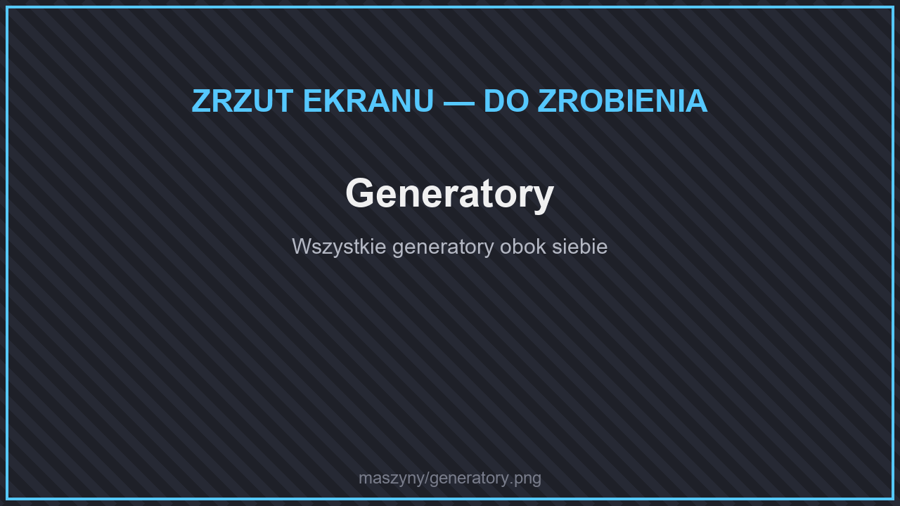
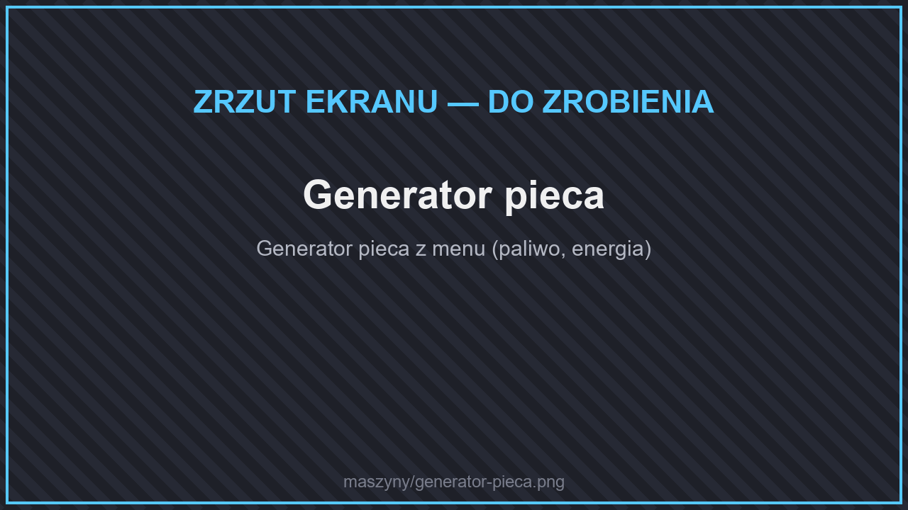
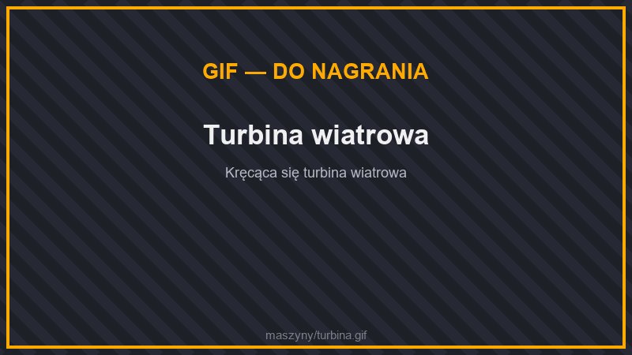
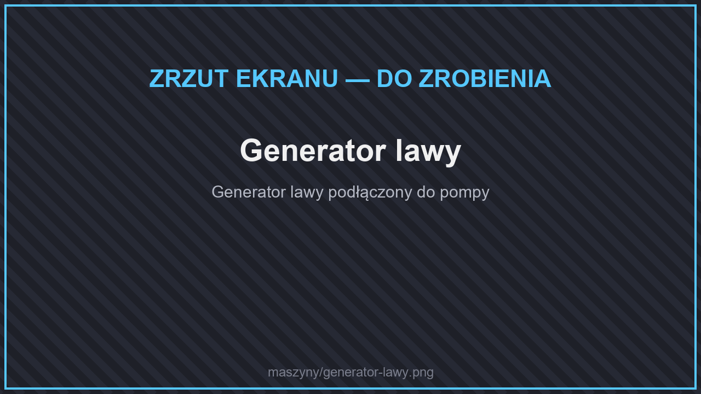

# ⚡ Generatory

<figure><figcaption>
Generatory
</figcaption></figure>

| Generator | Wytwarza | Magazyn | Z czego zbudować |
| --- | --- | --- | --- |
| **Generator pieca** | 80 J/t | 10 000 J | Piec, węgiel, żelazo, czerwony kamień |
| **Panel słoneczny** | do 40 J/t | 10 000 J | 3 ogniwa słoneczne, żelazo, płytki żelaza |
| **Turbina wiatrowa** | do 100 J/t | 10 000 J | Elitarna rama, bloki żelaza, koło zębate |
| **Generator Lawy** | 40 J z 1 mB lawy | 10 000 J, 10 000 mB lawy | Zaawansowana rama, wiadro lawy, miedziane koło zębate |
| **Wymiennik piorunów** | 700 000 – 1 000 000 J z pioruna | 10 000 000 J | Elitarna rama, piorunochrony, miedziane koła zębate |

## Generator pieca

<figure><figcaption>
Generator pieca
</figcaption></figure>

Najprostsze źródło prądu na początek. Spala **każde paliwo pieca** (węgiel, drewno, wiadro lawy…) i wytwarza 80 J/t. Paliwo pali się w nim krócej niż w zwykłym piecu (20% czasu), więc warto podłączyć do niego lejek albo kabel z paliwem.

## Panel słoneczny

<figure><figcaption>
Panele słoneczne
</figcaption></figure>

Działa **w dzień**, gdy nad panelem jest otwarte niebo. Nie potrzebuje paliwa — postaw ich kilka i podłącz kablami do [ogniwa zasilającego](logistyka.md#ogniwa-zasilajace), aby mieć energię także w nocy.

## Turbina wiatrowa

<figure><figcaption>
Turbina wiatrowa
</figcaption></figure>

Duży generator (zajmuje kilka bloków w górę — zostaw nad nim wolne miejsce). Im **wyżej** ją postawisz, tym więcej energii wytwarza, maksymalnie 100 J/t.

## Generator Lawy

<figure><figcaption>
Generator lawy
</figcaption></figure>

Spala lawę: z każdego mB (1 wiadro = 1000 mB) daje 40 J. Lawę doprowadzisz rurami z [pompy](wydobycie.md#pompa) albo wlejesz wiadrami.

## Wymiennik piorunów

<figure><figcaption>
Wymiennik piorunów
</figcaption></figure>

Łapie **pioruny** podczas burzy i zamienia je w ogromną ilość energii (700 tys. – 1 mln J z jednego uderzenia). Potem oddaje energię po 5000 J/t. Najlepiej postawić go wysoko i podłączyć do dużego [ogniwa](logistyka.md#ogniwa-zasilajace).
