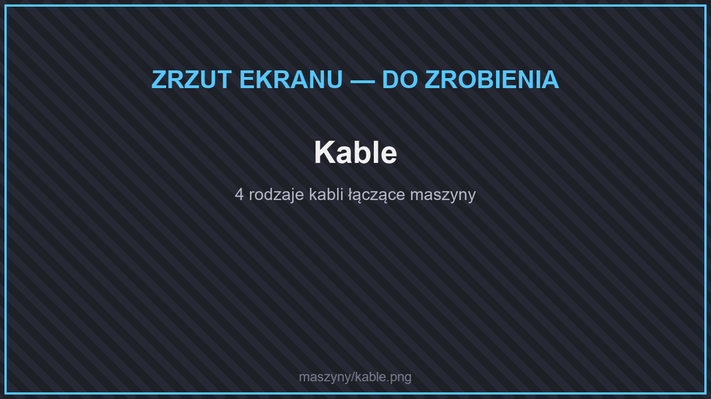

# 🔌 Logistyka

## Kable

<figure><figcaption>
Kable
</figcaption></figure>

Jeden kabel przesyła **naraz energię, płyny i przedmioty**. Kable łączą się same z maszynami, ogniwami, zbiornikami, skrzyniami i innymi kablami.

| Kabel | Energia | Płyny | Przedmioty (szybkość) | Z czego |
| --- | --- | --- | --- | --- |
| **Podstawowy kabel** | 500 J/t | 100 mB/t | ×1 | żelazo, czerwony kamień |
| **Zaawansowany kabel** | 2 000 J/t | 400 mB/t | ×2 | podstawowe kable, jasnopył |
| **Elitarny kabel** | 20 000 J/t | 1 600 mB/t | ×4 | zaawansowane kable, bryłki złota |
| **Ostateczny kabel** | 100 000 J/t | 6 400 mB/t | ×8 | elitarne kable, złoto, diament |

Każde połączenie kabla z blokiem możesz ustawić [kluczem](README.md#klucz): czy kabel tam **wkłada**, czy **wyjmuje** przedmioty i płyny, z jakim **priorytetem** i na którym **kanale**. Do połączenia możesz też włożyć [filtr przedmiotów](#filtry-przedmiotow).

## Ogniwa zasilające

<figure><figcaption>
Ogniwo zasilające
</figcaption></figure>

Magazyny energii — przyjmują nadmiar prądu z generatorów i oddają go maszynom. W menu ogniwa zobaczysz **wykres** energii.

| Ogniwo | Pojemność |
| --- | --- |
| Podstawowe ogniwo zasilające | 1 000 000 J |
| Zaawansowane ogniwo zasilające | 10 000 000 J |
| Elitarne ogniwo zasilające | 100 000 000 J |
| Najlepsze ogniwo zasilające | 1 000 000 000 J |

## Zbiorniki płynów

<figure><figcaption>
Zbiorniki płynów
</figcaption></figure>

Przechowują wodę albo lawę. Napełnisz je wiadrem lub kablami.

| Zbiornik | Pojemność |
| --- | --- |
| Zwykły Zbiornik | 10 000 mB (10 wiader) |
| Zaawansowany Zbiornik | 50 000 mB |
| Zbiornik płynu Elite | 250 000 mB |
| Ultimate Fluid Tank | 1 250 000 mB |
| **Jednostka magazynowania płynów** | praktycznie bez limitu |

## Filtry przedmiotów

<figure><figcaption>
Filtr przedmiotów
</figcaption></figure>

Filtr wkładasz do połączenia kabla, aby przepuszczał tylko wybrane przedmioty (**biała lista**) albo wszystkie oprócz wybranych (**czarna lista**). Możesz też włączyć porównywanie danych przedmiotu (NBT).

| Filtr | Miejsc na przedmioty |
| --- | --- |
| Zwykły Filtr Przedmiotów | 7 |
| Zaawansowany Filtr Przedmiotów | 14 |
| Elitarny Filtr Przedmiotów | 21 |
| Najlepszy Filtr Przedmiotów | 42 |

## Jednostki magazynowe

<figure><figcaption>
Jednostka magazynowa
</figcaption></figure>

**Jednostka magazynowa** przechowuje **jeden rodzaj przedmiotu** w ilości ponad 2 miliardów sztuk. Idealna na wyjście z [kamieniołomu](wydobycie.md#kamieniolom) albo farmy. Zawartość zostaje w bloku po jego zniszczeniu.

## Skrzynia próżniowa

<figure><figcaption>
Skrzynia próżniowa
</figcaption></figure>

Wciąga **leżące przedmioty** w zasięgu (domyślnie 2 kratki, więcej z ulepszeniem zasięgu) — przydaje się przy [zabójcy mobów](farmy.md#zabojca-mobow) i farmach. Ma sloty filtra.

## Kosz na Śmieci

Kosz z Logistyki niszczy wszystko, co do niego trafi kablem. Jest też osobny, bardziej rozbudowany [kosz na śmieci](../przechowywanie.md#kosz-na-smieci).
