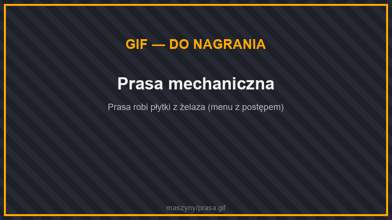
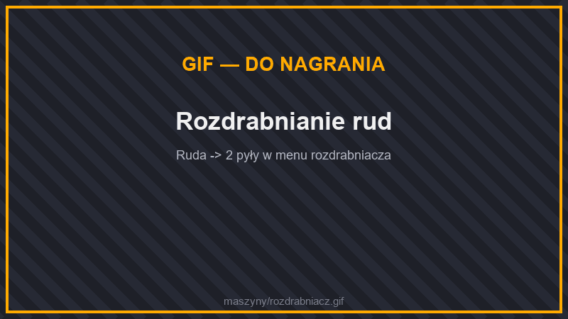
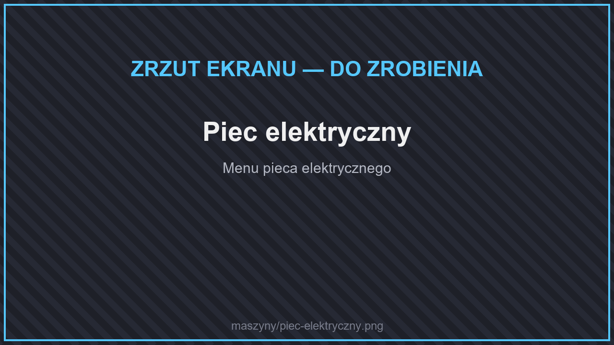
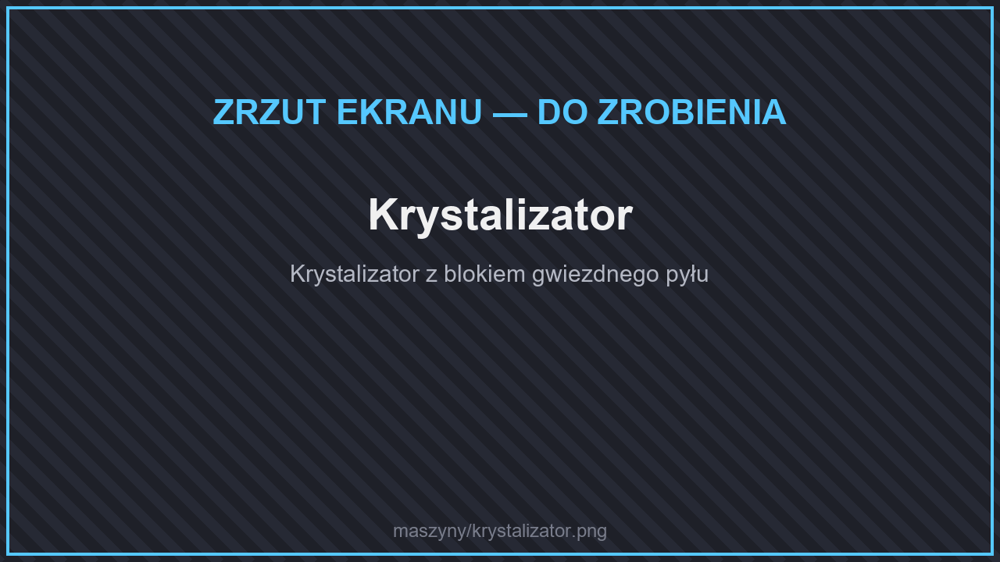
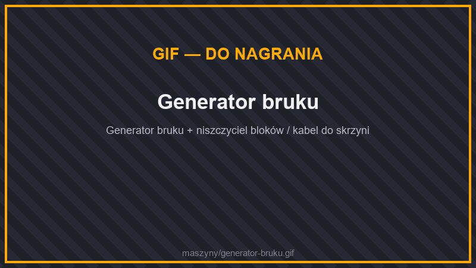
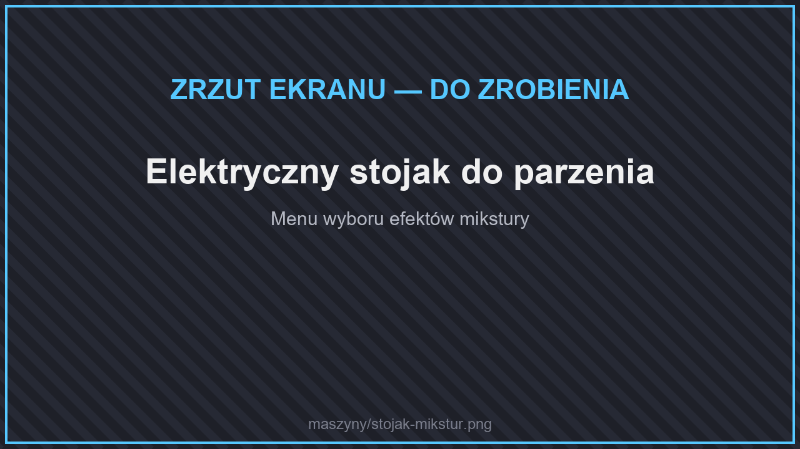
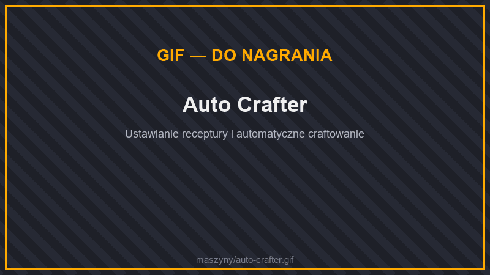
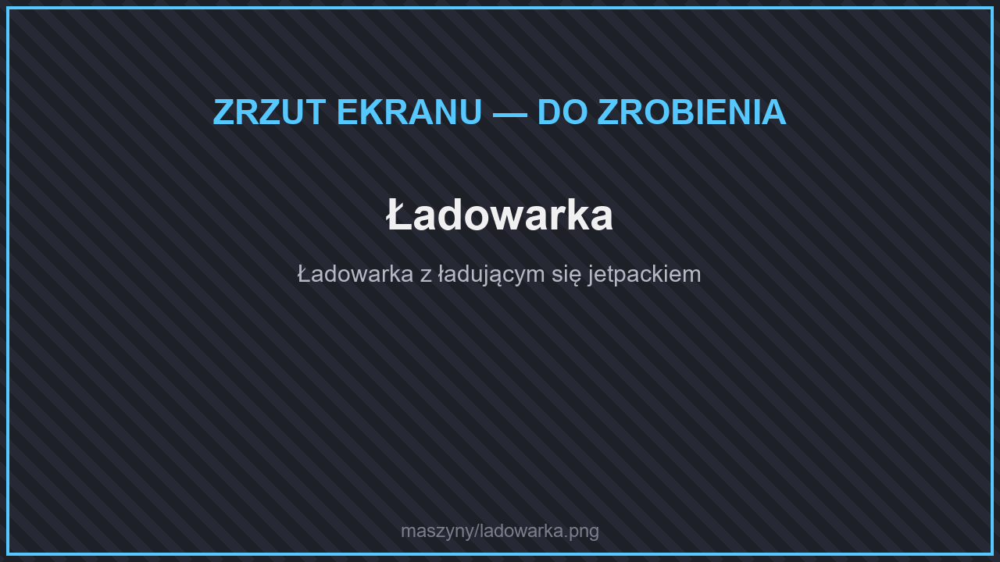

# 🏭 Przetwarzanie

| Maszyna | Zużycie | Magazyn energii | Rama |
| --- | --- | --- | --- |
| [Prasa mechaniczna](#prasa-mechaniczna) | 100 J/t | 10 000 J | podstawowa |
| [Rozpryskiwacz](#rozpryskiwacz) | 50 J/t | 10 000 J | podstawowa |
| [Piec Elektryczny](#piec-elektryczny) | 100 J/t | 10 000 J | podstawowa |
| [Crystallizer](#crystallizer) | 500 J/t | 10 000 J | ostateczna |
| [Zamrażarka](#zamrazarka) | 20 J/t | 10 000 J | zaawansowana |
| [Generator Bruku](#generator-bruku) | 10 J/t | 10 000 J | elitarna |
| [Zaparzacz do płynów](#zaparzacz-do-plynow) | 20 J/t | 10 000 J | zaawansowana |
| [Elektryczny stojak do parzenia](#elektryczny-stojak-do-parzenia-piwa) | 250 J/t | 10 000 J | ostateczna |
| [Auto Crafter](#auto-crafter) | 100 J/t | 10 000 J | elitarna |
| [Ładowarka](#ladowarka-i-ladowarka-bezprzewodowa) | do 500 J/t | 1 000 000 J | podstawowa |

## Prasa mechaniczna

<figure><figcaption>
Prasa mechaniczna
</figcaption></figure>

Zgniata sztabki i klejnoty w **płytki** albo **koła zębate** (tryb wybierasz w menu). Działa na: żelazo, złoto, miedź, diament, szmaragd, netheryt, czerwony kamień i lazuryt. Jeden przedmiot = 10 sekund pracy.

## Rozpryskiwacz

<figure><figcaption>
Rozdrabnianie rud
</figcaption></figure>

Rozdrabniacz — mieli rudy i bloki na pył. **Rudy dają więcej pyłu niż zwykłe przetapianie**, a pył przetopisz w piecu na sztabki:

| Wkładasz | Dostajesz |
| --- | --- |
| Ruda żelaza / złota / diamentu / szmaragdu / lazurytu / węgla | 2 pyły |
| Surowe żelazo / złoto / miedź | 2 pyły |
| **Ruda miedzi** | **6 pyłów** |
| Ruda czerwonego kamienia | 10 czerwonego kamienia |
| Ruda gwiezdnych odłamków | 3 gwiezdne pyły |
| Gwiezdne odłamki | 2 gwiezdne pyły |
| Sztabka, płytka lub koło zębate | 1 pył (odzysk) |
| Blok metalu / klejnotu | 9 pyłów |
| Kamień → bruk → żwir → piasek | po 1 |
| Kość / blok kości | 4 / 9 mączki kostnej |
| Jasnogłaz | 4 jasnopyły |
| Lód | 4 śnieżki |
| Wełna | 2 nici |

## Piec Elektryczny

<figure><figcaption>
Piec elektryczny
</figcaption></figure>

Przetapia wszystko, co zwykły piec, ale **dwa razy szybciej** i bez paliwa — tylko na prąd.

## Crystallizer

<figure><figcaption>
Krystalizator
</figcaption></figure>

Zamienia **blok gwiezdnego pyłu** w **gwiezdny kryształ** — materiał na [gwiezdny ekwipunek](../ekwipunek/README.md#gwiezdny-ekwipunek). Zużywa dużo energii (500 J/t).

## Zamrażarka

<figure><figcaption>
Zamrażarka
</figcaption></figure>

Zamraża wodę z wewnętrznego zbiornika (do 100 000 mB) w **lód**, **lód zbity** albo **niebieski lód** — wybierasz w menu.

## Generator Bruku

<figure><figcaption>
Generator bruku
</figcaption></figure>

Ze zbiornika wody i lawy (po 1000 mB) wytwarza **bruk** bez końca — możesz też wybrać kamień albo obsydian. Wodę i lawę doprowadzisz rurami albo wiadrami.

## Zaparzacz do płynów

<figure><figcaption>
Zaparzacz do płynów
</figcaption></figure>

Wkłada płyn do przedmiotu albo go z niego wyciąga. Przykłady:

* butelka → butelka wody, wiadro → wiadro wody / lawy (i z powrotem),
* koral ↔ martwy koral (wszystkie rodzaje, także bloki i wachlarze),
* gąbka ↔ mokra gąbka, wodorosty ↔ suszone wodorosty.

## Elektryczny stojak do parzenia piwa

<figure><figcaption>
Elektryczny stojak do parzenia
</figcaption></figure>

Elektryczna wersja statywu alchemicznego. W menu **wybierasz efekt mikstury** i jego wzmocnienie, wkładasz składniki (brodawka netherowa + składnik efektu, np. cukier — szybkość, różdżka płomyka — siła), a stojak sam warzy mikstury, używając wody ze zbiornika (do 10 000 mB). Czerwony kamień wydłuża działanie, jasnopył wzmacnia efekt — tak jak w zwykłym warzeniu.

Dostępne efekty: odporność na ogień, natychmiastowe leczenie i obrażenia, niewidzialność, skok, widzenie w ciemności, trucizna, regeneracja, powolne opadanie, spowolnienie, szybkość, siła, oddychanie pod wodą, osłabienie oraz efekty z 1.21 (zarażenie, oślizgłość, tkanie, naładowanie wiatrem).

## Auto Crafter

<figure><figcaption>
Auto Crafter
</figcaption></figure>

Automatyczny stół rzemieślniczy. Ustaw recepturę w menu, dostarczaj składniki (lejkiem albo kablem), a maszyna co 5 sekund wytworzy przedmiot.

## Ładowarka i Ładowarka bezprzewodowa

<figure><figcaption>
Ładowarka
</figcaption></figure>

* **Ładowarka** — włóż do niej przedmiot na energię (np. [jetpack](../pojazdy.md#jetpacki)), a naładuje go (500 J/t).
* **Ładowarka bezprzewodowa** — ładuje przedmioty w ekwipunku graczy stojących w zasięgu do 4 kratek (300 J/t).
