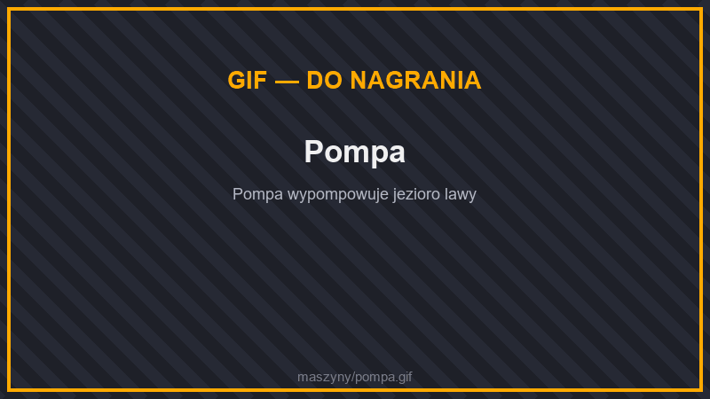

# ⛏️ Wydobycie

## Kamieniołom

<figure><figcaption>
Kamieniołom w pracy
</figcaption></figure>

<figure><figcaption>
Ustawienia kamieniołomu
</figcaption></figure>

Kopie za ciebie cały prostokątny obszar, warstwa po warstwie, aż do dna świata.

* Wielkość obszaru ustawiasz w menu: od 1 × 1 do **30 × 30** kratek (domyślnie 10 × 10), głębokość dowolna.
* Postaw go na skraju obszaru — wokół wykopu zbuduje się **rusztowanie**, po którym jeździ wiertło.
* Zużywa 300 J/t plus 1 J/t za każdą kratkę powierzchni, magazyn 100 000 J.
* Wykopane bloki trafiają do jego ekwipunku. Wyjmij je lejkiem lub kablem do skrzyni albo [jednostki magazynowej](logistyka.md#jednostki-magazynowe).
* Do budowy potrzebne: **elitarna rama**, **wiertło z netherytu** i **rusztowanie w kamieniołomach**.


Kamieniołom kopie na działce tylko tam, gdzie wolno ci budować.


## Niszczyciel Bloków

<figure><figcaption>
Niszczyciel bloków
</figcaption></figure>

Niszczy blok przed sobą, gdy ten się pojawi (np. kamień z generatora bruku, trzcina, dynia) i zbiera go do ekwipunku. 20 J/t.

## Stawiacz bloków

<figure><figcaption>
Stawiacz bloków
</figcaption></figure>

Stawia przed sobą bloki z ekwipunku. 200 J za każdy blok.

## Pompa

<figure><figcaption>
Pompa
</figcaption></figure>

Wypompowuje **wodę albo lawę** ze źródeł w zasięgu (od 1 do 10 kratek, domyślnie 5; więcej z ulepszeniami zasięgu) do własnego zbiornika (20 000 mB). Zużywa 250 J/t. Płyn odbierzesz rurami (kablami) do zbiorników, generatorów lawy i innych maszyn.

## Nieskończone Źródło Wody

Blok, z którego pompa i kable mogą pobierać **wodę bez końca**.

## Ładowarka chunków

<figure><figcaption>
Ładowarka chunków
</figcaption></figure>

Utrzymuje załadowane chunki wokół siebie (zasięg do 3 chunków), dzięki czemu maszyny pracują, gdy nie ma cię w pobliżu. Zużywa 250 J za każdy chunk.

## Star Collector

<figure><figcaption>
Star Collector
</figcaption></figure>

Nocą zbiera **gwiezdny pył** z nieba. Potrzebuje dużo energii (200 J/t podczas zbierania, magazyn 100 000 J) i ostatecznej ramy.
