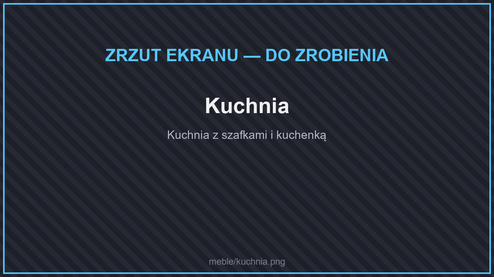
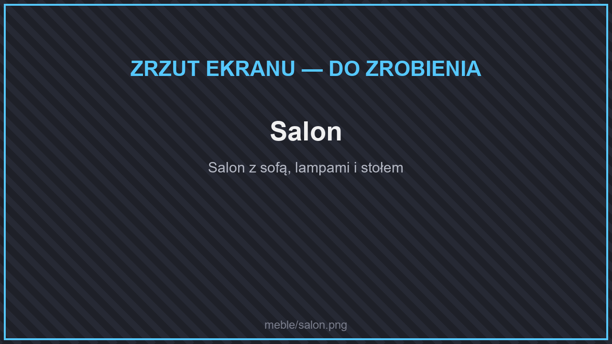
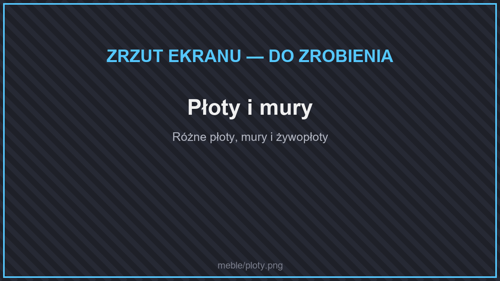

# 🪑 Meble

<figure><figcaption>
Urządzony pokój
</figcaption></figure>

Na serwerze jest ponad 2400 mebli i dekoracji. Większość stworzysz w stole rzemieślniczym albo kupisz u **meblarza** (**`/meble`**). Meble wypadają też ze **Skrzyni Meblowej**. Wszystkie znajdziesz w menu przedmiotów (**`/nova items`**) w zakładce **Bloki funkcjonalne**.

## Rodzaje mebli

<figure><figcaption>
Kuchnia
</figcaption></figure>

<figure><figcaption>
Salon
</figcaption></figure>

<figure><figcaption>
Płoty i mury
</figcaption></figure>

Większość kolekcji ma meble **w każdym rodzaju drewna** — także z drewna z nowych biomów.

| Kolekcja | Co zawiera |
| --- | --- |
| **Przytulny dom** | Ponad 500 mebli: krzesła, stoły, blaty, lampy i latarnie (świecą), lustra ścienne, wanny, zlewy, fontanny, pniaki. |
| **Szafki i szuflady** | Ponad 590 szafek (także z blatem z polerowanego kamienia i z przeszklonymi drzwiami), szuflad i spiżarni. Każda to **schowek na 27 przedmiotów**. |
| **Salon i sypialnia** | Ponad 430 mebli: sofy, kanapy, ławki, stoły, biurka, łóżka, zegary, pianina, umywalki, świece. |
| **Tradycyjne budownictwo** | Pergole, balustrady, kolumny, kominy i kominki, okiennice, latarnie, baseny, emblematy — zobacz [Bloki budowlane](bloki-budowlane.md). |
| **Miasteczko** | Wozy, latarnie uliczne, drogowskazy, studnie, stosy skrzyń, ławy. |
| **Zakurzone dekoracje** | Ponad 100 dekoracji: globusy, półki, markizy, plakaty, beczki, kotwice. |
| **Kopalnia** | Wagoniki, beczki TNT, taczki, liny, rudy na ściany, śpiwory. |
| **Wykopaliska** | Skamieniałości, kilofy i miecze wbite w ziemię, barykady, pochodnie. |
| **Talerze** | **Talerz** i **Mały Talerz**, na których postawisz jedzenie — zobacz [Gotowanie](gotowanie.md#wystawianie-jedzenia). |
| **Inne** | Ławki i siedziska, meble parkowe i znaki drogowe, rekwizyty (zwoje, butelki, kufle, małe kowadła), urządzenia (komputery, kamery, kasa fiskalna), terraria z owadami, wentylatory sufitowe, pluszaki. |

Do tego **ponad 170 płotów, murków, bram i żywopłotów** w każdym materiale (zakładka **Bloki budowlane**). Płoty **łączą się** z sąsiednimi płotami i blokami jak zwykłe płoty, a bramy się otwierają.

## Jak używać mebli

<figure><figcaption>
Siadanie na meblach
</figcaption></figure>

* **Stawianie:** kliknij PPM meblem w blok. Mebel obraca się w stronę, w którą patrzysz — większość mebli ustawisz w **8 kierunkach** (co 45°), część tylko w 4.
* **Meble ścienne** (np. emblematy, lustra ścienne) postawisz tylko na ścianie, a wentylatory sufitowe — tylko pod sufitem.
* **Siadanie:** kliknij PPM krzesło, sofę, kanapę albo ławkę.
* **Przechowywanie:** kliknij PPM szafkę lub szufladę, aby ją otworzyć.
* **Bramy:** kliknij PPM, aby otworzyć lub zamknąć.
* **Zbieranie:** zniszcz mebel, aby go podnieść.
