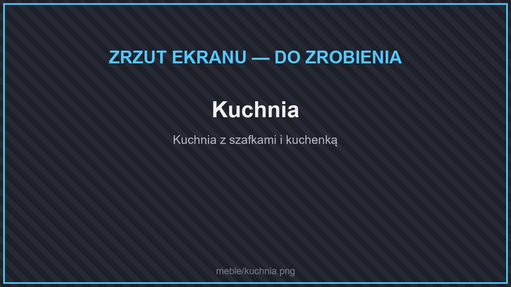
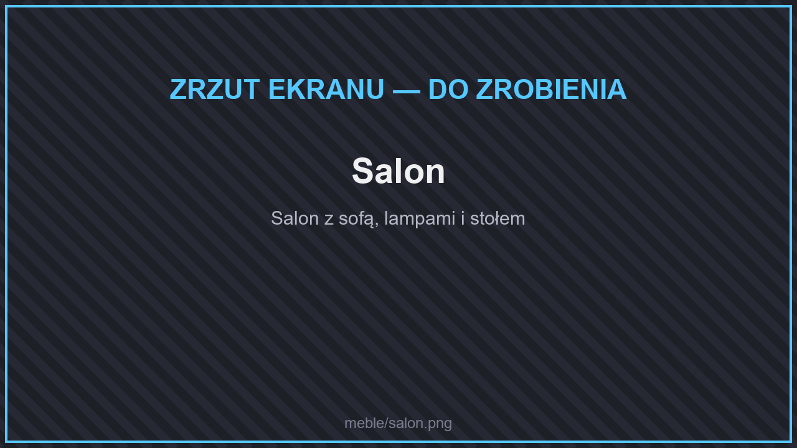

# 🪑 Meble

<figure><figcaption>
Urządzony pokój
</figcaption></figure>

Na serwerze jest ponad 900 mebli i dekoracji. Większość stworzysz w stole rzemieślniczym albo kupisz u **meblarza** (**`/meble`**). Meble wypadają też ze **skrzyni meblowej** (meblowy klucz).

## Rodzaje mebli

<figure><figcaption>
Kuchnia
</figcaption></figure>

<figure><figcaption>
Salon
</figcaption></figure>

<figure><figcaption>
Płoty i mury
</figcaption></figure>

| Kolekcja | Co zawiera |
| --- | --- |
| **Przytulny dom** | Ponad 200 mebli: krzesła, sofy i kanapy (można na nich usiąść), stoły, lampy, latarnie i żyrandole (świecą), wanny, zlewy, kominy, szafki. |
| **Zakurzone dekoracje** | Ponad 100 dekoracji do domów i warsztatów. |
| **Płoty, mury i żywopłoty** | Ponad 130 rodzajów płotów, murów i żywopłotów w każdym materiale oraz bramy, które się otwierają. Płoty **łączą się** z sąsiednimi płotami i blokami jak zwykłe płoty. |
| **Szafki i szuflady** | 170 szafek, szuflad i biblioteczek z drzwiami w każdym rodzaju drewna. Każda to **skrzynia na 27 przedmiotów**. |
| **Talerze** | Talerz i mały talerz, na których postawisz jedzenie — zobacz [Gotowanie](gotowanie.md#wystawianie-jedzenia). |
| **Inne** | Siedziska, meble do przechowywania, dekoracje do kopalni, rekwizyty, wyposażenie wnętrz i wentylatory sufitowe. |

## Jak używać mebli

<figure><figcaption>
Siadanie na meblach
</figcaption></figure>

* **Stawianie:** kliknij PPM meblem w blok. Mebel obraca się w stronę, w którą patrzysz.
* **Siadanie:** kliknij PPM krzesło, sofę albo kanapę.
* **Przechowywanie:** kliknij PPM szafkę lub szufladę, aby ją otworzyć.
* **Bramy:** kliknij PPM, aby otworzyć lub zamknąć.
* **Zbieranie:** zniszcz mebel, aby go podnieść.
