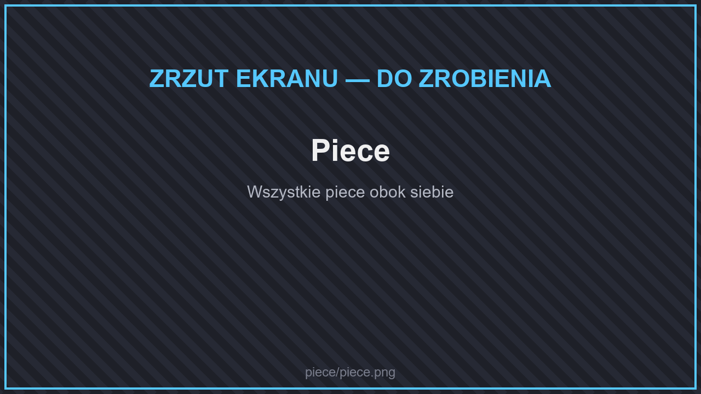
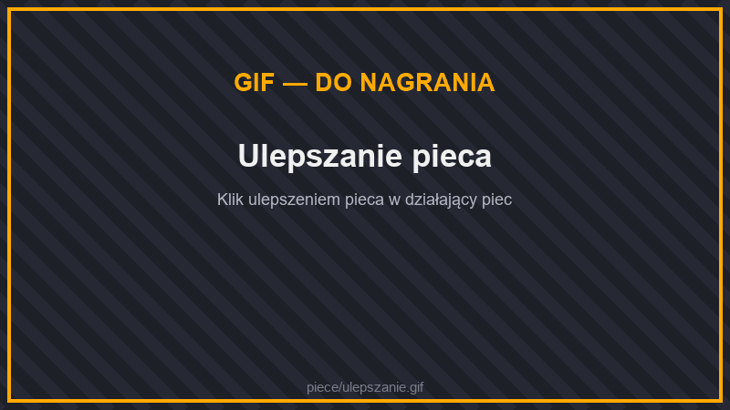
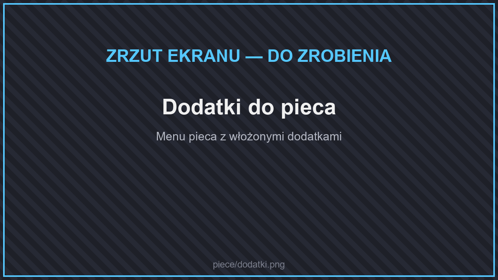
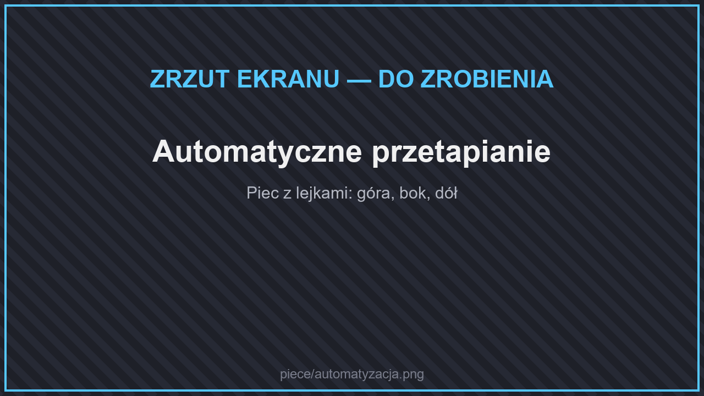

# 🔥 Piece

<figure><figcaption>
Piece
</figcaption></figure>

Szybsze piece zastępują zwykły piec. Działają jak zwykły piec, tylko szybciej, a **paliwo starcza na tyle samo przedmiotów**.

| Piec | Czas przetapiania 1 przedmiotu | Szybciej niż zwykły piec |
| --- | --- | --- |
| zwykły piec | 10 s | — |
| **Miedziany Piec** | 9 s | ×1,1 |
| **Żelazny Piec** | 8 s | ×1,25 |
| **Złoty Piec** | 6 s | ×1,7 |
| **Diamentowy Piec** | 4 s | ×2,5 |
| **Szmaragdowy Piec** | 2 s | ×5 |
| **Kryształowy Piec** | 2 s | ×5 |
| **Obsydianowy Piec** | 1 s | ×10 |
| **Netherytowy Piec** | 0,25 s | ×40 |

Szybsze piece liczą się do [limitu bloków z dodatków](maszyny/README.md#limity-maszyn) (500 na gracza, 256 w jednym chunku).

## Ulepszanie pieca

<figure><figcaption>
Ulepszanie pieca
</figcaption></figure>

Kliknij **Ulepszeniem Pieca** postawiony piec — zmieni się w lepszy, a zawartość zostanie. Każde ulepszenie ma w nazwie, z jakiego pieca na jaki działa, np. **Ulepszenie Pieca: Zwykły → Miedziany**.

| Ulepszenie pieca | |
| --- | --- |
| zwykły → miedziany, zwykły → żelazny | pierwszy krok |
| miedziany → żelazny, żelazny → złoty, złoty → diamentowy | |
| diamentowy → szmaragdowy **albo** diamentowy → kryształowy | rozgałęzienie |
| szmaragdowy → obsydianowy, kryształowy → obsydianowy | |
| obsydianowy → netherytowy | ostatni krok |

## Dodatki do pieca

<figure><figcaption>
Dodatki do pieca
</figcaption></figure>

W menu pieca są dwa sloty na **dodatki** (ulepszenia działania). Dodatek zostaje w piecu, gdy go zniszczysz i postawisz ponownie.

| Dodatek | Działanie |
| --- | --- |
| **Ulepszenie: Wytapianie** | Piec działa jak **piec hutniczy** (rudy, zbroje i narzędzia z metalu). |
| **Ulepszenie: Wędzenie** | Piec działa jak **wędzarnia** (jedzenie). |
| **Ulepszenie: Szybkość** | Przetapia **2× szybciej**, ale paliwo pali się 2× krócej. |
| **Ulepszenie: Oszczędność Paliwa** | Paliwo starcza na **2× dłużej**, ale przetapianie trwa o 25% dłużej. |

Piec może mieć naraz jeden dodatek „trybu” (wytapianie albo wędzenie) i jeden dodatek „szybkości” (szybkość albo oszczędność paliwa).

## Automatyzacja

<figure><figcaption>
Automatyczne przetapianie
</figcaption></figure>

Piece współpracują z lejkami i [kablami](maszyny/logistyka.md#kable):

* **od góry** — przedmioty do przetopienia,
* **z boków** — paliwo,
* **od dołu** — gotowe przedmioty.
