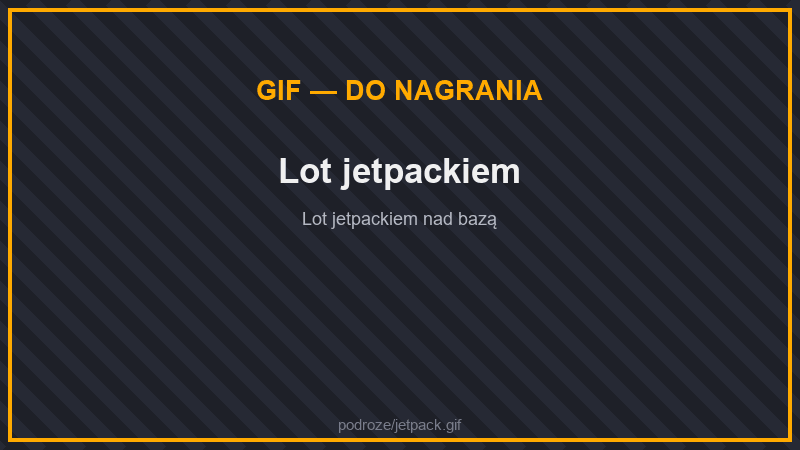
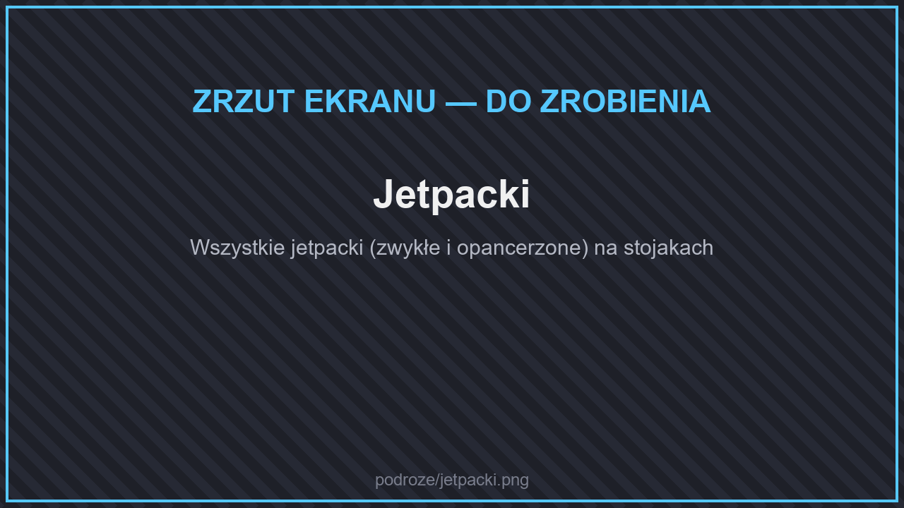
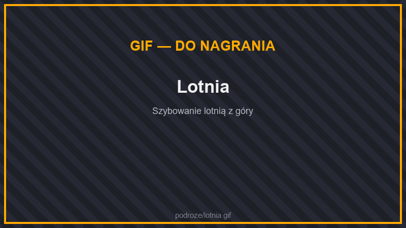
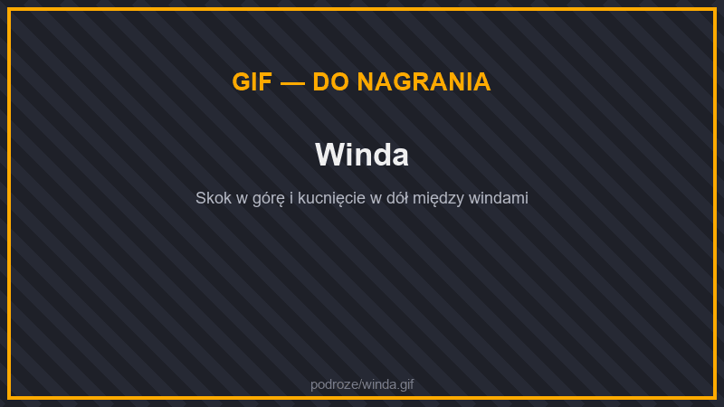
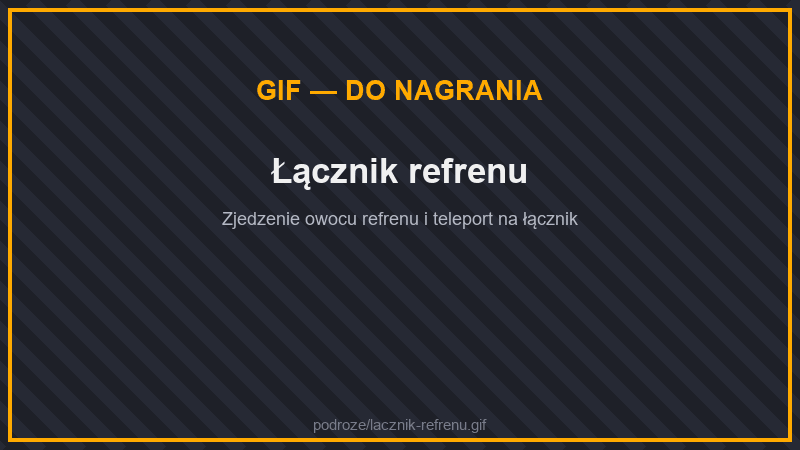
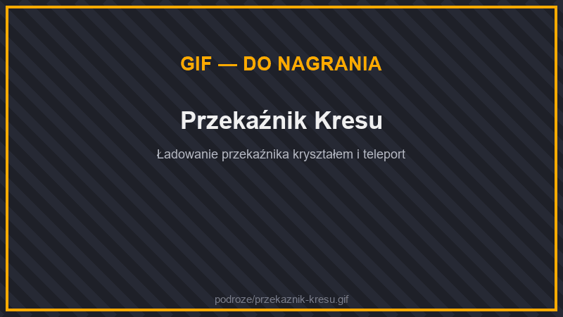
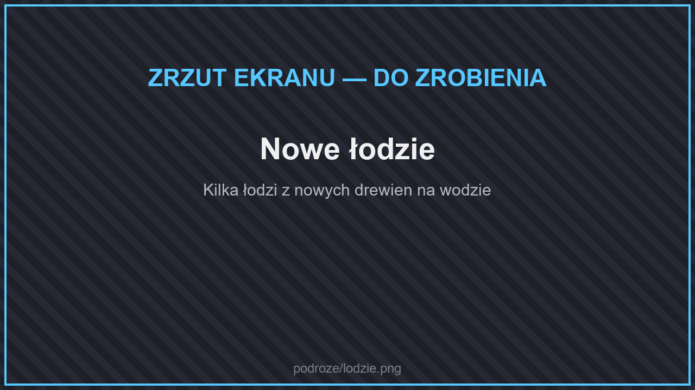

# 🚗 Podróże i pojazdy

## Pojazdy

Na serwerze możesz mieć **własne pojazdy**: samochody, pickupy, motocykle, rowery, tratwę, łódź podwodną i latające wierzchowce. Każdy pojazd, który zdobędziesz, należy **na stałe do ciebie**.

### Jak zdobyć pojazd

1. Zdobądź **przedmiot pojazdu** (np. **Biały Samochód**).
2. Użyj go (PPM). Przedmiot znika, a pojazd zostaje **przypisany do twojego konta** i od razu się pojawia obok ciebie.
3. Jeśli masz już ten pojazd, przedmiot nie zostanie zużyty — dostaniesz tylko przypomnienie, że przywołasz go komendą `/pojazdy`.

| Skąd | Co |
| --- | --- |
| **Mechanik** na spawnie (stacja „Pojazdy”), każdy za **9 Kamiennych Odłamków** | Biały Samochód, Biały Pickup, Biały Motocykl, Biały Rower, Latający Motor, Sterowiec, Balon, Łódź Podwodna, Tratwa z Kłód oraz farby we wszystkich kolorach |
| Stół rzemieślniczy | **Tratwa z Kłód**: 4 białe wełny (po bokach w dwóch górnych rzędach), 2 patyki (na środku) i 3 dębowe kłody (w dolnym rzędzie) |


**Kamienne Odłamki** to odłamki kluczy — wypadają z piniaty i na strefie AFK, a w kuźni kluczy zrobisz je z 64 bruku. Zobacz [Skrzynie i Piniata](../informacje/skrzynki.md).


### Rodzaje pojazdów

| Rodzaj | Pojazdy |
| --- | --- |
| 🚗 Samochody | Biały, Czarny, Niebieski, Zielony, Różowy i Czerwony Samochód, Taksówka |
| 🛻 Pickupy | Biały, Czarny, Niebieski, Zielony, Różowy i Czerwony Pickup |
| 🏍️ Motocykle | Biały, Czarny, Niebieski, Zielony, Różowy i Czerwony Motocykl |
| 🚲 Rowery | Biały, Czarny, Niebieski, Zielony, Różowy i Czerwony Rower |
| 🌊 Na wodę | Tratwa z Kłód, Łódź Podwodna |
| 🪽 Latające | Latający Motor, Sterowiec, Balon, Wywerna, Ghast, Chiński Smok, Pszczoła |

### Przywoływanie i chowanie

* `/pojazdy` — otwiera listę **twoich** pojazdów. Kliknij pojazd, aby go **przywołać** albo **schować**.
* Naraz możesz mieć przywołany **jeden pojazd**. Gdy przywołasz kolejny, poprzedni sam się schowa.
* **Lewy klik na swoim pojeździe** otwiera jego menu: możesz go tam **schować** albo **zmienić mu nazwę**.
* Do pojazdu wsiadasz PPM. **Prowadzić może tylko właściciel** — inni gracze mogą jechać co najwyżej jako pasażerowie.
* Twojego pojazdu **nikt nie zniszczy** — pojazdy nie otrzymują obrażeń.


Na **spawnie** nie da się przywoływać pojazdów. Pojazd użyty na spawnie i tak trafi na twoją listę — przywołasz go w innym świecie.


### Farby

Farbą (np. **Czerwona Farba**) kliknij swój **samochód, pickup, motocykl albo rower** — pojazd zmieni kolor, a na twojej liście zamiast starego koloru pojawi się nowy. Farba działa tylko na twoich pojazdach.

## Jetpacki

<figure><figcaption>
Lot jetpackiem
</figcaption></figure>

<figure><figcaption>
Jetpacki
</figcaption></figure>

Jetpack zakładasz na tors zamiast napierśnika i **latasz, trzymając spację**. Zasilany jest energią — naładujesz go w [ładowarce](maszyny/przetwarzanie.md#ladowarka-i-ladowarka-bezprzewodowa).

| Jetpack | Bateria | Zużycie | Prędkość lotu |
| --- | --- | --- | --- |
| **Zwykły Jetpack** | 100 000 J | 100 J/t | ★ |
| **Zaawansowany Jetpack** | 1 000 000 J | 200 J/t | ★★ |
| **Elitarny Jetpack** | 5 000 000 J | 300 J/t | ★★★ |
| **Najlepszy Jetpack** | 50 000 000 J | 500 J/t | ★★★★ |

Każdy jetpack ma wersję **opancerzoną**, która chroni jak napierśnik i przyjmuje zaklęcia zbroi (Ochrona, Ciernie…):

| Opancerzony jetpack | Pancerz |
| --- | --- |
| Zwykły opancerzony jetpack | 3 |
| Opancerzony Zaawansowany Jetpack | 6 |
| Opancerzony Elitarny Jetpack | 8 |
| Najlepszy Opancerzony Jetpack | 8 + 3 wytrzymałości pancerza |

Wersję opancerzoną stworzysz z jetpacka i napierśnika. Kolejny poziom jetpacka robi się z opancerzonej wersji poprzedniego.

## Lotnie

<figure><figcaption>
Lotnia
</figcaption></figure>

Lotnia pozwala **szybować** w powietrzu — skocz z wysokiego miejsca, trzymając ją w ręce. Lotnie są w 16 kolorach.

* Lotnia ma **300 punktów wytrzymałości** i traci 1 punkt na sekundę lotu. Gdy zostanie 1 punkt, lotnia ląduje.
* Naprawisz ją na kowadle **membraną fantoma**.

## Windy

<figure><figcaption>
Winda
</figcaption></figure>

**Winda** to blok z wełny i perły Kresu. Postaw kilka wind w jednej kolumnie (jedna nad drugą, w dowolnej odległości):

* **Skocz** na windzie — przeniesiesz się na następną windę wyżej.
* **Kucnij** — zjedziesz na następną windę niżej.
* Kliknij windę PPM innym blokiem, aby ją **przebrać** za ten blok (np. za podłogę z desek).

## Łączniki refrenu

<figure><figcaption>
Łącznik refrenu
</figcaption></figure>

Zwykły owoc refrenu teleportuje losowo. **Łącznik refrenu** sprawia, że zjedzony w pobliżu owoc przenosi cię **dokładnie do łącznika**.

| Przedmiot | Jak zrobić | Działanie |
| --- | --- | --- |
| **Łącznik refrenu** | 8 bloków purpury + złoty owoc refrenu | Owoc refrenu zjedzony w promieniu **128 kratek** przenosi na najbliższy łącznik. Łącznik zasilony czerwonym kamieniem jest pomijany. |
| **Złoty owoc refrenu** | 8 sztabek złota + owoc refrenu | Przenosi na najbliższy łącznik w tym wymiarze, **bez limitu odległości**. |
| **Zaklęty złoty owoc refrenu** | tylko ze skrzyń w **miastach Kresu** | Kliknij nim PPM łącznik, aby go **powiązać**. Przenosi na ten łącznik, nawet **z innego wymiaru**. 9 użyć. |

Złote owoce refrenu znajdziesz też w skrzyniach w miastach Kresu, a na statkach Kresu stoi gotowy łącznik.

## Przekaźnik Kresu

<figure><figcaption>
Przekaźnik Kresu
</figcaption></figure>

**Przekaźnik Kresu** (obsydian, prażone owoce refrenu i kompas) przenosi cię z Kresu prosto do wybranego miejsca w świecie:

1. Do stworzenia użyj **kompasu nastawionego na magnetyt** — przekaźnik zapamięta ten magnetyt.
2. Postaw przekaźnik **w Kresie** i naładuj go kryształem Kresu (PPM).
3. Kliknij PPM — przeniesiesz się do zapamiętanego magnetytu.


Przekaźnik działa **tylko w Kresie**. Użyty w innym wymiarze — wybucha.


## Łodzie

<figure><figcaption>
Łodzie
</figcaption></figure>

Z desek nowych rodzajów drewna z [biomów Świata Głównego](../wymiary/swiat-glowny/biomy.md), [Netheru](../wymiary/nether/biomy.md) i [Kresu](../wymiary/kres/biomy.md) (np. baobab, cyprys, eukaliptus, klon, sekwoja, wierzba, glicynia) zrobisz łódź tak samo jak ze zwykłych desek — powstaje **zwykła dębowa łódź**.

Na wodę możesz też wziąć własną **Tratwę z Kłód** albo **Łódź Podwodną** — zobacz [Pojazdy](#pojazdy).
