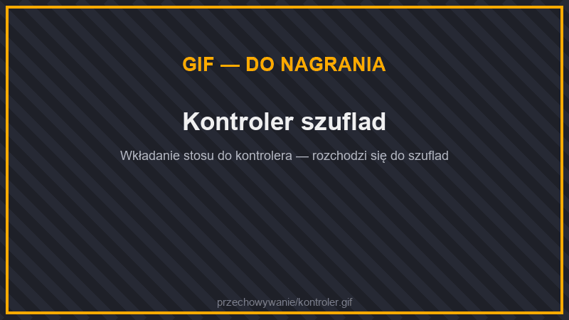
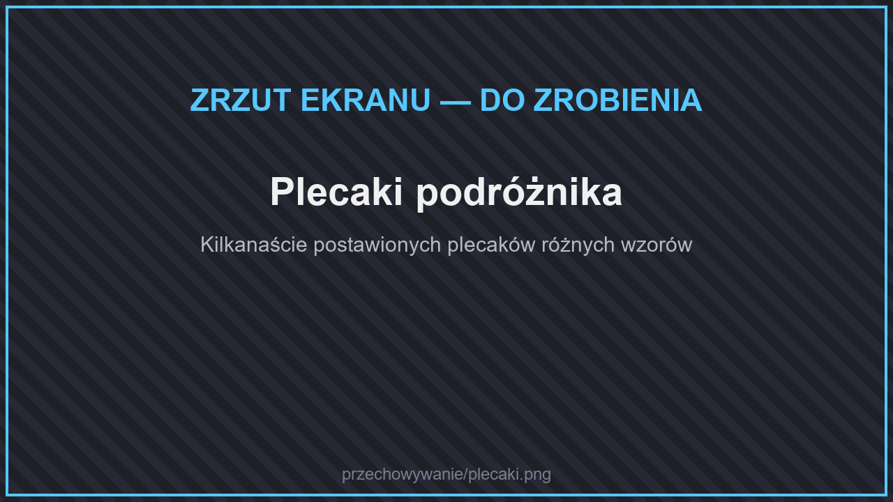
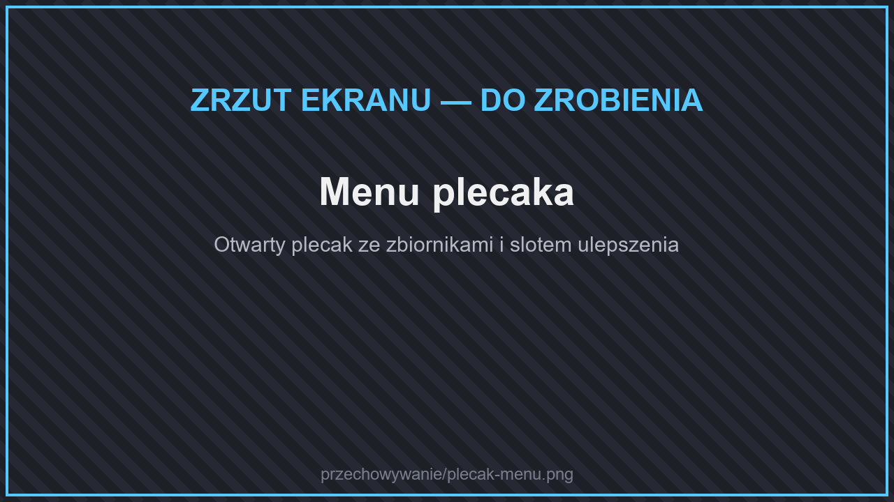

# 📦 Przechowywanie

## Skrzynie metalowe

<figure><figcaption>
Skrzynie metalowe
</figcaption></figure>

<figure><figcaption>
Kryształowa skrzynia
</figcaption></figure>

Większe skrzynie z metali i klejnotów. Działają z lejkami i [kablami](maszyny/logistyka.md#kable).

| Skrzynia | Miejsc | Uwagi |
| --- | --- | --- |
| **Miedziana skrzynia** | 45 | |
| **Żelazna skrzynia** | 54 | |
| **Złota skrzynia** | 81 | |
| **Diamentowa skrzynia** | 108 | |
| **Kryształowa skrzynia** | 108 | Na wierzchu widać 8 przedmiotów, których jest w niej najwięcej. |
| **Obsydianowa skrzynia** | 108 | |
| **Skrzynia na ziemię 9000!** | 1 | Żart — mieści jeden stos ziemi. |

Skrzynie, które mają więcej niż 6 rzędów, **przewijasz** strzałkami w menu.

### Ulepszanie skrzyń

<figure><figcaption>
Ulepszanie skrzyni
</figcaption></figure>

Nie musisz przekładać przedmiotów. Kliknij **ulepszeniem skrzyni** postawioną skrzynię — zmieni się w lepszą, a zawartość zostanie.

| Ulepszenie | Z jakiej skrzyni | Na jaką |
| --- | --- | --- |
| drewniana → miedziana | zwykła skrzynia | miedziana |
| drewniana → żelazna | zwykła skrzynia | żelazna |
| miedziana → żelazna | miedziana (także zwykła miedziana skrzynia z Minecrafta) | żelazna |
| żelazna → złota | żelazna | złota |
| złota → diamentowa | złota | diamentowa |
| diamentowa → kryształowa | diamentowa | kryształowa |
| diamentowa → obsydianowa | diamentowa | obsydianowa |


Ulepszyć można tylko **pojedynczą** skrzynię. Podwójną skrzynię najpierw rozdziel.


## Szuflady

<figure><figcaption>
Szuflady
</figcaption></figure>

Szuflady przechowują **dużo sztuk kilku rodzajów przedmiotów** i pokazują je na froncie razem z liczbą.

| Szuflada | Przegródek | Pojemność przegródki (bez ulepszeń) |
| --- | --- | --- |
| Pełna 1×1 | 1 | 32 stosy |
| Pełna 1×2 | 2 | 16 stosów |
| Pełna 2×2 | 4 | 8 stosów |
| Połówkowa 1×1 / 1×2 / 2×2 | 1 / 2 / 4 | 16 / 8 / 4 stosy |
| **Kompaktująca** (2 lub 3 przegródki) | 2–3 | 32 stosy najmniejszego przedmiotu |

Szuflady są w **każdym rodzaju drewna**. Do tego **obramowania** (trim) — dekoracyjne bloki pasujące do szuflad.

### Jak używać

<figure><figcaption>
Wkładanie do szuflad
</figcaption></figure>

* **PPM przedmiotem** — wkładasz trzymany stos. **Dwuklik PPM** — wkładasz wszystkie pasujące przedmioty z ekwipunku.
* **LPM** — wyjmujesz 1 sztukę, **Shift + LPM** — cały stos.
* **Szuflada kompaktująca** sama zamienia przedmioty: np. włożysz bryłki żelaza, a wyjmiesz też sztabki i bloki (i odwrotnie).
* Gdy zniszczysz szufladę, jej zawartość i ulepszenia **wypadną na ziemię**.

### Ulepszenia szuflad

Kliknij szufladę PPM ulepszeniem, aby je włożyć. Menu ulepszeń (wyjmowanie) otworzysz Shift + PPM pustą ręką. Mieści się **do 7 ulepszeń**. Ulepszenia pojemności dodają wielokrotność podstawowej pojemności:

| Ulepszenie | Pojemność |
| --- | --- |
| Obsydianowe | +2× |
| Miedziane | +3× |
| Żelazne | +4× |
| Złote | +8× |
| Szmaragdowe | +16× |
| Diamentowe | +32× |
| Netherytowe | +64× |
| **Jeden stos** | zmniejsza pojemność przegródki do 1 stosu |
| **Pustka** | niszczy przedmioty, które się już nie mieszczą |

Ulepszenia tworzysz na **szablonie ulepszenia**.

### Klucz i kontroler

<figure><figcaption>
Kontroler szuflad
</figcaption></figure>

* **Klucz do szuflad** — kliknij nim szufladę, aby ją **zablokować**: zapamięta przedmioty, nawet gdy się opróżni.
* **Kontroler** — łączy wszystkie szuflady stykające się z nim (do 12 kratek). Włóż przedmiot do kontrolera — trafi do szuflady, w której już taki leży. Do kontrolera podłączysz lejek lub kabel.

## Kosz na śmieci

<figure><figcaption>
Kosz na śmieci
</figcaption></figure>

* Przedmioty włożone do **górnego rzędu** znikają po 5 sekundach (do tego czasu możesz je wyjąć).
* Kosz niszczy też przedmioty, płyny i energię wpychane przez **lejki i rury**.
* **Dolny rząd** to filtr: przyciskiem na środku wybierasz, czy kosz ma przyjmować z lejków i rur tylko przedmioty z filtra, czy wszystko oprócz nich.

## Plecaki podróżnika

<figure><figcaption>
Plecaki podróżnika
</figcaption></figure>

<figure><figcaption>
Menu plecaka
</figcaption></figure>

Plecaki, które nosisz jako przedmiot albo stawiasz na ziemi. Jest ich **44 wzory** — od standardowego, przez zwierzęce (krowi, lisi, smoczy), po surowcowe (diamentowy, netherytowy).

* **Otwieranie:** PPM plecakiem w ręce. **Postawienie:** Shift + PPM na blok. Postawiony plecak otwierasz PPM, a zabierasz, niszcząc go — zawartość zostaje w środku.
* Każdy plecak ma **dwa zbiorniki** na wodę albo lawę — włóż wiadro do slotu pod zbiornikiem.
* Plecaka nie da się włożyć do innego plecaka.

### Poziomy

Plecak ulepszasz, wkładając **ulepszenie poziomu** do slotu w menu plecaka.

| Poziom | Rzędów | Miejsc | Zbiornik (każdy) |
| --- | --- | --- | --- |
| Skórzany | 3 | 27 | 3 000 mB |
| Żelazny | 5 | 45 | 5 000 mB |
| Złoty | 7 | 63 | 7 000 mB |
| Diamentowy | 9 | 81 | 9 000 mB |
| Netherytowy | 11 | 99 | 11 000 mB |


To co innego niż [plecak z komendy `/plecak`](../jak-grac/your-first-project.md#plecak), którego zawartość nie wypada po śmierci.

