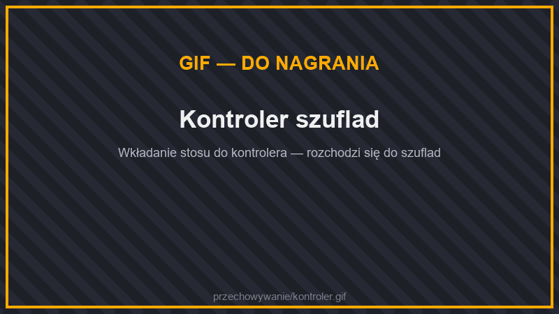
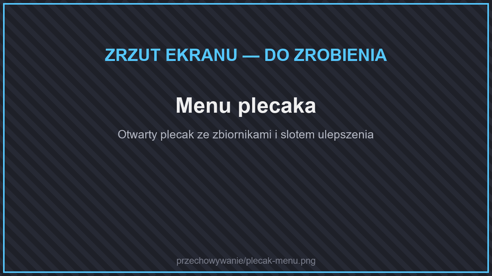

# 📦 Przechowywanie

## Skrzynie metalowe

<figure><figcaption>
Skrzynie metalowe
</figcaption></figure>

<figure><figcaption>
Kryształowa skrzynia
</figcaption></figure>

Większe skrzynie z metali i klejnotów. Działają z lejkami i [kablami](maszyny/logistyka.md#kable).

| Skrzynia | Miejsc | Uwagi |
| --- | --- | --- |
| **Miedziana Skrzynia** | 45 | |
| **Żelazna Skrzynia** | 54 | |
| **Złota Skrzynia** | 81 | |
| **Diamentowa Skrzynia** | 108 | |
| **Kryształowa Skrzynia** | 108 | Na wierzchu widać 8 przedmiotów, których jest w niej najwięcej. |
| **Obsydianowa Skrzynia** | 108 | |
| **Skrzynia na Ziemię 9000!** | 1 | Żart — mieści jeden stos ziemi. |

Skrzynie, które mają więcej niż 6 rzędów, **przewijasz** strzałkami w menu.


Metalowe skrzynie i szuflady liczą się do [limitu bloków z dodatków](maszyny/README.md#limity-maszyn) (500 na gracza, 256 w jednym chunku) — razem z maszynami i kablami.


### Ulepszanie skrzyń

<figure><figcaption>
Ulepszanie skrzyni
</figcaption></figure>

Nie musisz przekładać przedmiotów. Kliknij **Ulepszeniem Skrzyni** postawioną skrzynię — zmieni się w lepszą, a zawartość zostanie.

| Ulepszenie | Z jakiej skrzyni | Na jaką |
| --- | --- | --- |
| Ulepszenie Skrzyni: Drewniana → Miedziana | zwykła skrzynia | miedziana |
| Ulepszenie Skrzyni: Drewniana → Żelazna | zwykła skrzynia | żelazna |
| Ulepszenie Skrzyni: Miedziana → Żelazna | miedziana (także zwykła miedziana skrzynia z Minecrafta) | żelazna |
| Ulepszenie Skrzyni: Żelazna → Złota | żelazna | złota |
| Ulepszenie Skrzyni: Złota → Diamentowa | złota | diamentowa |
| Ulepszenie Skrzyni: Diamentowa → Kryształowa | diamentowa | kryształowa |
| Ulepszenie Skrzyni: Diamentowa → Obsydianowa | diamentowa | obsydianowa |


Ulepszyć można tylko **pojedynczą** skrzynię. Podwójną skrzynię najpierw rozdziel.


## Szuflady

<figure><figcaption>
Szuflady
</figcaption></figure>

Szuflady przechowują **dużo sztuk kilku rodzajów przedmiotów** i pokazują je na froncie razem z liczbą.

| Szuflada | Przegródek | Pojemność przegródki (bez ulepszeń) |
| --- | --- | --- |
| Szuflady 1x (np. Szuflady Dębowe 1x) | 1 | 32 stosy |
| Szuflady 2x | 2 | 16 stosów |
| Szuflady 4x | 4 | 8 stosów |
| Płytkie Szuflady 1x / 2x / 4x | 1 / 2 / 4 | 16 / 8 / 4 stosy |
| **Dwupoziomowa** lub **Trzypoziomowa Szuflada Kompresująca** (także płytkie) | 2–3 | 32 stosy najmniejszego przedmiotu |

Szuflady są w **każdym rodzaju drewna** z Minecrafta (dąb, świerk, brzoza, tropikalne, akacja, ciemny dąb, namorzyn, wiśnia, blady dąb, bambus, szkarłatne i spaczone). Do tego **Obramowania Szuflad** — dekoracyjne bloki pasujące do szuflad.

### Jak używać

<figure><figcaption>
Wkładanie do szuflad
</figcaption></figure>

* **PPM przedmiotem** — wkładasz trzymany stos. **Dwuklik PPM** — wkładasz wszystkie pasujące przedmioty z ekwipunku.
* **LPM** — wyjmujesz 1 sztukę, **Shift + LPM** — cały stos.
* **Szuflada Kompresująca** sama zamienia przedmioty: np. włożysz bryłki żelaza, a wyjmiesz też sztabki i bloki (i odwrotnie).
* Gdy zniszczysz szufladę, jej zawartość i ulepszenia **wypadną na ziemię**.

### Ulepszenia szuflad

Kliknij szufladę PPM ulepszeniem, aby je włożyć. Menu ulepszeń (wyjmowanie) otworzysz Shift + PPM pustą ręką. Mieści się **do 7 ulepszeń**. Ulepszenia pojemności dodają wielokrotność podstawowej pojemności:

| Ulepszenie | Z czego | Pojemność |
| --- | --- | --- |
| Ulepszenie Pojemności I | obsydian | +2× |
| Ulepszenie Pojemności II | miedź | +3× |
| Ulepszenie Pojemności III | żelazo | +4× |
| Ulepszenie Pojemności IV | złoto | +8× |
| Ulepszenie Pojemności V | szmaragdy | +16× |
| Ulepszenie Pojemności VI | diamenty | +32× |
| Ulepszenie Pojemności VII | netheryt | +64× |
| **Zmniejszenie Pojemności** | | zmniejsza pojemność przegródki do 1 stosu |
| **Ulepszenie Pustki** | | niszczy przedmioty, które się już nie mieszczą |

Ulepszenia tworzysz na **Szablonie Ulepszenia**.

### Klucz i kontroler

<figure><figcaption>
Kontroler szuflad
</figcaption></figure>

* **Klucz do Szuflad** — kliknij nim szufladę, aby ją **zablokować**: zapamięta przedmioty, nawet gdy się opróżni.
* **Kontroler Szuflad** — łączy wszystkie szuflady stykające się z nim (do 12 kratek). Włóż przedmiot do kontrolera — trafi do szuflady, w której już taki leży. Do kontrolera podłączysz lejek lub kabel.

## Plecaki podróżnika

<figure><figcaption>
Plecaki podróżnika
</figcaption></figure>

<figure><figcaption>
Menu plecaka
</figcaption></figure>

Plecaki, które nosisz jako przedmiot albo stawiasz na ziemi. Jest ich **44 wzory** — od standardowego, przez zwierzęce (krowi, lisi, smoczy), po surowcowe (diamentowy, netherytowy).

* **Otwieranie:** PPM plecakiem w ręce. **Postawienie:** Shift + PPM na blok. Postawiony plecak otwierasz PPM, a zabierasz, niszcząc go — zawartość zostaje w środku.
* **Standardowy Plecak** tworzysz ze skór, nici, skrzyni i dowolnej wełny. Pozostałe wzory powstają ze standardowego plecaka — zawartość zostaje.
* Plecaka nie da się włożyć do innego plecaka.

### Poziomy

Plecak ulepszasz, wkładając **Ulepszenie Poziomu** (Żelazne, Złote, Diamentowe, Netherytowe) do slotu w menu plecaka.

| Poziom | Rzędów | Miejsc |
| --- | --- | --- |
| Skórzany | 3 | 27 |
| Żelazny | 5 | 45 |
| Złoty | 7 | 63 |
| Diamentowy | 9 | 81 |
| Netherytowy | 11 | 99 |


To co innego niż [plecak z komendy `/plecak`](../jak-grac/your-first-project.md#plecak), którego zawartość nie wypada po śmierci.

