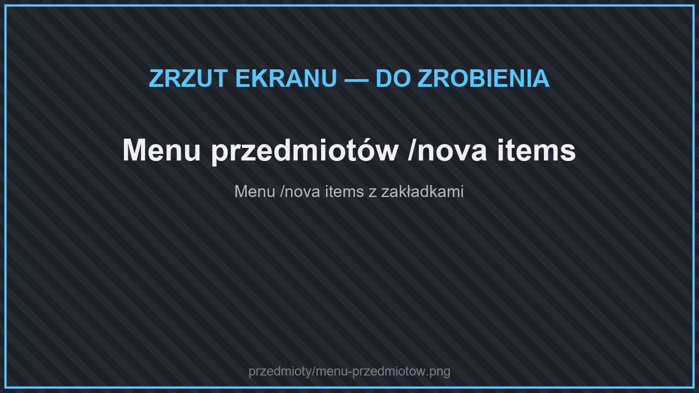
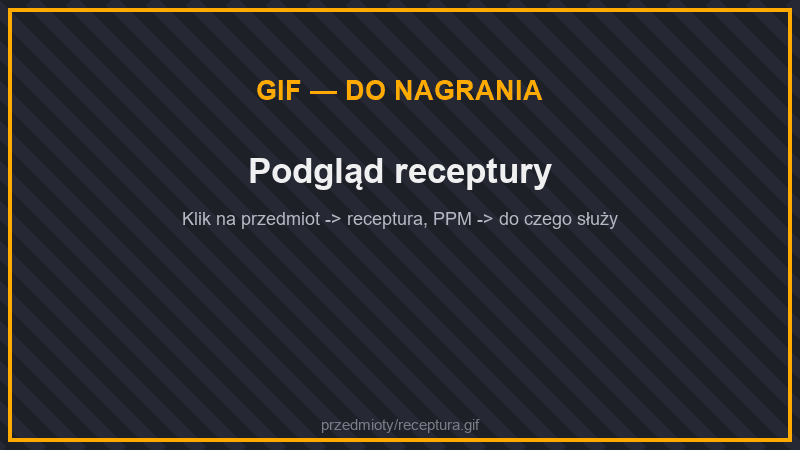
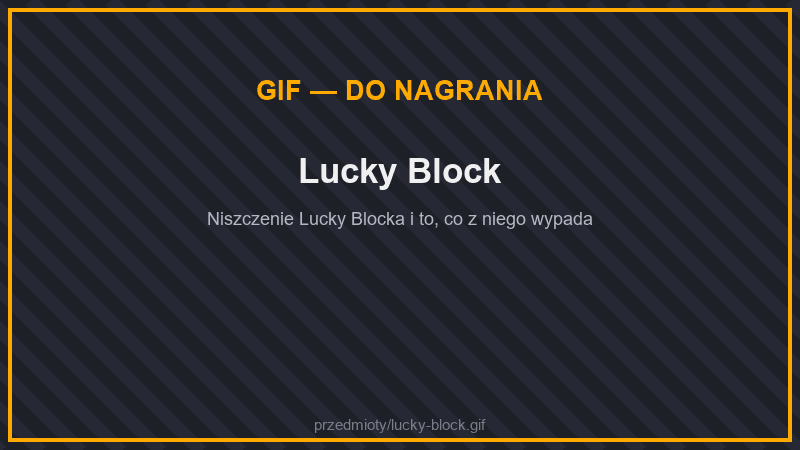

# ⚒️ Przedmioty

Na serwerze są **tysiące nowych przedmiotów i bloków**: rudy i zestawy ekwipunku, maszyny, większe skrzynie, szybsze piece, jedzenie, meble i bloki budowlane.

## Menu przedmiotów

<figure><figcaption>
Menu przedmiotów /nova items
</figcaption></figure>

<figure><figcaption>
Podgląd receptury
</figcaption></figure>

Wszystkie przedmioty przejrzysz w grze komendą **`/nova items`**. Menu jest podzielone na zakładki jak w trybie kreatywnym:

| Zakładka | Co w niej jest |
| --- | --- |
| **Bloki budowlane** | Kamienie, cegły, kafelki, dachy, szkło, drewno |
| **Bloki naturalne** | Rudy, rośliny, liście, gleba |
| **Bloki funkcjonalne** | Meble, szuflady, groby, pułapki, windy |
| **Mechanizmy** | Maszyny, kable, piece, skrzynie, ulepszenia |
| **Narzędzia** | Narzędzia, młoty, wędki, plecaki, jetpacki, lotnie |
| **Walka** | Broń, zbroje, totemy |
| **Jedzenie i napoje** | Potrawy i napoje |
| **Składniki** | Sztabki, pyły, części i materiały |

* **Kliknij** przedmiot — zobaczysz, **jak go stworzyć**.
* **Kliknij PPM** — zobaczysz, **do czego służy** (w jakich recepturach jest składnikiem).

## Kategorie

<table data-view="cards"><thead><tr><th></th><th></th><th data-hidden data-card-target data-type="content-ref"></th></tr></thead><tbody><tr><td><strong>⚔️ Ekwipunek</strong></td><td>Zestawy z rzadkich rud, zbroje z umiejętnościami, broń i totemy.</td><td><a href="ekwipunek/README.md">ekwipunek/README.md</a></td></tr><tr><td><strong>⚙️ Maszyny</strong></td><td>Generatory, przetwarzanie, farmy, wydobycie i logistyka.</td><td><a href="maszyny/README.md">maszyny/README.md</a></td></tr><tr><td><strong>📦 Przechowywanie</strong></td><td>Większe skrzynie, szuflady, kosze i plecaki.</td><td><a href="przechowywanie.md">przechowywanie.md</a></td></tr><tr><td><strong>🔥 Piece</strong></td><td>Piece od miedzianego do netherytowego.</td><td><a href="piece.md">piece.md</a></td></tr><tr><td><strong>🛠️ Narzędzia</strong></td><td>Młoty 3×3 i stół nasycania zaklęć.</td><td><a href="narzedzia.md">narzedzia.md</a></td></tr><tr><td><strong>🎣 Wędkarstwo</strong></td><td>Nowe ryby, wędki, łowienie w lawie.</td><td><a href="wedkarstwo.md">wedkarstwo.md</a></td></tr><tr><td><strong>🚗 Podróże</strong></td><td>Jetpacki, lotnie, windy, teleporty.</td><td><a href="pojazdy.md">pojazdy.md</a></td></tr><tr><td><strong>🪦 Groby</strong></td><td>Twoje rzeczy po śmierci.</td><td><a href="groby.md">groby.md</a></td></tr><tr><td><strong>🧱 Bloki budowlane</strong></td><td>Tysiące nowych bloków.</td><td><a href="bloki-budowlane.md">bloki-budowlane.md</a></td></tr><tr><td><strong>🪑 Meble</strong></td><td>Ponad 900 mebli i dekoracji.</td><td><a href="meble.md">meble.md</a></td></tr><tr><td><strong>🧑‍🍳 Gotowanie</strong></td><td>Uprawy, kuchnia i potrawy.</td><td><a href="gotowanie.md">gotowanie.md</a></td></tr><tr><td><strong>🦋 Insekty</strong></td><td>Łapanie owadów.</td><td><a href="insekty.md">insekty.md</a></td></tr></tbody></table>

## Szybki przegląd

| Szukasz… | Zobacz |
| --- | --- |
| ekwipunku lepszego od diamentowego | [Zestawy z rzadkich rud](ekwipunek/zestawy-rud.md) |
| sposobu na automatyczną farmę | [Maszyny → Farmy](maszyny/farmy.md) |
| miejsca na tysiące przedmiotów | [Szuflady](przechowywanie.md#szuflady), [jednostka magazynowa](maszyny/logistyka.md#jednostki-magazynowe) |
| szybszego przetapiania | [Piece](piece.md), [piec elektryczny](maszyny/przetwarzanie.md#piec-elektryczny) |
| więcej sztabek z rud | [Rozpryskiwacz](maszyny/przetwarzanie.md#rozpryskiwacz) |
| konkretnych zaklęć | [Stół nasycania zaklęć](narzedzia.md#stol-nasycania-zaklec) |
| latania | [Jetpacki](pojazdy.md#jetpacki), [lotnie](pojazdy.md#lotnie) |
| ochrony przed śmiercią | [Totemy](ekwipunek/totemy.md), [Groby](groby.md) |

## Lucky Block

<figure><figcaption>
Lucky Block
</figcaption></figure>

**Lucky Block** (8 sztabek złota + kwarc; czasem spotkasz go też w świecie) — zniszcz go, aby sprawdzić swoje szczęście! Może wypaść coś cennego… albo coś bardzo niebezpiecznego.
