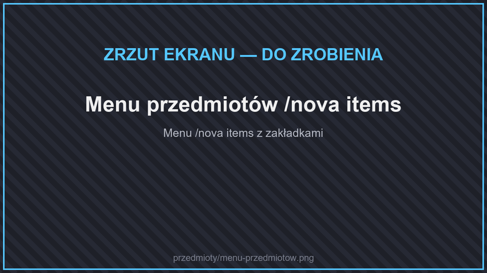
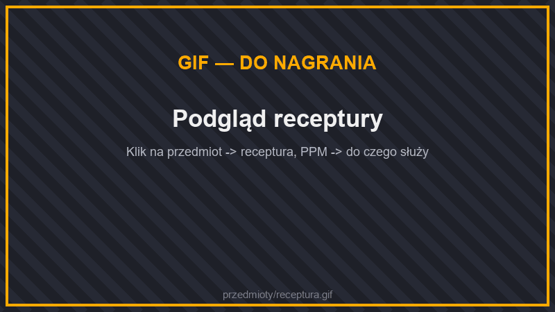
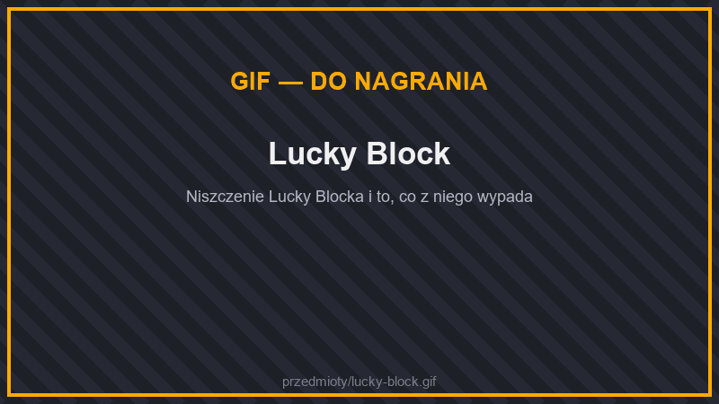

# ⚒️ Przedmioty

Na serwerze jest **ponad 5000 nowych przedmiotów i bloków**: rudy i zestawy ekwipunku, maszyny, większe skrzynie, szybsze piece, jedzenie, meble i bloki budowlane.

## Menu przedmiotów

<figure><figcaption>
Menu przedmiotów /nova items
</figcaption></figure>

<figure><figcaption>
Podgląd receptury
</figcaption></figure>

Wszystkie przedmioty przejrzysz w grze komendą **`/nova items`** albo w menu głównym (**`/menu`**) przyciskiem **Itemy**. Menu jest podzielone na zakładki jak w trybie kreatywnym:

| Zakładka | Co w niej jest |
| --- | --- |
| **Bloki budowlane** | Kamienie, cegły, dachy, drewno, płoty i mury |
| **Bloki naturalne** | Rudy, rośliny, liście, gleba |
| **Bloki funkcjonalne** | Meble, szafki, szuflady, talerze, nagrobki, pułapki, windy, Lucky Bloki |
| **Mechanizmy** | Maszyny, kable, piece, skrzynie, ulepszenia |
| **Narzędzia** | Narzędzia, młoty, wędki, przynęty, plecaki, plecaki odrzutowe, pojazdy |
| **Walka** | Broń, zbroje, totemy |
| **Jedzenie i napoje** | Potrawy i napoje |
| **Składniki** | Sztabki, pyły, części i materiały |

* **Kliknij** przedmiot — zobaczysz, **jak go stworzyć**.
* **Kliknij PPM** — zobaczysz, **do czego służy** (w jakich recepturach jest składnikiem).

### Opisy przedmiotów

Każdy przedmiot w menu ma **opis**. W widoku receptury, w prawym górnym rogu, jest książka **Opis** — najedź na nią kursorem, aby przeczytać, do czego służy przedmiot, skąd go zdobyć, ile głodu przywraca jedzenie albo ile miejsca ma schowek. Jeśli przedmiotu nie da się wytworzyć, po kliknięciu go w menu opis pojawi się na czacie.

## Kategorie

<table data-view="cards"><thead><tr><th></th><th></th><th data-hidden data-card-target data-type="content-ref"></th></tr></thead><tbody><tr><td><strong>⚔️ Ekwipunek</strong></td><td>Zestawy z rzadkich rud, zbroje z umiejętnościami, broń i totemy.</td><td><a href="ekwipunek/README.md">ekwipunek/README.md</a></td></tr><tr><td><strong>⚙️ Maszyny</strong></td><td>Generatory, przetwarzanie, farmy, wydobycie i logistyka.</td><td><a href="maszyny/README.md">maszyny/README.md</a></td></tr><tr><td><strong>📦 Przechowywanie</strong></td><td>Większe skrzynie, szuflady i plecaki.</td><td><a href="przechowywanie.md">przechowywanie.md</a></td></tr><tr><td><strong>🔥 Piece</strong></td><td>Piece od miedzianego do netherytowego.</td><td><a href="piece.md">piece.md</a></td></tr><tr><td><strong>🛠️ Narzędzia</strong></td><td>Młoty 3×3 i Stół Nasycania Zaklęć.</td><td><a href="narzedzia.md">narzedzia.md</a></td></tr><tr><td><strong>🎣 Wędkarstwo</strong></td><td>Nowe ryby, wędki, łowienie w lawie.</td><td><a href="wedkarstwo.md">wedkarstwo.md</a></td></tr><tr><td><strong>🚗 Podróże</strong></td><td>Jetpacki, pojazdy, windy, teleporty.</td><td><a href="pojazdy.md">pojazdy.md</a></td></tr><tr><td><strong>🪦 Groby</strong></td><td>Twoje rzeczy po śmierci.</td><td><a href="groby.md">groby.md</a></td></tr><tr><td><strong>🧱 Bloki budowlane</strong></td><td>Ponad tysiąc nowych bloków.</td><td><a href="bloki-budowlane.md">bloki-budowlane.md</a></td></tr><tr><td><strong>🪑 Meble</strong></td><td>Ponad 2400 mebli i dekoracji.</td><td><a href="meble.md">meble.md</a></td></tr><tr><td><strong>🧑‍🍳 Gotowanie</strong></td><td>Uprawy, kuchnia, potrawy i talerze.</td><td><a href="gotowanie.md">gotowanie.md</a></td></tr><tr><td><strong>🦋 Insekty</strong></td><td>Łapanie owadów.</td><td><a href="insekty.md">insekty.md</a></td></tr></tbody></table>

## Szybki przegląd

| Szukasz… | Zobacz |
| --- | --- |
| ekwipunku lepszego od diamentowego | [Zestawy z rzadkich rud](ekwipunek/zestawy-rud.md) |
| sposobu na automatyczną farmę | [Maszyny → Farmy](maszyny/farmy.md) |
| miejsca na tysiące przedmiotów | [Szuflady](przechowywanie.md#szuflady), [Jednostka Magazynowa](maszyny/logistyka.md#jednostki-magazynowe) |
| szybszego przetapiania | [Piece](piece.md), [Elektryczny Piec](maszyny/przetwarzanie.md#piec-elektryczny) |
| więcej sztabek z rud | [Rozdrabniacz](maszyny/przetwarzanie.md#rozdrabniacz) |
| konkretnych zaklęć | [Stół Nasycania Zaklęć](narzedzia.md#stol-nasycania-zaklec) |
| latania | [Plecaki odrzutowe](pojazdy.md#plecaki-odrzutowe) |
| mebli do domu | [Meble](meble.md) |
| ochrony przed śmiercią | [Totemy](ekwipunek/totemy.md), [Groby](groby.md) |

## Lucky Block

<figure><figcaption>
Lucky Block
</figcaption></figure>

Zniszcz **Lucky Blok**, aby sprawdzić swoje szczęście! Może wypaść coś cennego… albo coś bardzo niebezpiecznego: TNT, wrogie moby, pułapka. Czasem Lucky Blok zamieni się w inny rodzaj albo da ci dwa Lucky Bloki.

| Lucky Blok | Gdzie się pojawia | Jak stworzyć |
| --- | --- | --- |
| **Lucky Blok** | Świat Główny, na powierzchni i w jaskiniach | 8 sztabek złota wokół podajnika |
| **Dobry Lucky Blok** | Świat Główny | szmaragdy, podajnik, Lucky Blok |
| **Lucky Blok Łupów** | wszędzie, najczęściej pod ziemią | bloki złota, skrzynie, podajnik, Lucky Blok |
| **Lucky Blok Mobów** | Świat Główny (często pod ziemią), Nether | kości, nić, zgniłe mięso, proch, podajnik, Lucky Blok |
| **Lucky Blok Budowli** | Świat Główny | cegły, kamienne cegły, podajnik, Lucky Blok |
| **Niebezpieczny Lucky Blok** | Nether, End | TNT, płomienny proszek, podajnik, Lucky Blok |
| **Ostateczny Lucky Blok** | rzadko wszędzie, częściej w Endzie | bloki diamentów, gwiazda Netheru, odłamki netherytu, podajnik, Lucky Blok |

Lucky Bloki pojawiają się co jakiś czas **w pobliżu graczy** (dostaniesz wiadomość na czacie) oraz w okolicy spawnu. Niezniszczony Lucky Blok po pewnym czasie znika. Wszystkie rodzaje, przepisy i możliwe wyniki znajdziesz na stronie [Lucky Bloki](lucky-bloki.md).
