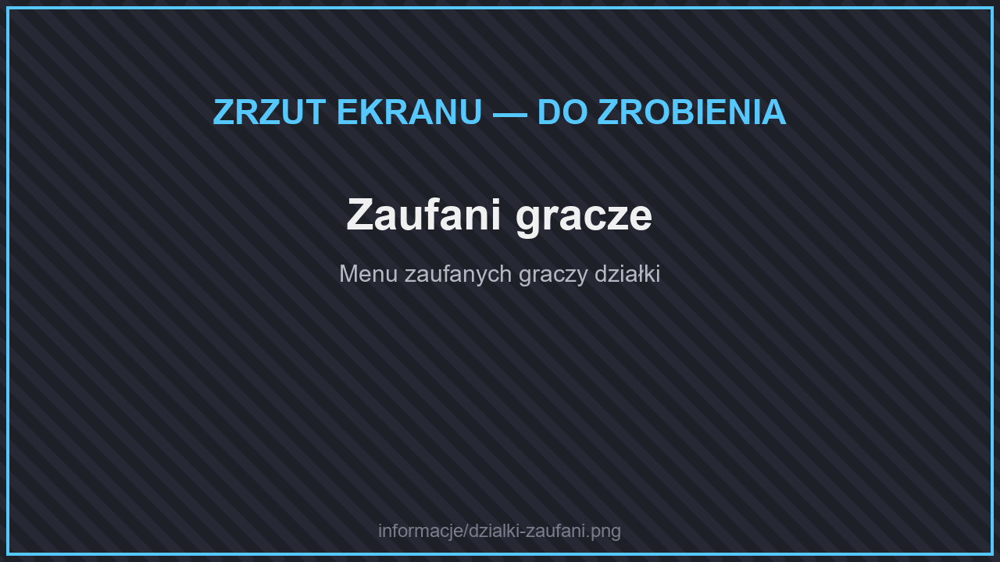

# 🏡 Działki

Działka to twoje chronione miejsce. Nikt poza tobą i zaufanymi graczami nie może na niej budować, niszczyć ani otwierać skrzyń.

## Zakładanie działki

<figure><figcaption>
Granice działki
</figcaption></figure>

1. Znajdź miejsce komendą **`/rtp`**.
2. Otwórz menu **`/dzialki`** i załóż działkę.
3. Kolejne chunki dołączysz, stojąc w nich i wpisując **`/dzialki claim`**.

Jedna działka może mieć **do 100 chunków**. Działki nie mają opłat za utrzymanie ani podatków.

## Ile działek możesz mieć?

| | Liczba działek |
| --- | --- |
| Bez rangi | 1 |
| VIP | 2 |
| SVIP | 3 |
| MVIP | 5 |

Dodatkowe działki odblokujesz też za pieniądze w menu ulepszeń. Kolejną działkę zakładasz komendą **`/dzialki create <nazwa>`**.

### Blok Przejęcia

<figure><figcaption>
Blok Przejęcia
</figcaption></figure>

Blok Przejęcia (300$ w menu ulepszeń) postawiony w dziczy graniczącej z twoją działką przejmuje ten chunk.

## Budowanie razem

<figure><figcaption>
Zaufani gracze
</figcaption></figure>

* **`/dzialki trust <gracz>`** — zaufany gracz może budować na twojej działce.
* **`/dzialki untrust <gracz>`** — usuwa zaufanie.
* Uprawnienia członków ustawisz w menu **`/dzialki`**.

## Ochrona

* Teren jest chroniony przed niszczeniem przez moby — **ale creepery nadal wybuchają!**
* Na swojej działce możesz włączyć **PvP**.
* Na działce możesz postawić **skrzynkowy sklep** — zobacz [Sklepy i Skupy](sklepy-i-skupy.md).
