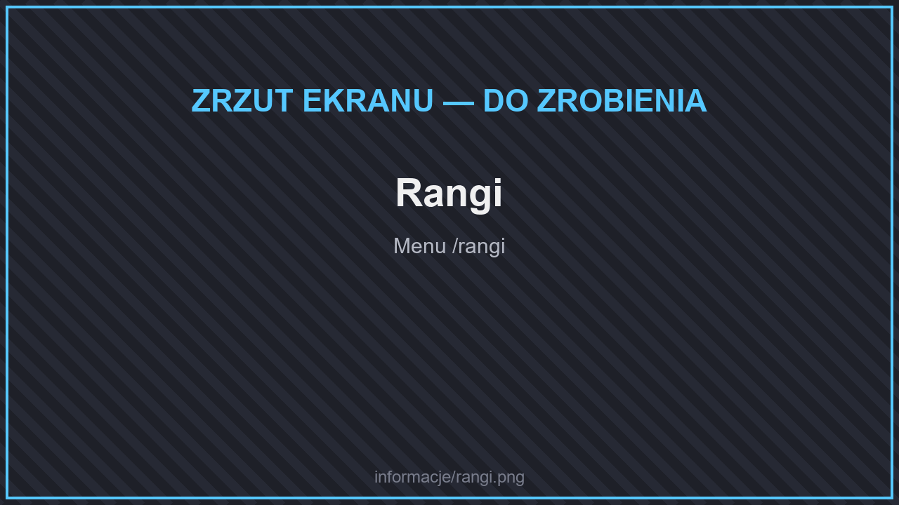

# ⭐ Rangi

Rangi kupisz za **kryształy** w sklepie premium (**`/sklep`** lub **`/rangi`**). Każda wyższa ranga ma wszystko to, co niższa. Posiadając niższą rangę, wyższą kupisz taniej — o wartość rangi, którą już masz.

* [VIP](vip.md) — **`/vip`**
* [SVIP](svip.md) — **`/svip`**
* [MVIP](mvip.md) — **`/evip`**

## Porównanie

<figure><figcaption>
Rangi
</figcaption></figure>

| | Bez rangi | VIP | SVIP | MVIP |
| --- | --- | --- | --- | --- |
| Działki | 1 | 2 | 3 | 5 |
| Domy | 2 | 3 | 4 | 3 |
| Zasięg `/rtp` | 5k × 5k | 6k × 6k | 8k × 8k | 10k × 10k |
| Jednoczesne aukcje | 8 | 12 | 15 | 20 |
| Sklepy na działce | 15 | 20 | 30 | 40 |
| Aktywne zadania | 3 | 5 | 7 | 9 |
| Poziom plecaka | — | 6 | 9 | maks. |
| Drop do ekwipunku | — | ✅ | ✅ | ✅ |
| `/craft` | — | ✅ | ✅ | ✅ |
| Strefa VIP | — | ✅ | ✅ | ✅ |
| Kanał na Discordzie | — | ✅ | ✅ | ✅ |
| Grawitacja drzew | — | — | ✅ | ✅ |
| `/enderchest` | — | — | ✅ | ✅ |
| `/kowadlo` | — | — | — | ✅ |
| `/naprawa` (raz dziennie) | — | — | — | ✅ |

## Klucze przy zakupie

Przy zakupie rangi dostajesz skrzynkę shulkera z kluczami:

| Klucz | VIP | SVIP | MVIP |
| --- | --- | --- | --- |
| Kamienny | 4 | 5 | 6 |
| Meblowy | 2 | 3 | 4 |
| Mityczny | 2 | 3 | 4 |
| Kosmetyczny | 1 | 1 | 2 |
| Legendarny | — | 1 | 2 |

## Lepsze dropy na strefie AFK

| Odłamek | Bez rangi | VIP | SVIP | MVIP |
| --- | --- | --- | --- | --- |
| Kamienny | 10% | 15% | 20% | 25% |
| Meblowy | 8% | 10% | 12% | 15% |
| Mityczny | 5% | 7.5% | 10% | 12.5% |
| Kosmetyczny | 1.2% | 1.5% | 2% | 2.5% |
| Legendarny | 1% | 1.2% | 1.5% | 2% |
