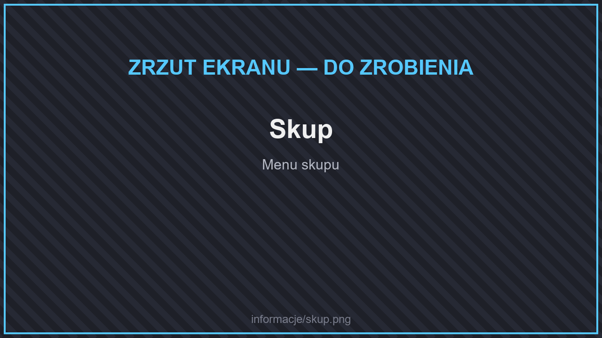
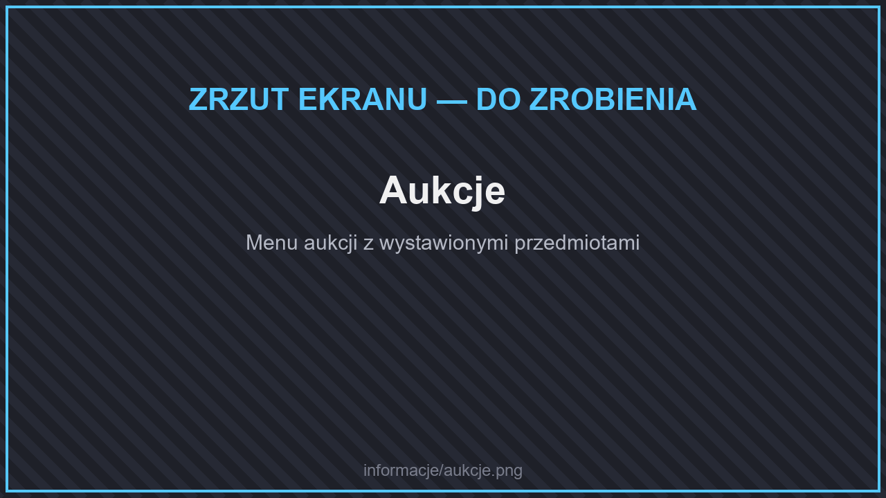

# 🛒 Sklepy i Skupy

## Skup

<figure><figcaption>
Skup
</figcaption></figure>

W skupie sprzedasz zebrane surowce za pieniądze. Skup otworzysz u handlarzy na spawnie. Na górnym pasku menu przełączasz kategorie:

| Kategoria | Co sprzedasz |
| --- | --- |
| **Surowce** | Rudy, sztabki, kamienie szlachetne i ich bloki — także rudy z nowych krain (wulkanit, kresum, topaz, enderyt i inne). |
| **Bloki** | Kamień, ziemia, piasek, drewno, bloki z Netheru i inne bloki budowlane. |
| **Drop z mobów** | Przedmioty z potworów i zwierząt, także trofea z nowych zwierząt. |
| **Hodowlane** | Plony, nasiona, sadzonki, kwiaty, grzyby i ryby z wędkarstwa. |
| **Szybki Skup** | Wrzuć do okna wszystko, co chcesz sprzedać — po zamknięciu menu przedmioty zostaną sprzedane. |

### Przykładowe ceny

| Przedmiot | Cena za sztukę |
| --- | --- |
| Bruk | 0,05$ |
| Kamień | 0,08$ |
| Pszenica | 0,3$ |
| Dębowy Pień | 1$ |
| Węgiel | 1$ |
| Ruda Żelaza | 2,5$ |
| Sztabka Żelaza | 3,5$ |
| Sztabka Złota | 5$ |
| Szmaragd | 6$ |
| Enderperła | 4$ |
| Diament | 40$ |
| Pradawne Zgliszcza | 150$ |
| Topaz | 160$ |
| Enderyt | 320$ |
| Sztabka Netherytu | 620$ |

Bloki surowców (np. Blok Diamentu) skupowane są dokładnie za 9 sztuk surowca, więc nie musisz ich rozbijać przed sprzedażą.


Ceny w skupie są **dynamiczne** — gdy gracze sprzedają dużo danego towaru, jego cena spada (maksymalnie o 25%), a z czasem sama wraca do normalnej wartości. Dzięki temu żaden surowiec nie jest stale najbardziej opłacalny.


## Aukcje

<figure><figcaption>
Aukcje
</figcaption></figure>

Aukcje to rynek tworzony przez graczy.

* **`/aukcje`** (albo **`/ah`**, albo kafelek **Aukcje** w menu głównym) — przeglądaj oferty innych graczy.
* **`/sprzedaj <cena>`** — wystaw na aukcję przedmiot trzymany w ręce.

## Sklepy na działce

<figure><figcaption>
Zakładanie sklepu skrzynkowego
</figcaption></figure>

Na swojej działce możesz postawić **skrzynkowy sklep**: kliknij skrzynię przedmiotem, który chcesz sprzedawać, wpisz cenę na czacie i włóż przedmioty do skrzyni.

## Wymiana

Bezpieczną wymianę z innym graczem zrobisz komendą **`/trade <gracz>`**.

## Sklep premium

W sklepie premium (**`/sklep`** albo kafelek **Sklep Premium** w menu głównym) kupisz za **Ogniste Kryształy** rangi, klucze do skrzyń i przywołanie piniaty. Zobacz [Rangi](rangi/) i [Skrzynie i Piniata](skrzynki.md).
