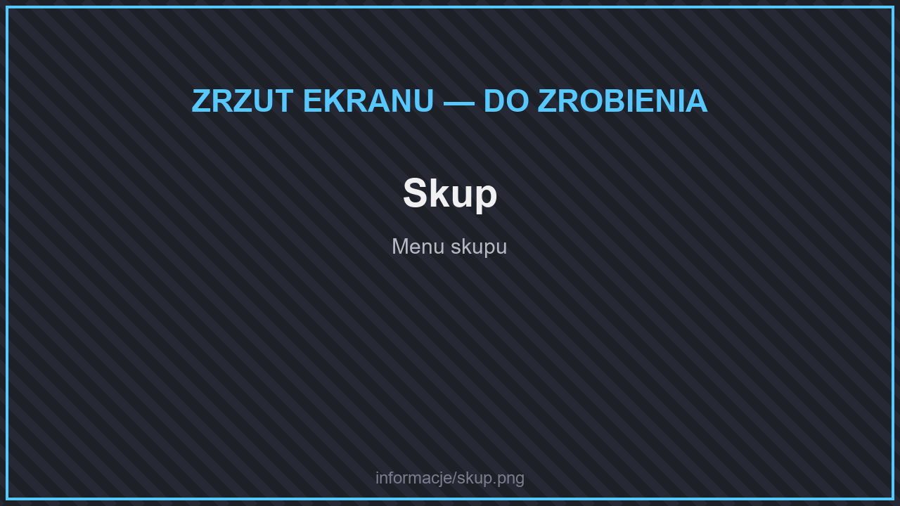
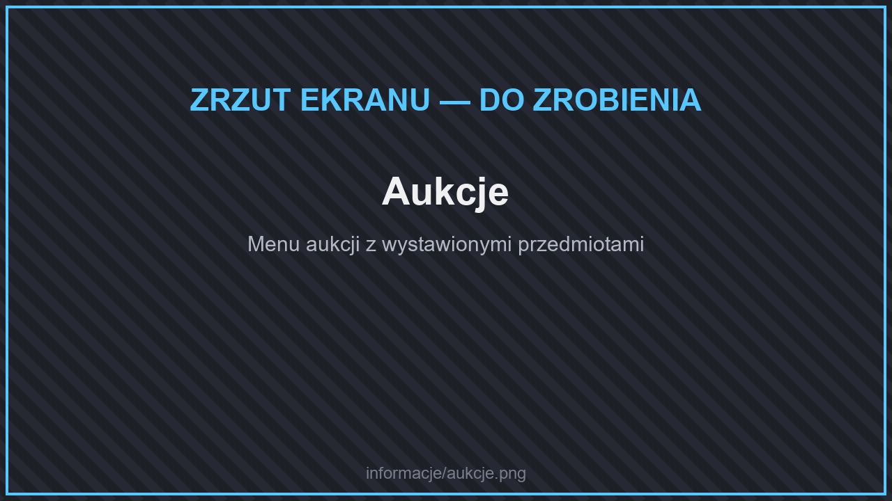

# 🛒 Sklepy i Skupy

## Skup

<figure><figcaption>
Skup
</figcaption></figure>

W skupie sprzedasz zebrane surowce za pieniądze. Jest podzielony na kategorie:

* **Surowce** (dwie strony),
* **Rośliny**,
* **Bloki**,
* **Przedmioty z potworów**.

### Dynamiczne ceny

Niektóre skupy mają **dynamiczne ceny** — zmieniają się w zależności od tego, ile danego towaru sprzedają gracze. Dzięki temu rynek sam się reguluje i żaden surowiec nie jest stale najbardziej opłacalny.

## Aukcje

<figure><figcaption>
Aukcje
</figcaption></figure>

Aukcje to rynek tworzony przez graczy.

* **`/aukcje`** — przeglądaj oferty innych graczy.
* **`/sprzedaj <cena>`** — wystaw na aukcję przedmiot trzymany w ręce.

| | Jednoczesne aukcje |
| --- | --- |
| Bez rangi | 8 |
| VIP | 12 |
| SVIP | 15 |
| MVIP | 20 |

## Sklepy na działce

<figure><figcaption>
Zakładanie sklepu skrzynkowego
</figcaption></figure>

Na swojej działce możesz postawić **skrzynkowy sklep**: kliknij skrzynię przedmiotem, który chcesz sprzedawać, wpisz cenę na czacie i włóż przedmioty do skrzyni.

| | Sklepy na działce |
| --- | --- |
| Bez rangi | 15 |
| VIP | 20 |
| SVIP | 30 |
| MVIP | 40 |

## Wymiana

Bezpieczną wymianę z innym graczem zrobisz komendą **`/wymiana <gracz>`**.

## Sklep premium

W sklepie premium (**`/sklep`**) kupisz za kryształy rangi, klucze i piniaty. Zobacz [Rangi](rangi/).
