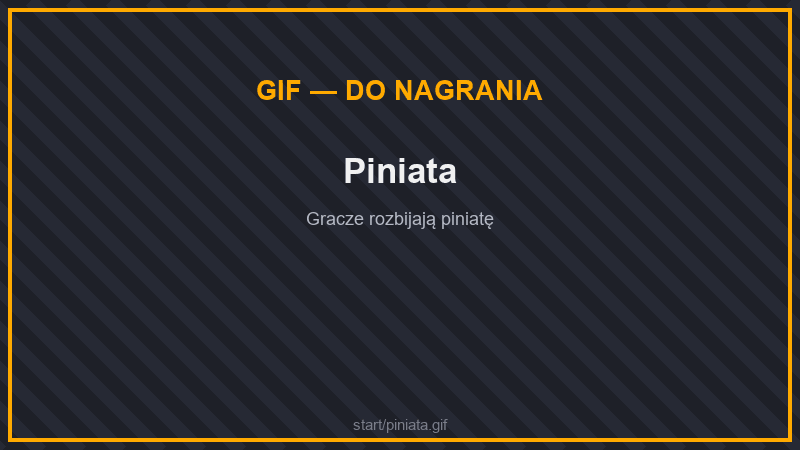

# 🎁 Skrzynie i Piniata

Na spawnie stoi sześć skrzyń. Każdą otwierasz jej własnym kluczem. Teleport do skrzyń: **`/skrzynie`**.

* **Prawy przycisk** na skrzyni z kluczem w ekwipunku — otwiera skrzynię.
* **Shift + prawy przycisk** — otwiera kilka skrzyń naraz.
* **Lewy przycisk** — podgląd nagród i ich szans.

Listę wszystkich skrzyń z podglądem nagród i liczbą twoich kluczy otworzysz też komendą **`/crate`**.

## Skrzynie

| Skrzynia | Klucz | Co w niej znajdziesz |
| --- | --- | --- |
| **Kamienna** | Kamienny Klucz | Podstawowe surowce, jedzenie, pieniądze i pierwsze klucze. |
| **Meblowa** | Meblowy Klucz | Meble i dekoracje do domu. |
| **Mityczna** | Mityczny Klucz | Diamenty, księgi, totemy, Lucky Bloki i ekwipunek z mobów. |
| **Eventowa** | Eventowy Klucz | Zwierzaki, Lucky Bloki i nagrody z eventów. |
| **Kosmetyczna** | Kosmetyczny Klucz | Czapki i maski do noszenia na głowie. |
| **Legendarna** | Legendarny Klucz | Najlepsze nagrody na serwerze. |

### Kamienna

* **Pieniądze:** 50$, 100$ albo 250$.
* **Surowce:** Sztabki Żelaza, Miedzi i Złota, Węgiel, Sproszkowany Redstone, Lazuryt, Diamenty (2), Szmaragdy (4).
* **Jedzenie i przydatne rzeczy:** Chleb, Pieczona Wołowina, Złote Marchewki, Pochodnie, Zaklęte Butelki, Złote Jabłka, Plakietka.
* **Zaklęte księgi:** Wydajność III, Niezniszczalność II, Ochrona II.
* **Rzadkie:** Lucky Blok, Kamienny Klucz, Meblowy Klucz, a nawet Mityczny Klucz.

### Meblowa

Ponad 70 mebli i dekoracji: krzesła, stołki, lampy, komody, łóżka, sofy, ławki parkowe, beczki, stosy książek i zwojów, skrzynki z narzędziami i wiele innych. Najrzadsze to m.in. **Kominek**, łóżko piętrowe i podwójne, **Globus**, **Kryształowa Kula** i **Pluszowy Rudy Lis**. Możesz też trafić Meblowy albo Mityczny Klucz.

### Mityczna

* **Pieniądze:** 500$, 1 000$ albo 2 500$.
* **Surowce:** Diamenty (6), Szmaragdy (16), bloki złota, żelaza i lazurytu, Zaklęte Butelki, Odłamek Netherytu.
* **Przedmioty:** Złote Jabłka, Zaklęte Złote Jabłko, Totem Nieśmiertelności, Shulkerowa Skrzynia.
* **Zaklęte księgi:** m.in. Naprawa, Niezniszczalność III, Wydajność IV, Ochrona III, Ostrość IV, Szczęście II, Łagodny Upadek IV, Moc IV.
* **Lucky Bloki:** Dobry Lucky Blok, Lucky Blok Łupów, Lucky Blok Mobów.
* **Ekwipunek z mobów:** Czapka Trapera, Hełm Okracznika, Hełm Mroźnego Łowcy, Marakas.
* **Totemy:** Wybuchowy, Upiorny i Teleportujący Totem Nieśmiertelności.
* **Klucze:** 2× Kamienny, Eventowy, Kosmetyczny, a bardzo rzadko Legendarny.

### Eventowa

* **Zwierzaki:** jaja spawnu wilka, kota, papugi, aksolotla, lisa, królika, żaby i pancernika oraz Jajo Niuchacza.
* **Lucky Bloki** wszystkich rodzajów — aż do Ostatecznego Lucky Bloka.
* **Pieniądze:** 1 000$ albo 2 500$.
* **Inne:** fajerwerki, ciasto, ciastka, Pluszowy Rudy Lis, Serce Oceanu, Trójząb, płyty muzyczne, Zaklęte Złote Jabłko, Totem Nieśmiertelności.
* **Klucze:** Mityczny, Kosmetyczny i (bardzo rzadko) Legendarny.

### Kosmetyczna

Ponad 60 czapek i masek: kapelusze, okulary, słuchawki, wąsy, kaptury ze skór zwierząt i wiele innych. Najrzadsze to m.in. **Korona**, **Kapelusz ze Skóry Smoka Endu**, **Legendarny Kaptur Kozy**, **Czapka Yeti** i **Przebranie Mikołaja**. Możesz też trafić kolejny Kosmetyczny Klucz.

### Legendarna

* **Pieniądze:** 5 000$, 10 000$ albo 25 000$.
* **Surowce:** Sztabka Netherytu, Odłamki Netherytu, bloki diamentów i szmaragdów, 64 Zaklęte Butelki, Sztabka Perłytu.
* **Przedmioty:** Zaklęte Złote Jabłka, Totemy Nieśmiertelności, Shulkerowe Skrzynie, Elytry, Netherowa Gwiazda, Magiczna Latarnia, Ciężki Rdzeń, Trójząb, Perłytowy Miecz.
* **Zaklęte księgi:** Naprawa, Ochrona IV, Ostrość V, Wydajność V, Niezniszczalność III, Szczęście III, Grabież III, Jedwabny Dotyk.
* **Lucky Bloki:** Lucky Blok Budowli, Niebezpieczny Lucky Blok, Ostateczny Lucky Blok.
* **Zbroje z mobów:** Krokodyli Napierśnik, Skalisty Napierśnik.
* **Totemy:** wszystkie siedem specjalnych Totemów Nieśmiertelności.
* **Klucze:** 3× Mityczny, Kosmetyczny, Legendarny.


Dokładne szanse na każdą nagrodę zobaczysz w podglądzie skrzyni (lewy przycisk albo **`/crate`**).


## Jak zdobyć klucze?

### Kuźnia kluczy

Klucze złożysz z **odłamków kluczy** u barmana w kuźni kluczy:

* **9 odłamków** danego rodzaju = **1 klucz**,
* **2 odłamki** = 1 odłamek następnego rodzaju,
* Kamienny Odłamek zrobisz z **64 bruku**.

Kolejność odłamków: Kamienny → Meblowy → Mityczny → Eventowy → Kosmetyczny → Legendarny.

Odłamki kluczy zdobędziesz:

* na **strefie AFK** (**`/strefaafk`**) — zobacz [Ekonomia i rozwój](../jak-grac/your-first-project.md#strefa-afk),
* z **piniaty**,
* w **grach na czacie** — kto pierwszy odpowie, dostaje odłamek i 10 Ognistych Kryształów.

### Sklep premium

W sklepie premium (**`/sklep`** → Klucze) kupisz klucze za **Ogniste Kryształy**:

| Klucz | 1 sztuka | 3 sztuki | 5 sztuk |
| --- | --- | --- | --- |
| Kamienny | 190 | 325 | 620 |
| Meblowy | 250 | 420 | 750 |
| Mityczny | 320 | 540 | 1 140 |
| Kosmetyczny | 500 | 1 200 | 2 000 |
| Legendarny | 800 | 1 800 | 3 000 |

### Inne sposoby

* Klucze wypadają z **piniaty** i z innych **skrzyń**.
* Za zakup **rangi** dostajesz skrzynkę shulkera z kluczami — zobacz [Rangi](rangi/).
* Klucze są też nagrodą w **eventach** na serwerze.

## Piniata

<figure><figcaption>
Piniata
</figcaption></figure>

Piniata pojawia się na spawnie (**`/warp piniata`**). Bijcie ją razem, aż pęknie!

Kiedy się pojawia?

* **W każdą sobotę o 20:00** — 10 minut wcześniej na czacie pojawi się ostrzeżenie.
* Gdy gracze zbiorą **50 punktów** z głosowania na serwer na listach serwerów (linki pod **`/linki`**).
* Brakujące punkty możesz dopełnić w sklepie premium — natychmiastowe przywołanie piniaty kosztuje **25 Ognistych Kryształów** za każdy brakujący punkt.

### Nagrody z piniaty

* Każde uderzenie ma **4% szansy** na mały łup: ciastka, słodycze, Złote Marchewki, Bryłki Złota, 10$, Kamienny albo Eventowy Odłamek, a nawet klucz.
* Gdy piniata pęknie, **każdy gracz** dostaje od 12 do 20 przedmiotów: słodycze i desery, Złote Jabłka, Szmaragdy, Diamenty, Zaklęte Butelki, pieniądze (do 500$), odłamki kluczy wszystkich rodzajów, klucze, Lucky Bloki (nawet Ostateczny) i czapki kosmetyczne.


Za rozbicie piniaty są też [osiągnięcia](osiagniecia.md) i [Zadanie Specjalne](zadania.md#zadania-specjalne).

