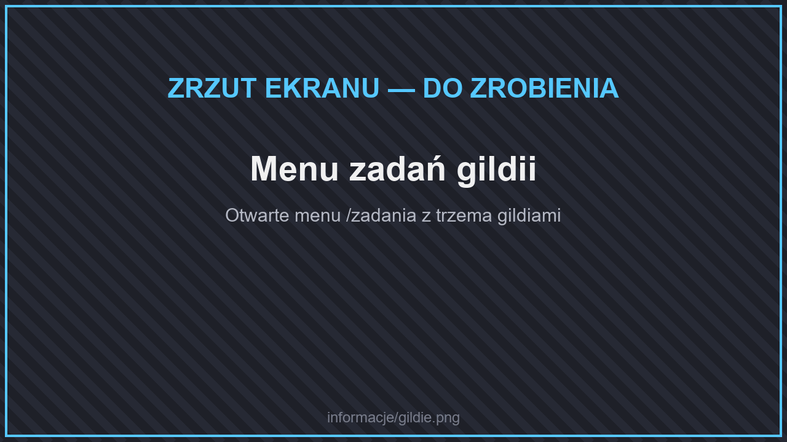

# 📑 Zadania

Na serwerze są dwa rodzaje zadań:

* **Ogólne zadania** — ponad 1700 zadań w 19 kategoriach, w tym **Zadania z Wypraw** i **Zadania Specjalne**. Otworzysz je kafelkiem **Zadania** w menu głównym (**`/menu`**) albo komendą **`/quests`**.
* **Dzienne zadania gildii** — codziennie nowe zadania od trzech gildii. Otworzysz je kafelkiem **Dzienne zadania** na dolnym pasku menu głównego.

Komenda **`/zadania`** otwiera menu z wyborem: dzienne zadania albo ogólne zadania.

## Ogólne zadania

Wybierz kategorię, kliknij zadanie, aby je rozpocząć, i wykonuj je podczas zwykłej gry. Za każde ukończone zadanie dostajesz **pieniądze** — od kilkudziesięciu $ za proste zadania do **30 000$** za Niemożliwe Zadania. Zadania z EXP dają doświadczenie.

| Kategorie | |
| --- | --- |
| ⛏️ Górnictwo, Kopanie, Rąbanie Drewna | Wydobywanie bloków, rud i drewna. |
| 🌾 Uprawy, Aktywności, Łowienie | Zbieranie plonów, zwierzęta, wędkowanie. |
| ⚔️ Łowca | Zabijanie potworów. |
| 🧰 Zbieranie, Rzemiosło, Topienie, Kowalstwo Broni | Zdobywanie i tworzenie przedmiotów. |
| 🧱 Budowanie | Stawianie bloków. |
| ✨ Zaklinanie, Warzenie, EXP | Zaklęcia, mikstury i doświadczenie. |
| 🎲 Różne Zadania | Nietypowe wyzwania. |
| 💀 Niemożliwe Zadania | Ogromne wyzwania z największymi nagrodami. |
| 🧭 Zadania z Wypraw | Nowe potwory, trofea, Lucky Bloki i ryby — zobacz niżej. |
| 🔧 Zadania Specjalne | Maszyny, kuchnia, wędkarstwo, fotografia i inne mechaniki serwera — zobacz niżej. |

### Limit aktywnych zadań

| | Aktywne zadania naraz |
| --- | --- |
| Bez rangi | 4 |
| VIP | 5 |
| SVIP | 7 |
| MVIP | 9 |

Rozpoczęte zadanie możesz anulować albo śledzić jego postęp.

### Zadania z Wypraw

Zadania z Wypraw to jednorazowe zadania związane z nowymi potworami, trofeami i wydarzeniami. Niektóre odblokowują się dopiero po ukończeniu poprzedniego.

| Zadanie | Cel | Nagroda |
| --- | --- | --- |
| Mroźne polowanie | Pokonaj 10 lodowych zombie (zaśnieżone biomy) | 250$ |
| Kobolty z mrocznego lasu | Pokonaj 8 koboltów | 250$ |
| Pustynne pająki | Pokonaj 6 pustynnych pająków (pustynia) | 250$ |
| Czarne pająki | Pokonaj 10 czarnych pająków (mroczny las) | 200$ |
| Nieumarli górnicy | Pokonaj 5 nieumarłych górników (głęboko pod ziemią) | 300$ |
| Ogon szopa | Zdobądź ogon szopa | 300$ |
| Czapka trapera | Zrób Czapkę Trapera | 500$ |
| Krokodyle łuski | Zbierz 7 łusek krokodyla (bagna) | 600$ |
| Krokodyli napierśnik | Zrób Krokodyli Napierśnik | 1 000$ |
| Hełm mroźnego łowcy | Zrób Hełm Mroźnego Łowcy | 800$ |
| Marakas | Zrób Marakas z grzechotki grzechotnika | 400$ |
| Szczęściarz | Otwórz 5 Lucky Bloków | 200$ |
| Lepsze szczęście | Otwórz 3 dobre, łupowe albo mobowe Lucky Bloki | 500$ |
| Ostateczne szczęście | Otwórz Ostateczny Lucky Blok | 1 500$ |
| Nowe łowiska | Złów 10 ryb z wędkarstwa | 200$ |
| Mistrz wędkarstwa | Złów 25 ryb z wędkarstwa | 600$ |
| Boss tygodnia | Pokonaj bossa tygodnia (piątek 20:00) | 3 000$ |

### Zadania Specjalne

Zadania Specjalne uczą nowych mechanik serwera. Każde wykonasz raz.

| Dziedzina | Zadania | Nagrody |
| --- | --- | --- |
| ⚙️ [Maszyny](../dodatki/maszyny/) | Pierwsza Maszyna, Zielona Energia (panel słoneczny albo turbina wiatrowa), Sieć Kabli, Plecak Odrzutowy, Porządek w Magazynie (4 szuflady) | 300$–1 500$ |
| 🧑‍🍳 [Gotowanie](../dodatki/gotowanie.md) | Kuchenny Nóż, Na Desce do Krojenia, Gotowanie w Garnku, Nowe Żniwa, Stół Biesiadny (wystaw 5 potraw) | 100$–500$ |
| 🎣 [Wędkarstwo](../dodatki/wedkarstwo.md) | Rzadki Połów (5 rzadkich ryb), Legendarny Połów | 800$, 1 500$ |
| 🏃 [Umiejętności](umiejetnosci.md) | Wszechstronny (50 poziomów), Mistrz Umiejętności (150 poziomów) | 600$, 2 500$ |
| 🪅 Wydarzenia | Pogromca Piniaty, Golem Doświadczenia | 500$, 1 000$ |
| 🍀 Lucky Bloki | Budowlane Szczęście, Niebezpieczne Szczęście | 600$, 800$ |
| 📷 Fotografia | Pierwsze Zdjęcia (3), Fotoreporter (15) | 200$, 800$ |
| 🛡️ Ekwipunek z mobów | Skalista Zbroja, Ognioodporny Hełm | 1 000$ każde |
| 🏡 [Działki](dzialki.md) | Własny Kawałek Ziemi (4 chunki), Wielka Posiadłość (16 chunków) | 200$, 800$ |
| 🛒 [Skup](sklepy-i-skupy.md) | Pierwszy Handel (256 przedmiotów), Hurtownik (2048 przedmiotów) | 200$, 1 000$ |
| 🎁 [Skrzynie](skrzynki.md) | Otwieracz Skrzynek (3), Kolekcjoner Skrzynek (15) | 200$, 1 000$ |
| 🪑 [Meble](../dodatki/meble.md) | Urządzanie Domu (10 mebli), Domowe Spa (wanna) | 200$, 300$ |


Ukończone Zadania z Wypraw liczą się też do [osiągnięć](osiagniecia.md) Wyprawowicz I–III.


## Dzienne zadania gildii

<figure><figcaption>
Menu zadań gildii
</figcaption></figure>

Na serwerze są trzy gildie. Wykonując ich zadania, zdobywasz **pieniądze** i **reputację**.

| Gildia | Czym się zajmuje |
| --- | --- |
| ⚔️ **Wojownicy** | Zabijanie potworów, lochy i walki z bossami. |
| ⛏️ **Górnicy** | Wydobywanie poszukiwanych surowców, eksploracja jaskiń i kopalni. |
| 🌾 **Farmerzy** | Uprawy, hodowla i polowanie na zwierzęta. |

Każda gildia ma codziennie trzy zadania: **łatwe**, **średnie** i **trudne**. Im trudniejsze zadanie, tym większa nagroda:

| Zadanie | Wojownicy i Górnicy | Farmerzy |
| --- | --- | --- |
| Łatwe | 100–200$ | 80–140$ |
| Średnie | 400–600$ | 180–240$ |
| Trudne | 1 000–1 200$ | 800–1 200$ |


Zadania gildii resetują się **codziennie o 4:00 rano**.


### Reputacja

Co **5 poziomów reputacji** w każdej gildii dostajesz specjalną nagrodę.

## Lochy i bossowie

Lochy i areny bossów znajdziesz pod **`/warp`**. Bossowie są wyjątkowo silni — przyda ci się dobry ekwipunek, zaklęcia i mikstury. W każdy piątek o 20:00 pojawia się też [boss tygodnia](osiagniecia.md#boss-tygodnia).
