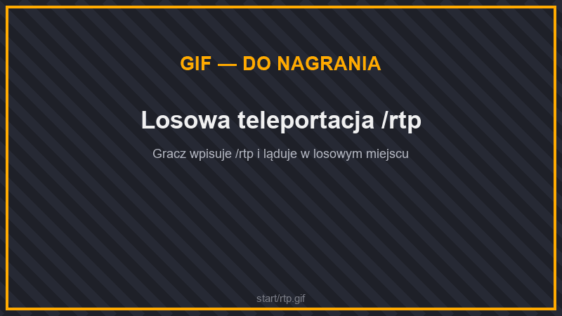
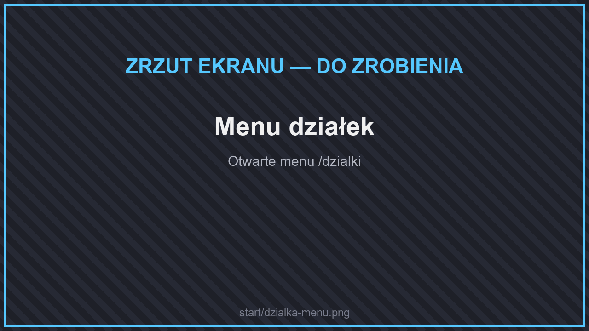
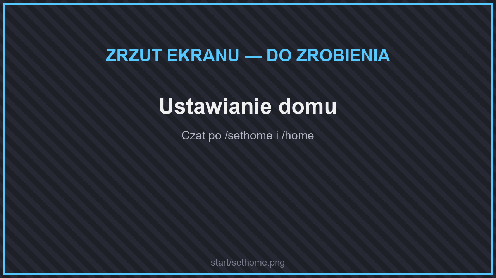
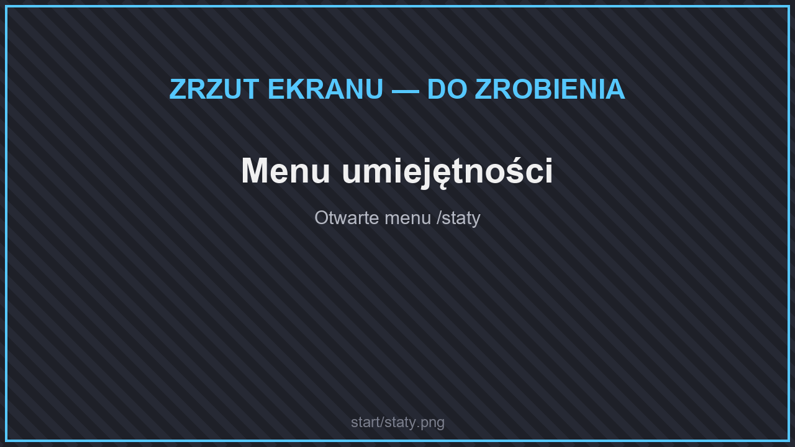
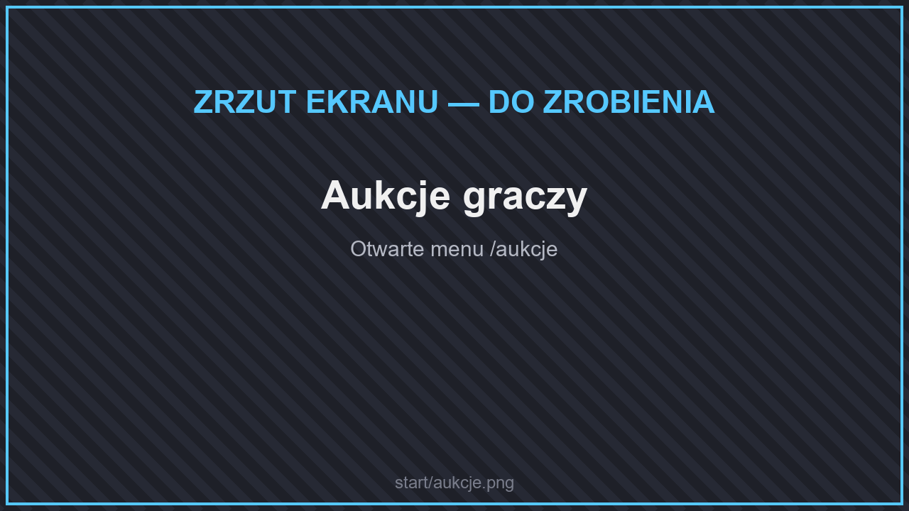

# Pierwsze kroki


Wszystkie najważniejsze rzeczy otworzysz z **menu głównego** — wpisz **`/menu`**. Opis wszystkich kafelków znajdziesz w [Komendach](quickstart.md).


## 1. Znajdź swoje miejsce

<figure><figcaption>
Losowa teleportacja /rtp
</figcaption></figure>

Na spawnie nie da się budować. Użyj komendy **`/rtp`**, aby przenieść się w losowe miejsce na mapie survivalowej. Zasięg losowej teleportacji to 5000 × 5000 kratek (więcej z rangami [VIP+](../informacje/rangi/)).

## 2. Załóż działkę

<figure><figcaption>
Menu działek
</figcaption></figure>

Gdy znajdziesz dobre miejsce, otwórz menu **`/dzialki`** i załóż działkę. Tylko ty i zaufani gracze będziecie mogli tam budować i otwierać skrzynie. Kolejne chunki dołączysz, stojąc w nich i wpisując **`/dzialki claim`**. Pierwsze 16 chunków jest za darmo.

Więcej: [Działki](../informacje/dzialki.md).

## 3. Ustaw dom

<figure><figcaption>
Ustawianie domu
</figcaption></figure>

Wpisz **`/sethome`**, aby zapisać swój dom, i **`/home`**, aby do niego wrócić. Więcej domów odblokujesz ulepszeniami za pieniądze lub rangą VIP+.

## 4. Rozwijaj postać

<figure><figcaption>
Menu umiejętności
</figcaption></figure>

* Wszystko, co robisz — kopanie, walka, farmienie, łowienie — daje doświadczenie [umiejętności](../informacje/umiejetnosci.md) (**`/staty`**).
* Wykonuj [zadania](../informacje/zadania.md) — ogólne zadania (**`/quests`**) i codzienne zadania gildii — aby zarabiać pieniądze i reputację.
* Zdobywaj [osiągnięcia](../informacje/osiagniecia.md) (**`/osiagniecia`**) — za każde dostajesz pieniądze, a za niektóre tytuł przy nicku.
* Szukaj [rzadkich rud](../dodatki/ekwipunek/zestawy-rud.md) — z nich stworzysz ekwipunek lepszy od diamentowego.

## 5. Zarabiaj

<figure><figcaption>
Aukcje graczy
</figcaption></figure>

Surowce sprzedasz w **skupie**, a przedmioty innym graczom na **aukcjach** (`/aukcje`, `/sprzedaj`) albo w skrzynkowym sklepie na swojej działce. Więcej: [Sklepy i Skupy](../informacje/sklepy-i-skupy.md).

## 6. Bierz udział w wydarzeniach

W każdy piątek o 20:00 pojawia się **boss tygodnia**, w sobotę o 20:00 na spawnie czeka **piniata**, a w weekendy od 16:00 do 22:00 trwają **łowy na Lucky Bloki**. Terminy sprawdzisz komendą **`/wydarzenia`**. Więcej: [Osiągnięcia i Wydarzenia](../informacje/osiagniecia.md#wydarzenia).


Zanim zaczniesz, przeczytaj **`/regulamin`**. Nieprzestrzeganie zasad skutkuje karą.


## Co dalej?

* [Komendy](quickstart.md) — menu główne i lista najważniejszych komend.
* [Ekonomia i rozwój](your-first-project.md) — pieniądze, plecak, ulepszenia, klucze, piniata, strefa AFK.
* [Skrzynie i Piniata](../informacje/skrzynki.md) — co jest w skrzyniach i jak zdobyć klucze.
