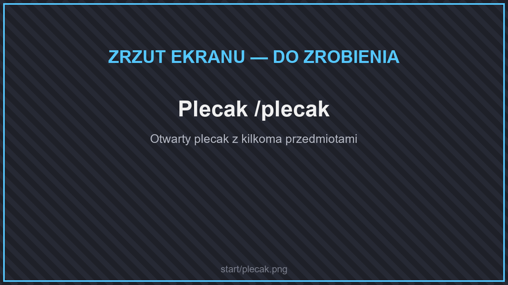
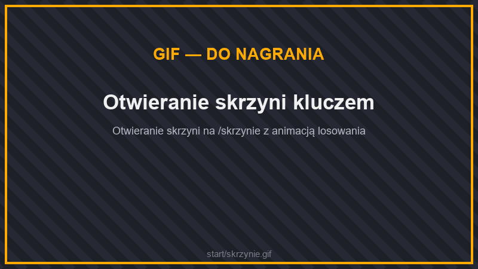
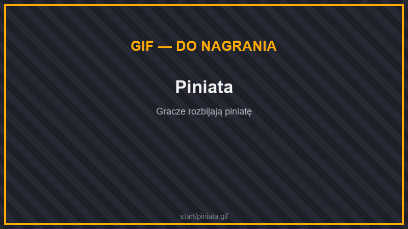
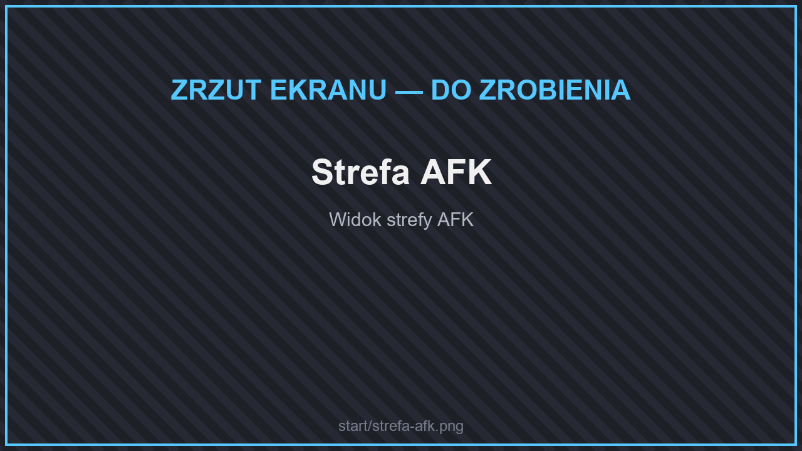
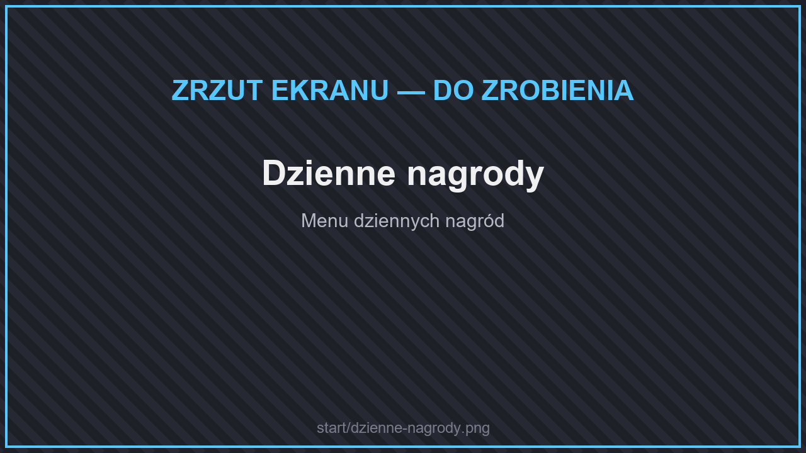

# Ekonomia i rozwój

## Waluty

* **Pieniądze ($)** — zaczynasz z pustym kontem. Zarabiasz, sprzedając surowce w skupie, wykonując zadania i osiągnięcia oraz handlując z graczami. Wydajesz na działki, domy, ulepszenia plecaka i zakupy od innych graczy. Stan konta: **`/bal`**.
* **Ogniste Kryształy** — waluta premium. Kupisz za nie rangi VIP+, klucze i przywołanie piniaty (**`/sklep`**). Zdobędziesz je w sklepie internetowym serwera, podczas eventów i w grach na czacie.

## Jak zarabiać?

| Źródło | Ile |
| --- | --- |
| [Skup](../informacje/sklepy-i-skupy.md) | Np. Sztabka Żelaza 3,5$, Diament 40$, Pradawne Zgliszcza 150$, Sztabka Netherytu 620$. |
| [Dzienne zadania gildii](../informacje/zadania.md#dzienne-zadania-gildii) | Codziennie 3 zadania w każdej z 3 gildii: od 80$ do 1 200$ za zadanie. |
| [Ogólne zadania](../informacje/zadania.md#ogolne-zadania) | Od kilkudziesięciu $ do 30 000$ za Niemożliwe Zadania. |
| [Zadania z Wypraw](../informacje/zadania.md#zadania-z-wypraw) i [Zadania Specjalne](../informacje/zadania.md#zadania-specjalne) | Od 100$ do 3 000$ za zadanie. |
| [Osiągnięcia](../informacje/osiagniecia.md) | Od 100$ do 15 000$ za osiągnięcie. |
| [Skrzynie](../informacje/skrzynki.md) i piniata | Pieniądze, surowce i rzadkie przedmioty. |
| [Aukcje](../informacje/sklepy-i-skupy.md#aukcje) i sklepy na działce | Sprzedaż przedmiotów innym graczom. |

## Na co wydawać?

Ulepszenia kupisz u NPC na spawnie.

### Działki

* Pierwsze **16 chunków** dołączysz za darmo. Każdy kolejny chunk kosztuje **25$**, a cena rośnie o 2$ z każdym następnym (maksymalnie 300$ za chunk).
* **Kolejne działki** odblokujesz w menu ulepszeń działek:

| Ulepszenie | Koszt |
| --- | --- |
| Działki I (druga działka) | 1 500$ |
| Działki II | 3 000$ |
| Działki III | 6 000$ |
| Działki IV | 12 000$ |
| Działki V | 20 000$ |
| Działki VI | 30 000$ |
| Działki VII | 45 000$ |

* **Blok Przejęcia** (500$) — postawiony w dziczy graniczącej z twoją działką przejmuje ten chunk.

### Domy

Bez rangi masz 2 domy. Trzeci dom kosztuje **300$**, a każdy kolejny (aż do 9.) — **800$**.

### Plecak

<figure><figcaption>
Plecak /plecak
</figcaption></figure>

Plecak (**`/plecak`**) to dodatkowe miejsce na przedmioty. Jego zawartość **nie wypada po śmierci**. Możesz w nim trzymać także pieniądze.

Każdy poziom plecaka dodaje miejsca. Poziom II kosztuje **300$**, poziom III — **800$**, a każdy kolejny — **5 000$**. Rangi dają darmowe ulepszenia: VIP do poziomu 6, SVIP do 9, MVIP do maksimum.


To coś innego niż [plecaki podróżnika](../dodatki/przechowywanie.md#plecaki-podroznika), które nosisz jako przedmiot.


### Rangi

Rangi VIP, SVIP i MVIP kupisz za Ogniste Kryształy (2 200 / 5 500 / 11 500). Zobacz [Rangi](../informacje/rangi/).

## Skrzynie i klucze

<figure><figcaption>
Otwieranie skrzyni kluczem
</figcaption></figure>

Na spawnie (**`/skrzynie`**) stoją skrzynie: Kamienna, Meblowa, Mityczna, Eventowa, Kosmetyczna i Legendarna. Otwierasz je kluczami.

Klucze zdobędziesz na kilka sposobów:

* złożysz z **odłamków kluczy** w kuźni kluczy (9 odłamków = 1 klucz),
* kupisz za Ogniste Kryształy w sklepie premium,
* wypadną z piniaty i z innych skrzyń,
* dostaniesz w zestawie przy zakupie rangi.

Odłamki kluczy wypadają z **piniaty**, na **strefie AFK** i w **grach na czacie**. Więcej: [Skrzynie i Piniata](../informacje/skrzynki.md).

## Piniata

<figure><figcaption>
Piniata
</figcaption></figure>

Piniata pojawia się na spawnie **w każdą sobotę o 20:00** oraz gdy gracze zbiorą 50 punktów z głosowania na serwer na listach serwerów (wszystkie są pod **`/linki`**). Rozbij ją razem z innymi graczami — wypadną z niej słodycze, pieniądze, odłamki kluczy, klucze i Lucky Bloki. Więcej: [Piniata](../informacje/skrzynki.md#piniata).

## Strefa AFK

<figure><figcaption>
Strefa AFK
</figcaption></figure>

Na strefie AFK (**`/strefaafk`**) co **10 minut** masz szansę na odłamek klucza:

| Odłamek | Bez rangi | VIP | SVIP | MVIP |
| --- | --- | --- | --- | --- |
| Kamienny | 10% | 15% | 20% | 25% |
| Meblowy | 8% | 10% | 12% | 15% |
| Mityczny | 5% | 7.5% | 10% | 12.5% |
| Kosmetyczny | 1.2% | 1.5% | 2% | 2.5% |
| Legendarny | 1% | 1.2% | 1.5% | 2% |

## Dzienne nagrody

<figure><figcaption>
Dzienne nagrody
</figcaption></figure>

Odbieraj nagrody za codzienne logowanie — komenda **`/daily`** albo przycisk **Dzienne Nagrody** w menu głównym. Im dłuższa seria, tym lepsze nagrody.
