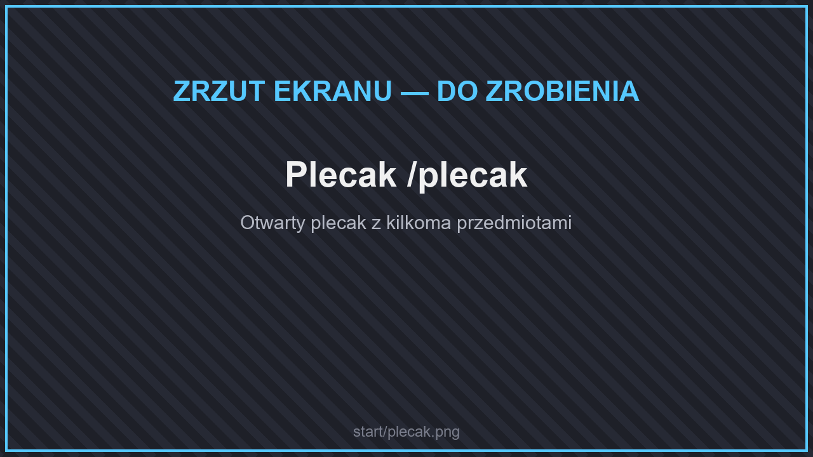
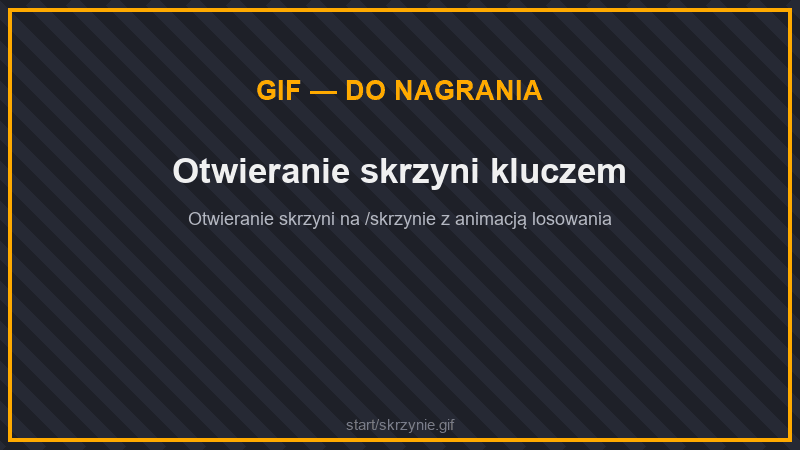
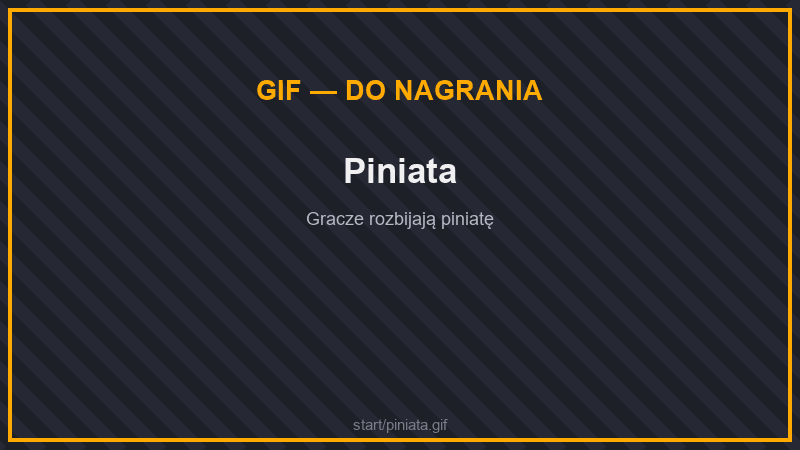
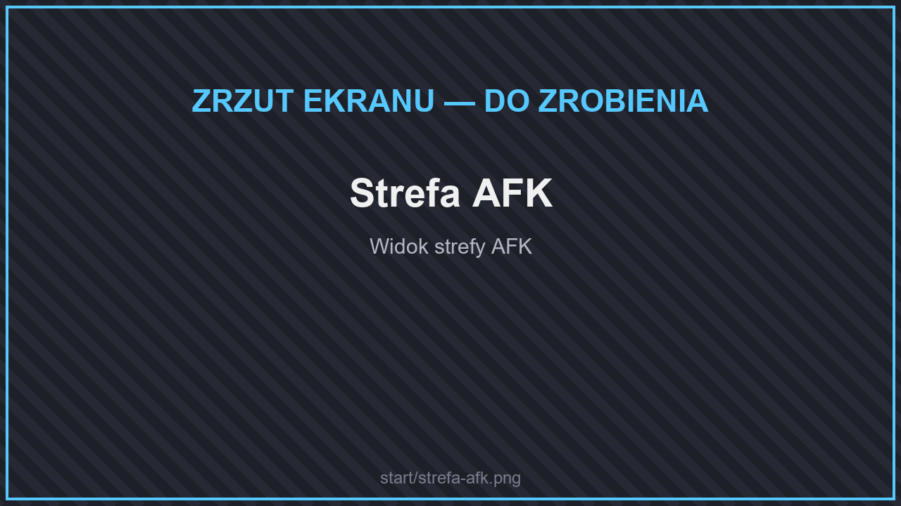
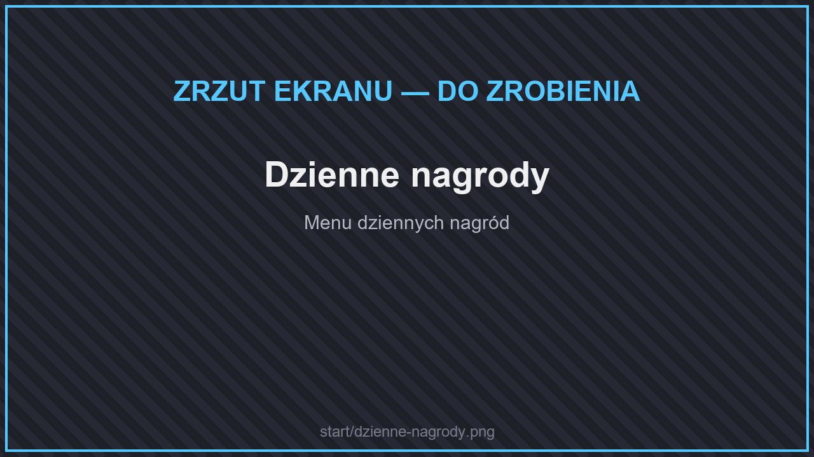

# Ekonomia i rozwój

## Waluty

* **Pieniądze ($)** — zarabiasz je, sprzedając surowce w skupie, wykonując zadania gildii i handlując z graczami. Wydajesz na ulepszenia plecaka, działek i domów.
* **Kryształy** — waluta premium. Kupisz za nie rangi VIP+, klucze i piniaty. Zdobędziesz je podczas eventów albo w sklepie internetowym.

## Plecak

<figure><figcaption>
Plecak /plecak
</figcaption></figure>

Plecak (**`/plecak`**) to dodatkowe miejsce na przedmioty. Jego zawartość **nie wypada po śmierci**. Możesz w nim trzymać także pieniądze.

Plecak ulepszasz u NPC na spawnie — każdy poziom dodaje miejsca. Ulepszenia kosztują od 300$ (poziom II) do kilkudziesięciu tysięcy $ za najwyższe poziomy. Rangi dają darmowe ulepszenia: VIP do poziomu 6, SVIP do 9, MVIP do maksimum.


To coś innego niż [plecaki podróżnika](../dodatki/przechowywanie.md#plecaki-podroznika), które nosisz jako przedmiot.


## Ulepszenia

W menu ulepszeń kupisz za pieniądze:

* **kolejne działki**,
* **kolejne domy**,
* **Blok Przejęcia** (300$) — postawiony w dziczy przy twojej działce przejmuje ten chunk.

## Skrzynie i klucze

<figure><figcaption>
Otwieranie skrzyni kluczem
</figcaption></figure>

Na spawnie (**`/skrzynie`**) stoją skrzynie: zwykła, rzadka, legendarna, meblowa, kosmetyczna i ze zwierzakami. Otwierasz je kluczami.

Klucze zdobędziesz na kilka sposobów:

* kupisz za kryształy w sklepie premium,
* połączysz **odłamki kluczy** u barmana w kuźni kluczy,
* dostaniesz w zestawie przy zakupie rangi.

Odłamki kluczy wypadają z **piniaty** i na **strefie AFK**.

## Piniata

<figure><figcaption>
Piniata
</figcaption></figure>

Piniatę przywołuje się, głosując na serwer na stronach z listami serwerów (wszystkie są pod **`/linki`**). Gdy się pojawi, rozbij ją razem z innymi graczami — wypadną z niej odłamki kluczy i inne nagrody.

## Strefa AFK

<figure><figcaption>
Strefa AFK
</figcaption></figure>

Na strefie AFK (**`/strefaafk`**) co jakiś czas dostajesz odłamki kluczy i losowe przedmioty. Szanse na odłamki:

| Odłamek | Bez rangi | VIP | SVIP | MVIP |
| --- | --- | --- | --- | --- |
| Kamienny | 10% | 15% | 20% | 25% |
| Meblowy | 8% | 10% | 12% | 15% |
| Mityczny | 5% | 7.5% | 10% | 12.5% |
| Kosmetyczny | 1.2% | 1.5% | 2% | 2.5% |
| Legendarny | 1% | 1.2% | 1.5% | 2% |

## Dzienne nagrody

<figure><figcaption>
Dzienne nagrody
</figcaption></figure>

Odbieraj nagrody za codzienne logowanie w menu głównym. Im dłuższa seria, tym lepsze nagrody.
