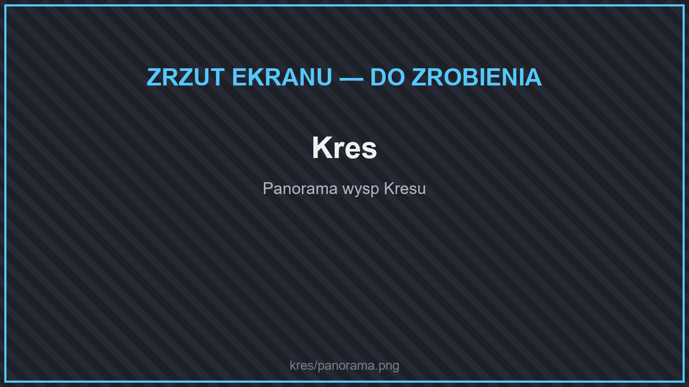

# 👾 Kres

<figure><figcaption>
Kres
</figcaption></figure>

Zewnętrzne wyspy Kresu wyglądają zupełnie inaczej niż w zwykłym Minecrafcie: mają kilkanaście nowych biomów, porastają je dziwne drzewa i rośliny, a w kamieniu Kresu kryje się pięć nowych rud.

<table data-view="cards"><thead><tr><th></th><th></th><th data-hidden data-card-target data-type="content-ref"></th></tr></thead><tbody><tr><td><strong>⚒️ Przedmioty</strong></td><td>Voidium, perłyt, enderyt, talas i rośliny Kresu.</td><td><a href="przedmioty.md">przedmioty.md</a></td></tr><tr><td><strong>🌆 Struktury</strong></td><td>Miasta, zamki, latarnie i statki Kresu.</td><td><a href="struktury.md">struktury.md</a></td></tr><tr><td><strong>😈 Potwory</strong></td><td>Endereki, zjawy i strażnicy Kresu.</td><td><a href="potwory.md">potwory.md</a></td></tr><tr><td><strong>🌌 Biomy</strong></td><td>Lasy refrenu, cieniste lasy, kryształowe góry i megajeziora.</td><td><a href="biomy.md">biomy.md</a></td></tr></tbody></table>

## Smok Kresu

Pokonanie Smoka Kresu daje też [osiągnięcie](../../informacje/osiagniecia.md).
