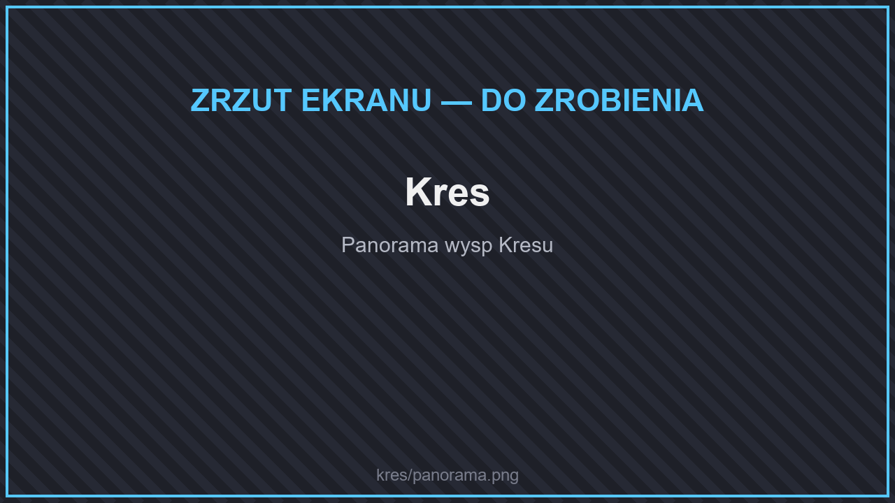

# 👾 Kres

<figure><figcaption>
Kres
</figcaption></figure>

Wyspy Kresu wyglądają zupełnie inaczej niż w zwykłym Minecrafcie: mają nowe biomy, porastają je dziwne rośliny, a w kamieniu Kresu kryją się trzy nowe rudy.

<table data-view="cards"><thead><tr><th></th><th></th><th data-hidden data-card-target data-type="content-ref"></th></tr></thead><tbody><tr><td><strong>⚒️ Przedmioty</strong></td><td>Voidium, perłyt, enderyt i rośliny Kresu.</td><td><a href="przedmioty.md">przedmioty.md</a></td></tr><tr><td><strong>🌆 Struktury</strong></td><td>Zamki, latarnie, statki i szkielety smoków.</td><td><a href="struktury.md">struktury.md</a></td></tr><tr><td><strong>😈 Potwory</strong></td><td>Enderlingi, upiory i strażnicy Kresu.</td><td><a href="potwory.md">potwory.md</a></td></tr><tr><td><strong>🌌 Biomy</strong></td><td>Kryształowe szczyty, krainy cieni i pustkowia.</td><td><a href="biomy.md">biomy.md</a></td></tr></tbody></table>

## Smok Kresu

Walkę ze Smokiem Kresu znajdziesz też jako [misję](../../informacje/zadania.md#misje).
