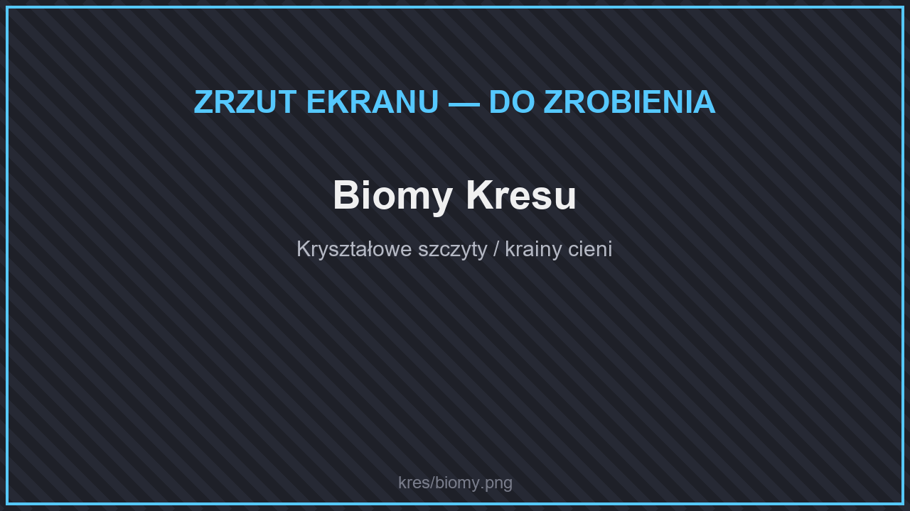

# 🌌 Biomy

<figure><figcaption>
Biomy Endu
</figcaption></figure>

W Endzie jest **16 biomów**. Środkowa wyspa ze Smokiem Endu wygląda jak w zwykłym Minecrafcie, ale zewnętrzne wyspy mają **14 nowych biomów** (nazwy w grze są po angielsku).

## Lasy

| Biom | |
| --- | --- |
| **Chorus Forest** | Las refrenusu z fioletowymi drzewami pytadendronu i refrenusową trawą. |
| **Shadow Forest** | Mroczny, cienisty las ze smoczymi drzewami i cienistymi jagodami. |
| **Umbrella Jungle** | Dżungla z drzewami parasolowymi i galaretnikami. |
| **Blossoming Spires** | Skalne iglice porośnięte kwitnącymi drzewami tenanei. |
| **Foggy Mushroomland** | Mglista kraina olbrzymich, świecących grzybów. |

## Łąki i jeziora

| Biom | |
| --- | --- |
| **Glowing Grasslands** | Świecące łąki z lumekornem. |
| **Flower Islets** | Kwieciste wysepki. |
| **Megalake**, **Megalake Grove** | Ogromne jezioro i gaj nad nim z drzewami lakugrove. |
| **Waterfall Ponds** | Stawy z wodospadami. |

## Pustkowia i góry

| Biom | |
| --- | --- |
| **Crystal Mountains** | Góry z kryształami zorzy. |
| **Ice Starfield** | Pole lodowych gwiazd. |
| **Dust Wastelands** | Pyłowe pustkowia. |
| **Umbra Valley** | Ciemna dolina z łukami z umbralitu. |

## Zwykłe biomy

| Biom | |
| --- | --- |
| **The End** (End) | Środkowa wyspa ze Smokiem Endu i obsydianowymi filarami. |
| **Small End Islands** (małe wyspy Endu) | Drobne wysepki w pustce między dużymi wyspami. |
