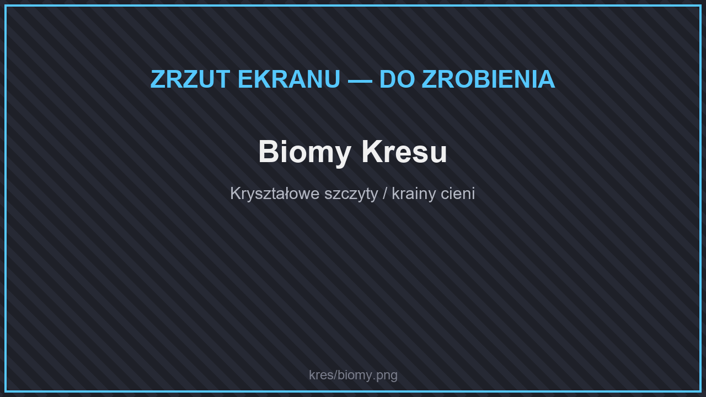

# 🌌 Biomy

<figure><figcaption>
Biomy Kresu
</figcaption></figure>

Zewnętrzne wyspy Kresu mają nowy kształt i trzy nowe biomy (nazwy w grze są po angielsku):

| Biom | |
| --- | --- |
| **Crystal Peaks** | Kryształowe szczyty. |
| **Shadowlands** | Krainy cieni. |
| **Void Barrens** | Pustkowia pustki. |
