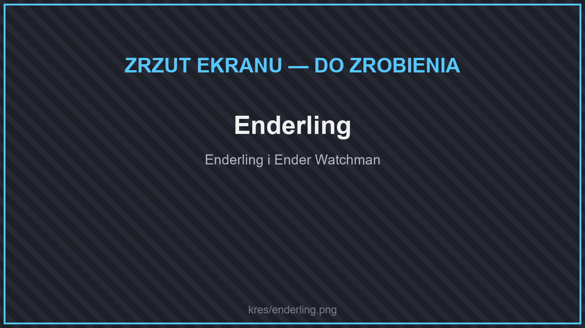

# 😈 Potwory

<figure><figcaption>
Enderek
</figcaption></figure>

Na zewnętrznych wyspach Endu część endermanów zastępują nowe stwory:

| Potwór | Gdzie | |
| --- | --- | --- |
| **Enderek** | wszystkie zewnętrzne wyspy | Najczęstszy stwór Endu. |
| **Enderman z Wysp Endu** | małe wyspy, lasy refrenusu, kwieciste wysepki, świecące łąki, kryształowe góry, jeziora, dżungla | Odmiana endermana z zewnętrznych wysp. |
| **Cienisty Wędrowiec** | cieniste lasy, Umbra Valley | Mieszkaniec cienistych lasów. |
| **Zjawa Endu** | wszędzie, najczęściej cieniste lasy i Umbra Valley | Upiór wysp Endu. |
| **Osiłek Endu** | wszędzie, najczęściej kryształowe góry, lodowe pola i pyłowe pustkowia | Rzadszy, silny przeciwnik. |
| **Pełzacz Endu** | wszędzie, najczęściej dżungla parasolowa, kwitnące iglice i pyłowe pustkowia | Rzadszy przeciwnik. |
| **Szlam Pustki** | jeziora, mglista kraina grzybów, cieniste lasy, Umbra Valley, dżungla | Skacze na graczy. |
| **Endermit** | małe wyspy, lasy refrenusu, pyłowe pustkowia | Nieszkodliwy — ucieka i się teleportuje. |
| **Wzmocniony Enderek**, **Wzmocniona Zjawa Endu** | rzadko; enderki najczęściej w kryształowych górach, zjawy w cienistych lasach | Silniejsze odmiany. |
| **Strażnik Endu** | bardzo rzadko, najczęściej kryształowe góry i lodowe pola | |
| **Rozszarpywacz Endu** | cieniste lasy, Umbra Valley — bardzo rzadko | Miniboss z paskiem zdrowia. |

Na środkowej wyspie ze smokiem część endermanów to odmiana **Enderman z Endu**. W budowlach z purpuru, np. w miastach Endu, czekają **Purpurowy Wartownik**, **Splugawiony Obserwator** i **Wypaczony Obserwator**. Bardzo rzadko przez End przechodzi też **Burza Endu**.

## Stworzenia Endu

<figure><figcaption>
Zjawa
</figcaption></figure>

Na wyspach Endu żyją też dziwne stworzenia:

| Stworzenie | Gdzie | |
| --- | --- | --- |
| **Szlam Endu** | lasy refrenusu, mglista kraina grzybów, megajeziora | Kilka odmian szlamu. |
| **Ważka** | mglista kraina grzybów, megajeziora | Latający owad. |
| **Jedwabna Ćma** | kwitnące iglice | |
| **Ryba Endu**, **Kostkomeduza** | megajeziora, mglista kraina grzybów | Pływają w wodzie. |
| **Upiorna Ryba** | jeziora, stawy z wodospadami, mglista kraina grzybów, dżungla parasolowa, kwitnące iglice | Świecąca ryba, która pływa w powietrzu. |
| **Ślimak Endu** | kwieciste wysepki, świecące łąki, jeziora, mglista kraina grzybów, lasy refrenusu | Złapiesz go do pustej butelki. |
| **Szulkrab** | kryształowe góry, lodowe pola, jeziora | Krab w skorupie shulkera — chowa się w niej i oddaje, gdy go zaatakujesz. Poluje na endermity. |
| **Krocznik Endu** | pyłowe pustkowia, kryształowe góry, lodowe pola, małe wyspy — rzadko | Spokojny olbrzym. Można go oswoić i na nim jeździć. |
| **Mimikostka** | wszystkie zewnętrzne wyspy Endu | Wrogi sześcian. |
| **Zjawa** | wszystkie zewnętrzne wyspy Endu | Ogromny, latający duch. |
| **Endoraczek** | wszystkie zewnętrzne wyspy Endu | Spokojny niesporczak Endu. |
| **Enderofag** | wszystkie zewnętrzne wyspy Endu — rzadko | Mały, wirusowy stwór Endu. |
| **Kosmak** | wszystkie zewnętrzne wyspy Endu | Latający stwór. Wypada z niego owoc refrenusu. |
| **Kosmiczny Dorsz** | środkowa i wszystkie zewnętrzne wyspy Endu | Ryba, która pływa w powietrzu. Wypada z niej kosmiczny dorsz do zjedzenia. |

## Co spotkasz w którym biomie

Enderki, Zjawy Endu, Mimikostki, Zjawy, Endoraczki, Kosmaki i Kosmiczne Dorsze żyją na wszystkich zewnętrznych wyspach. Do tego każdy biom ma swoje stwory:

| Biom | Charakterystyczne stwory |
| --- | --- |
| **Small End Islands** (małe wyspy) | Enderman z Wysp Endu, Endermit, rzadko Krocznik Endu |
| **Shadow Forest**, **Umbra Valley** | Cienisty Wędrowiec, Zjawa Endu, Wzmocniona Zjawa Endu, Szlam Pustki, bardzo rzadko Rozszarpywacz Endu |
| **Chorus Forest** | Enderman z Wysp Endu, Endermit, Szlam Endu, Ślimak Endu |
| **Umbrella Jungle**, **Blossoming Spires** | Pełzacz Endu, Szlam Pustki, Upiorna Ryba, Jedwabna Ćma (iglice) |
| **Megalake**, **Megalake Grove**, **Waterfall Ponds** | Szlam Pustki, Szulkrab, Upiorna Ryba, Ślimak Endu, Ryby Endu, Kostkomeduzy, Ważki, Szlam Endu |
| **Foggy Mushroomland** | Szlam Pustki, Upiorna Ryba, Ślimak Endu, Ważki, Szlam Endu |
| **Crystal Mountains**, **Ice Starfield** | Osiłek Endu, Strażnik Endu, Wzmocniony Enderek, Szulkrab, rzadko Krocznik Endu |
| **Dust Wastelands** | Osiłek Endu, Pełzacz Endu, Endermit, rzadko Krocznik Endu |
| **Glowing Grasslands**, **Flower Islets** | Enderman z Wysp Endu, Ślimak Endu |


W Umbra Valley wcześniej nic się nie pojawiało — teraz żyją tam Cieniste Wędrowce, Zjawy Endu i Szlamy Pustki.

