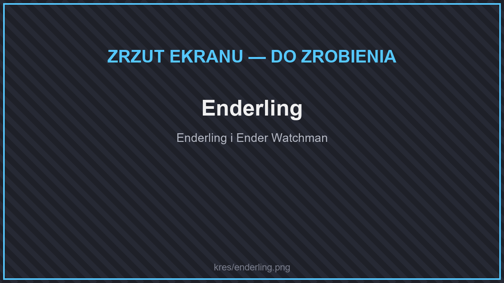
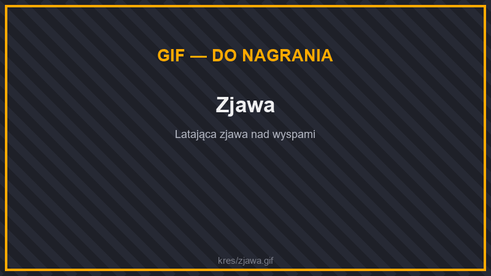

# 😈 Potwory

<figure><figcaption>
Enderling
</figcaption></figure>

Na wyspach Kresu część endermanów zastępują nowe stwory:

| Potwór | |
| --- | --- |
| **Enderling** | Najczęstszy stwór Kresu. |
| **Enderbruiser** | Rzadszy przeciwnik. |
| **Ender Watchman** | Bardzo rzadki strażnik. |
| **End Wraith** | |
| **Enderman wysp** | Odmiana endermana z wysp Kresu. |
| **Endermite** | |
| **Shulkrab** | |
| **Ślimak Kresu** | |
| **Swapper** | |
| **Void Ooze** | |

## Stworzenia Kresu

<figure><figcaption>
Zjawa
</figcaption></figure>

Na wyspach Kresu żyją też dziwne stworzenia:

| Stworzenie | |
| --- | --- |
| **Mimikostka** | Często spotykany, wrogi sześcian. |
| **Zjawa** | Ogromny, latający duch wysp. |
| **Kosmak** | Latające stworzenie — wypada z niego owoc refrenu. |
| **Kosmiczny Dorsz** | Ryba, która pływa w powietrzu. Wypada z niej kosmiczny dorsz do zjedzenia. |
| **Endoraczek** | Spokojny niesporczak Kresu. |
| **Enderofag** | Mały „wirus” Kresu ze środkowych wysp. |
