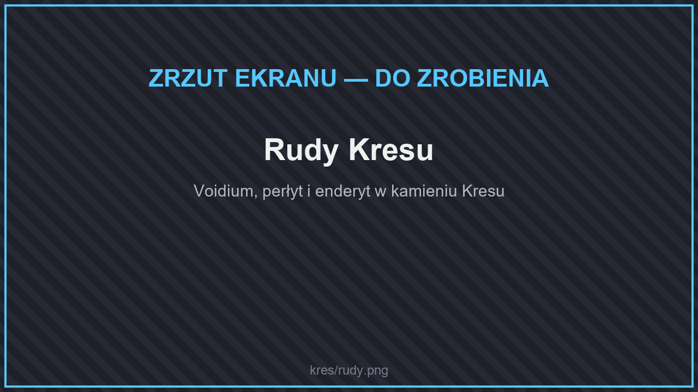

# ⚒️ Przedmioty

## Rudy

<figure><figcaption>
Rudy Kresu
</figcaption></figure>

| Ruda | Gdzie | Zestaw |
| --- | --- | --- |
| **Voidium** | W kamieniu Kresu | Kresowy |
| **Perłyt** | W kamieniu Kresu, poziomy Y 8–70 | Perłytowy |
| **Enderyt** | W kamieniu Kresu, bardzo rzadko | Enderytowy — najmocniejszy na serwerze |

Jest też **zestaw Shulkera**. Zestawy z Kresu zmniejszają obrażenia od upadku i dają zdolności związane z teleportacją i lewitacją. Szczegóły: [Zestawy z rzadkich rud](../../dodatki/ekwipunek/zestawy-rud.md).

## Rośliny

Wyspy porastają nowe rośliny: trawa Kresu i chorusa, róże chorusa, lilie Kresu, smocze owoce, grzyby Kresu i krzewy oczu.

## Inne skarby

* **Złote i zaklęte złote owoce refrenu** w skrzyniach miast Kresu — zobacz [Łączniki refrenu](../../dodatki/pojazdy.md#laczniki-refrenu).
* **Przekaźnik Kresu** — teleport z Kresu do magnetytu w świecie, zobacz [Przekaźnik Kresu](../../dodatki/pojazdy.md#przekaznik-kresu).
* W wodzie w Kresie złowisz własne ryby, m.in. **elytrout** — zobacz [Wędkarstwo](../../dodatki/wedkarstwo.md#ryby).
