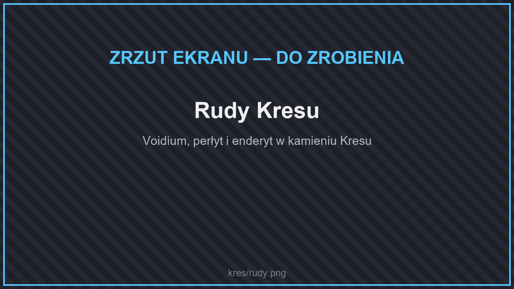

# ⚒️ Przedmioty

## Rudy

<figure><figcaption>
Rudy Endu
</figcaption></figure>

| Ruda | Gdzie | Do czego |
| --- | --- | --- |
| **Voidium** | W kamieniu Endu | Zestaw kresumowy |
| **Perłyt** | W kamieniu Endu, poziomy Y 8–70 | Zestaw perłytowy |
| **Enderyt** | W kamieniu Endu, bardzo rzadko | Zestaw enderytowy — najmocniejszy na serwerze |
| **Endowa Ruda** | W kamieniu Endu, we wszystkich nowych biomach | Endowe odłamki |
| **Talasowa Ruda** | W kamieniu Endu, we wszystkich nowych biomach | Talasowe sztabki na narzędzia i zbroję |

Jest też **zestaw Shulkera**. Zestawy z Endu zmniejszają obrażenia od upadku i dają zdolności związane z teleportacją i lewitacją. Szczegóły: [Zestawy z rzadkich rud](../../dodatki/ekwipunek/zestawy-rud.md).

## Rośliny i drewno

Każdy biom Endu ma własne rośliny: **refrenusową trawę** i **grzyby refrenusowe** w lasach refrenusu, **cienistą trawę** i **cieniste jagody** w cienistych lasach, **kryształową trawę** w górach, **Lumekorn** na świecących łąkach, **endowe lilie** i **lotosy** w jeziorach oraz mchy, paprocie i pnącza. Rosną tam też drzewa: **pytadendron**, **smocze drzewo**, **drzewo parasolowe**, **galaretnik**, **tenanea**, **lakugrove** i **omszały świetlak** — z ich drewna zbudujesz domy, zobacz [Bloki budowlane](../../dodatki/bloki-budowlane.md#end).

## Inne skarby

* **Złote i zaklęte złote owoce refrenusu** w skrzyniach miast Endu — zobacz [Łączniki refrenusu](../../dodatki/pojazdy.md#laczniki-refrenusu).
* **Przekaźnik Endu** — teleport z Endu do magnetytu w świecie, zobacz [Przekaźnik Endu](../../dodatki/pojazdy.md#przekaznik-endu).
* W wodzie w Endzie złowisz własne ryby, m.in. **elytrowego pstrąga** — zobacz [Wędkarstwo](../../dodatki/wedkarstwo.md#ryby).
