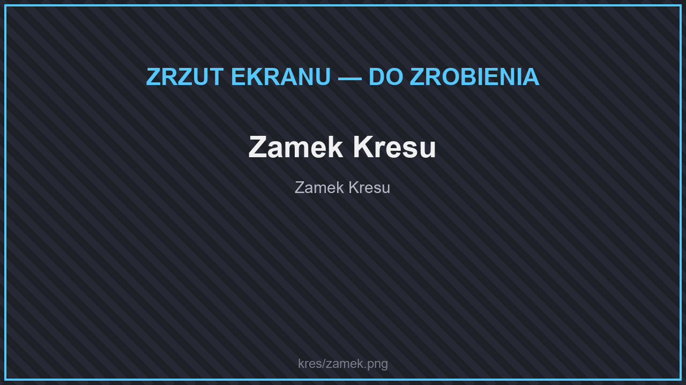

# 🌆 Struktury

<figure><figcaption>
Zamek Endu
</figcaption></figure>

* **Miasta Endu** ze statkami — jak w zwykłym Minecrafcie, w lasach i na łąkach zewnętrznych wysp.
* **Zamek Endu**.
* **Latarnia Endu** — w tych samych biomach co miasta Endu.
* **Statek Endu** i **wrak statku Endu**.
* **Wieża Endu** — we wszystkich [biomach Endu](biomy.md), także na małych wyspach.

## Łupy w strukturach

W skrzyniach Endu czasem leżą przedmioty z Endu — rzadko i po kilka sztuk (w miastach Endu także złote owoce refrenusu).

* **End** — miasta, statki, zamek i latarnie Endu, wieża Endu: Endowy Pył, Endowy Odłamek, Odłamki Kryształu Zorzy, Surowy Talas, Terminitowa Bryłka, Zaklęty Płatek, Endowa Ryba, Włókno Jedwabiu, Surowe Kresum, Enderyt, Odłamek Perłytu, Kosmiczny Dorsz, ryby z wędkarstwa (Enderopłetwiec, Dorsz Chorusowy, Okoń z Kamienia Endu i inne); rzadko: Ostateczny Lucky Blok, Wieczny Kryształ.
