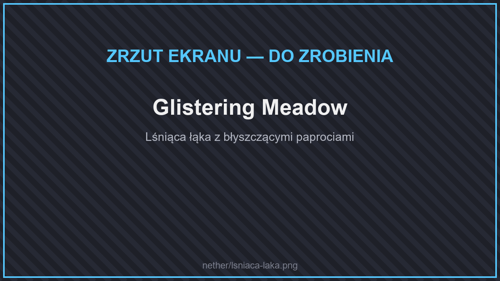
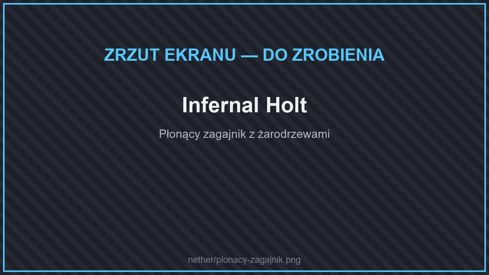
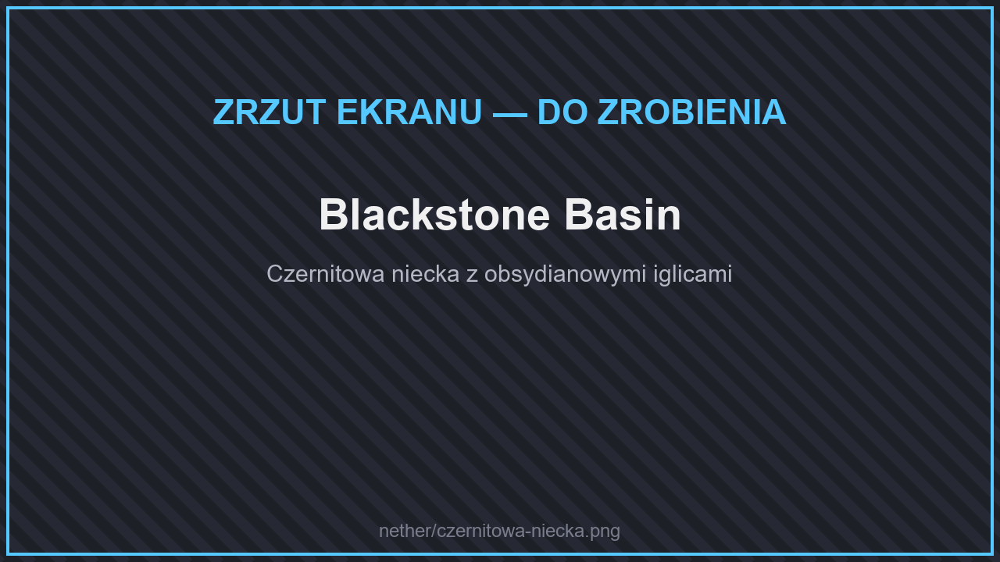
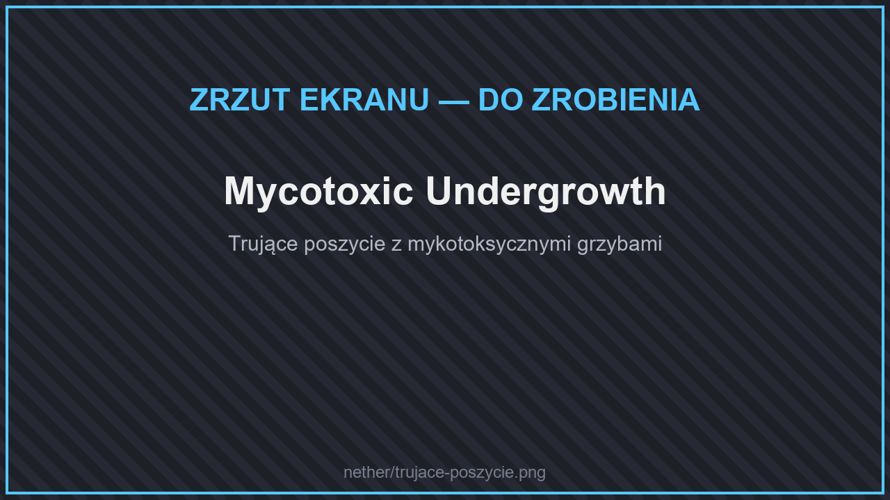

# 🌋 Biomy

W Netherze jest **9 biomów**: **cztery nowe** i pięć zwykłych biomów Minecrafta. Nazwy w grze są po angielsku.

## Nowe biomy

<figure><figcaption>
Glistering Meadow
</figcaption></figure>

<figure><figcaption>
Infernal Holt
</figcaption></figure>

<figure><figcaption>
Blackstone Basin
</figcaption></figure>

<figure><figcaption>
Mycotoxic Undergrowth
</figcaption></figure>

| Biom | |
| --- | --- |
| **Glistering Meadow** | Lśniąca łąka — błyszczące paprocie, kwiaty, bluszcz i iglice na błyszczącym nylium. |
| **Infernal Holt** | Płonący zagajnik z drzew żarodrzewu, pełen ognia i żarokiełków. |
| **Blackstone Basin** | Czernitowa niecka z obsydianowymi iglicami, kobaltowymi korzeniami i świecącymi roślinami. |
| **Mycotoxic Undergrowth** | Trujące poszycie z mykotoksycznymi grzybami, trawą i stokrotkami. |

## Zwykłe biomy

| Biom | |
| --- | --- |
| **Nether Wastes** (netherowe pustkowia) | Pustkowia z netherracku i jeziora lawy. |
| **Crimson Forest** (karmazynowy las) | Karmazynowe grzyby i hogliny. |
| **Warped Forest** (spaczony las) | Spaczone grzyby i endermany. |
| **Soul Sand Valley** (dolina piasku dusz) | Piasek dusz, skamieniałe kości i ghasty. |
| **Basalt Deltas** (delty bazaltowe) | Bazaltowe kolumny i czernit. |


Drewno żarodrzewu i rośliny z nowych biomów opisuje strona [Bloki budowlane](../../dodatki/bloki-budowlane.md#nether).

