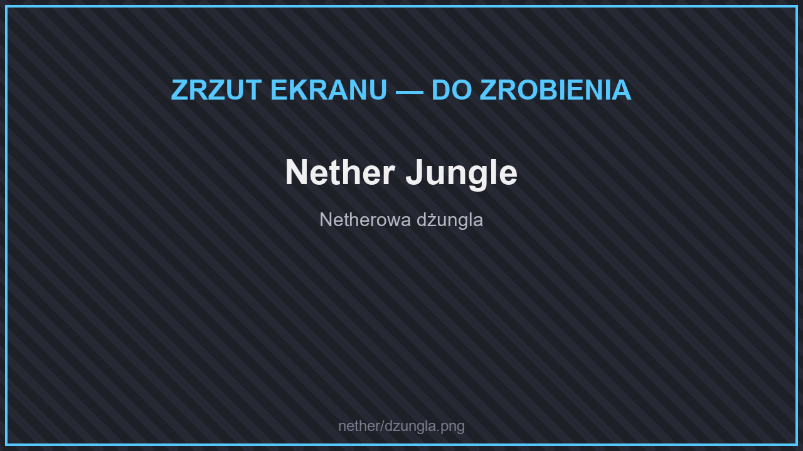
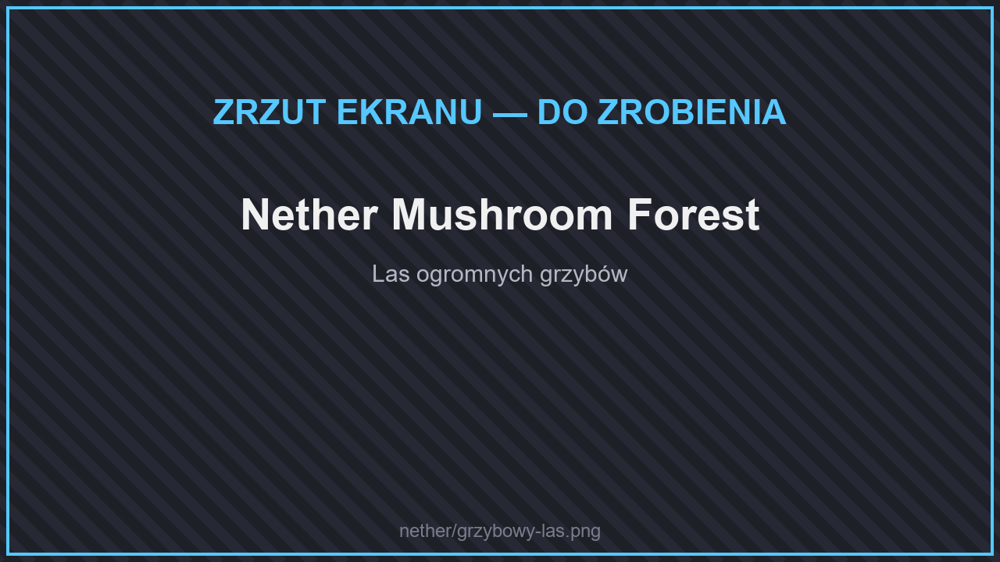
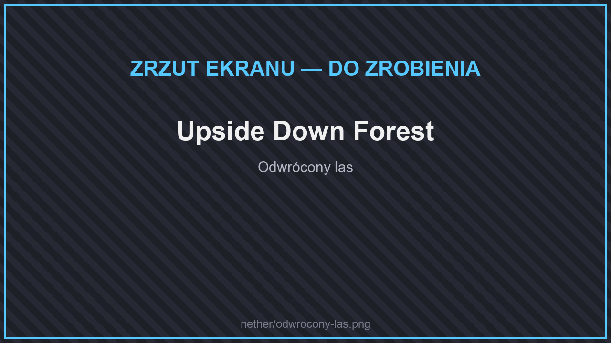
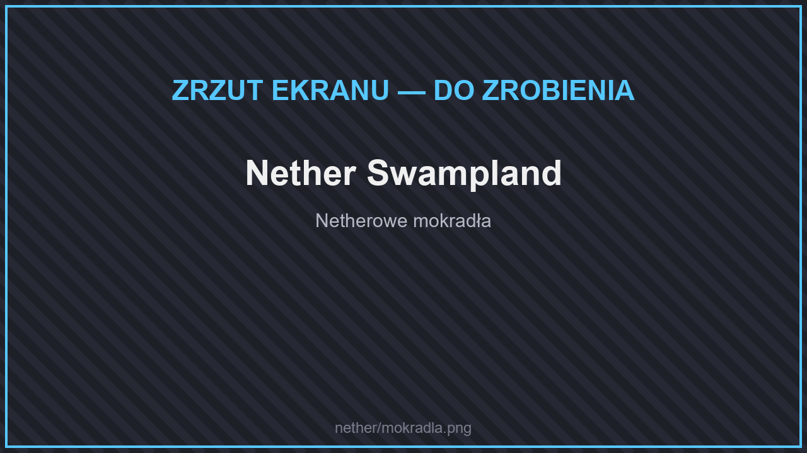
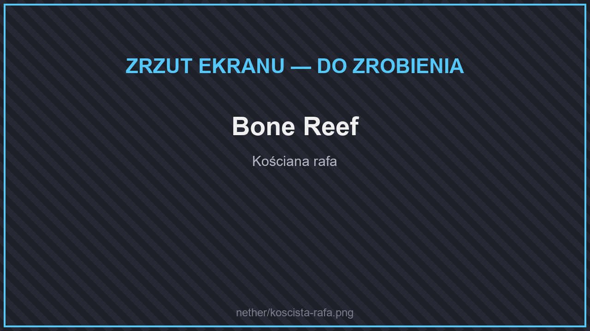

# 🌋 Biomy

Nether jest dużo bardziej zróżnicowany niż w zwykłym Minecrafcie. Oprócz pięciu zwykłych biomów (netherowe pustkowia, karmazynowy i spaczony las, dolina dusz, delty bazaltowe) znajdziesz ponad 25 nowych. Nazwy w grze są po angielsku.

## Lasy

<figure><figcaption>
Nether Jungle
</figcaption></figure>

<figure><figcaption>
Nether Mushroom Forest
</figcaption></figure>

<figure><figcaption>
Upside Down Forest
</figcaption></figure>

| Biom | |
| --- | --- |
| **Nether Jungle** | Netherowa dżungla — gęsta, pełna pnączy i świątyń. |
| **Nether Mushroom Forest**, **Nether Mushroom Forest Edge** | Las ogromnych grzybów. |
| **Old Fungiwoods** | Stary las grzybowych drzew. |
| **Crimson Glowing Woods**, **Crimson Pinewood** | Świecące karmazynowe lasy i bory. |
| **Old Warped Woods** | Stary spaczony las. |
| **Wart Forest**, **Wart Forest Edge** | Las z drzew z brodawek netherowych. |
| **Upside Down Forest**, **Dead Upside Down Forest** | Odwrócony las — drzewa rosną z sufitu. |
| **Gloomwood** | Mroczny las. |
| **Infernal Holt** | Piekielny zagajnik. |

## Bagna i równiny

<figure><figcaption>
Nether Swampland
</figcaption></figure>

| Biom | |
| --- | --- |
| **Nether Swampland**, **Nether Swampland Terraces**, **Old Swampland** | Netherowe mokradła i tarasy. |
| **Nether Grasslands**, **Poor Nether Grasslands** | Porośnięte netherowe łąki. |
| **Glistering Meadow** | Lśniąca łąka. |
| **Soul Plain** | Równina dusz. |
| **Mycotoxic Undergrowth** | Trujące grzybowe poszycie. |

## Pustkowia

<figure><figcaption>
Bone Reef
</figcaption></figure>

| Biom | |
| --- | --- |
| **Gravel Desert** | Żwirowa pustynia. |
| **Magma Land** | Kraina magmy — uważaj, gdzie stajesz. |
| **Flooded Deltas** | Delty zalane lawą. |
| **Blackstone Basin** | Niecka z czernitu. |
| **Bone Reef**, **Sulfuric Bone Reef** | Kościane rafy — ogromne kości, także w siarkowej odmianie. |


Każdy las ma swoje drewno — zobacz [Bloki budowlane](../../dodatki/bloki-budowlane.md#nether).

