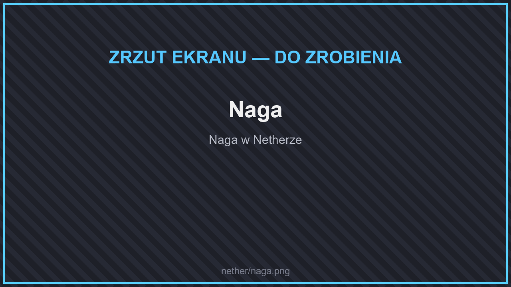
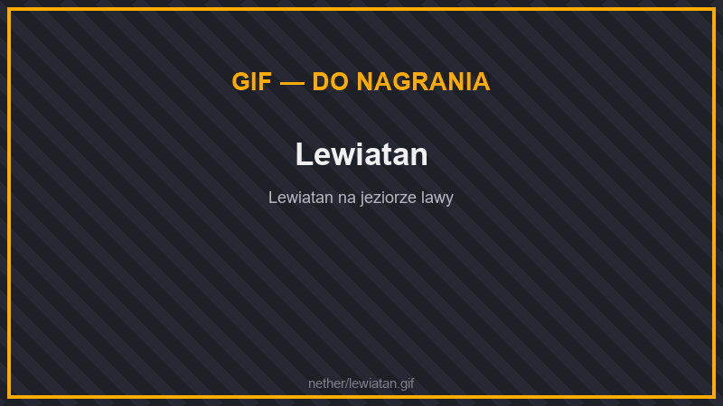

# 🧛 Potwory

## Potwory

<figure><figcaption>
Naga
</figcaption></figure>

| Potwór | Gdzie | |
| --- | --- | --- |
| **Naga** | prawie cały Nether, najczęściej lśniące łąki | Strzela kulami ognia. Rzadko wypada z niej czaszka witherowego szkieletu. |
| **Szkielet Dżungli** | lśniące łąki | |
| **Latająca Czaszka** | cały Nether, najczęściej lśniące łąki | Lata i atakuje z powietrza. |
| **Zagubiona Dusza** | dolina dusz | Latający duch. |
| **Mroczny Chochlik** | prawie cały Nether | Częsty, silny przeciwnik. |
| **Piekielny Ogar** | cały Nether | Groźny, najczęściej w karmazynowych lasach i płonących zagajnikach. |
| **Lawowy Roztocz** | cały Nether | |
| **Netherowy Grzyb** | cały Nether, najczęściej trujące grzybowiska | Chodzący grzyb. |
| **Ognisty Chochlik** | cały Nether, najczęściej pustkowia, płonące zagajniki, delty bazaltowe i lśniące łąki | Latający. |
| **Lawowa Salamandra** | delty bazaltowe, czernitowe niecki, pustkowia, płonące zagajniki | Ognista jaszczurka. |
| **Witherowy Szkielet** | dolina dusz, czernitowe niecki | Nakłada efekt uschnięcia. |
| **Płomieniec** | twierdze, delty bazaltowe, netherowe pustkowia, płonące zagajniki | Ognista odmiana płomyka. |
| **Płomienny Żołnierz** | twierdze, delty bazaltowe, płonące zagajniki | |
| **Płomienny Ognik** | twierdze, netherowe pustkowia | |
| **Płomienny Szkielet**, **Spopielony Płomienny Szkielet** | twierdze, czernitowe niecki | |
| **Szkarłatny Komar** | karmazynowe lasy | Latający owad. |
| **Spadający Niedźwiedź** | netherowe pustkowia | |
| **Eteryczny Sęp** | dolina dusz | |
| **Okracznik** | delty bazaltowe | |
| **Lawowa Pirania** | lawa w całym Netherze | Gryzie wszystko, co wpadnie do lawy. |
| **Lawowa Kałamarnica** | lawa w deltach bazaltowych, czernitowych nieckach i na pustkowiach | |
| **Pożoga** | delty bazaltowe, czernitowe niecki — bardzo rzadko | Ognisty miniboss osłonięty wirującymi tarczami. |
| **Król Płomyków** | netherowe pustkowia, płonące zagajniki — bardzo rzadko | Miniboss, przywołuje płomyki. |

Endermany w Netherze mają własne odmiany: **Enderman z Pustkowi Netheru** (pustkowia, czernitowe niecki), **z Karmazynowego Lasu** (lśniące łąki), **z Wypaczonego Lasu** i **z Doliny Piasku Dusz**. Bardzo rzadko przez Nether przechodzi też **Ognista Burza**.

## Stworzenia

<figure><figcaption>
Lewiatan
</figcaption></figure>

| Stworzenie | Gdzie | Wypada |
| --- | --- | --- |
| **Świetlik** | cały Nether | jasnopył |
| **Latająca Świnia** | karmazynowe lasy, płonące zagajniki | surowa wieprzowina |
| **Brodawkowy Dzik Netheru** | karmazynowe lasy, płonące zagajniki | surowa wieprzowina |
| **Wypaczony Dzik Netheru** | spaczone lasy, trujące grzybowiska | surowa wieprzowina |
| **Wodorowa Meduza** | cały Nether | |
| **Kościany Wąż** | cały Nether — porusza się po lawie | kości |
| **Lewiatan** | cały Nether — porusza się po lawie | bloki magmy, czernit |
| **Okraczątko** | delty bazaltowe | |
| **Spaczona Żaba** | spaczone lasy | świetlik grzybowy, brodawki, żabie udka |

## Co spotkasz w którym biomie

W każdym biomie część zwykłych potworów zastępują jego własne stwory. Wszędzie spotkasz też Lawowy Roztocz, Piekielnego Ogara, Latającą Czaszkę, Świetliki, Wodorowe Meduzy, a w lawie Lawowe Piranie, Kościane Węże i Lewiatany.

| Biom | Charakterystyczne stwory |
| --- | --- |
| **Netherowe pustkowia** | Mroczny Chochlik, Ognisty Chochlik, Płomieniec, Płomienny Ognik, Lawowa Salamandra, Spadający Niedźwiedź, Enderman z Pustkowi Netheru, bardzo rzadko Król Płomyków |
| **Karmazynowy las** | Piekielny Ogar (także zamiast części hoglinów), Mroczny Chochlik, Szkarłatny Komar, Latająca Świnia, Brodawkowy Dzik Netheru |
| **Infernal Holt** (płonący zagajnik) | Piekielny Ogar, Ognisty Chochlik, Lawowa Salamandra, Płomieniec i Płomienny Żołnierz (zamiast części hoglinów), Latająca Świnia, Brodawkowy Dzik Netheru, bardzo rzadko Król Płomyków |
| **Spaczony las** | Enderman z Wypaczonego Lasu, Spaczona Żaba, Wypaczony Dzik Netheru |
| **Mycotoxic Undergrowth** (trujące grzybowisko) | Netherowy Grzyb, Mroczny Chochlik, Wypaczony Dzik Netheru |
| **Dolina dusz** | Zagubiona Dusza, Witherowy Szkielet, Mroczny Chochlik, Eteryczny Sęp, Enderman z Doliny Piasku Dusz |
| **Delty bazaltowe** | Płomieniec, Płomienny Żołnierz i Ognisty Chochlik (zamiast części ghastów), Lawowa Salamandra, Okracznik, Okraczątko, Lawowa Kałamarnica, bardzo rzadko Pożoga |
| **Blackstone Basin** (czernitowa niecka) | Płomienny Szkielet, Spopielony Płomienny Szkielet i Witherowy Szkielet (zamiast części witherowych szkieletów), Lawowa Salamandra, Mroczny Chochlik, Enderman z Pustkowi Netheru, Lawowa Kałamarnica, bardzo rzadko Pożoga |
| **Glistering Meadow** (lśniąca łąka) | Szkielet Dżungli i Naga (także zamiast części hoglinów), Latająca Czaszka, Ognisty Chochlik, Enderman z Karmazynowego Lasu |
