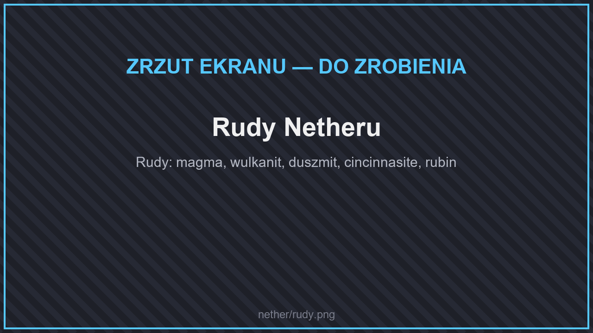

# ⚒️ Przedmioty

## Rudy

<figure><figcaption>
Rudy Netheru
</figcaption></figure>

| Ruda | Gdzie | Zestaw |
| --- | --- | --- |
| **Klastry magmy** | W blokach magmy, poziomy Y 20–40 | Magmowy |
| **Wulkanit** | W netherracku, poziomy Y 40–187 | Wulkanitowy |
| **Duszmit** | W netherracku, poziomy Y 4–160 | Duszmitowy |

Zestawy magmowy, wulkanitowy i duszmitowy zmniejszają obrażenia od ognia, a ich premie za noszenie zbroi dają m.in. odporność na ogień. Narzędzia magmowe i wulkanitowe od razu przetapiają wykopane rudy. Szczegóły: [Zestawy z rzadkich rud](../../dodatki/ekwipunek/zestawy-rud.md).

## Łowienie w lawie

Wędką obsydianową lub netherytową złowisz w lawie ryby i skarby. W Netherze jest najwięcej gatunków ryb, a najcenniejsze łupy to **promethium** i **Skarb Prometeusza**. Szczegóły: [Łowienie w lawie](../../dodatki/wedkarstwo.md#lowienie-w-lawie).

## Rośliny i drewno

W nowych biomach rosną świecące i trujące rośliny: **błyszczące paprocie, kwiaty i bluszcz** na lśniących łąkach, **żarokiełki** i drzewa **żarodrzewu** w płonących zagajnikach, **kobaltowe korzenie** w czernitowych nieckach oraz **mykotoksyczne grzyby, trawa i stokrotki** w trującym poszyciu. Z żarodrzewu zrobisz deski, schody i inne bloki — zobacz [Bloki budowlane](../../dodatki/bloki-budowlane.md#nether).
