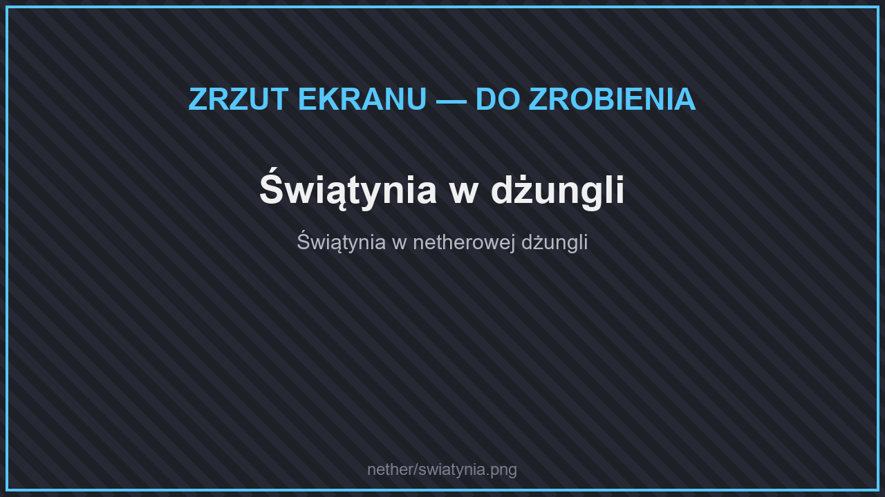
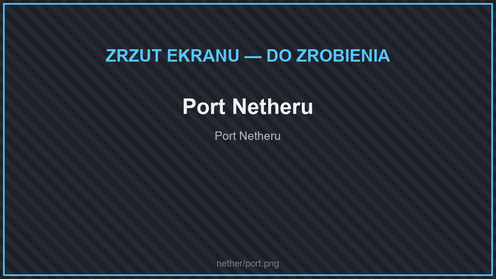

# 🏯 Struktury

## Odnowione

* **Twierdza Netheru** — przebudowana, większa i groźniejsza.
* **Zniszczone portale** — nowe wersje; w Netherze w postaci ruin piglinów.

## Nowe struktury

<figure><figcaption>
Świątynia w dżungli
</figcaption></figure>

<figure><figcaption>
Port Netheru
</figcaption></figure>

* **Twierdza** (keep), **port Netheru** i **zapieczętowane sale** — w całym Netherze.
* **Donżon**, **obozy**, **placówki** i **osada piglinów** — w tych samych biomach co bastiony.
* **Wieże szkieletów** — w lasach karmazynowych, spaczonych i w dolinach dusz, a forteczne w całym Netherze.
* **Wieże fortowe** w całym Netherze, **dziwna placówka** w dolinach dusz i **spaczona placówka** w spaczonych lasach.
* **Czarna spirala** — wieża piglinów z mostami, w tych samych biomach co bastiony.
* **Fabryka piglinów** — loch z próbą, w której walczysz z falami piglinowych golemów. Zobacz [Fabryki golemów](../swiat-glowny/struktury.md#fabryki-golemow).

## Łupy w strukturach

W skrzyniach Netheru czasem leżą przedmioty pasujące do miejsca — rzadko i po kilka sztuk. Zobacz też [Łupy w strukturach Świata Głównego](../swiat-glowny/struktury.md#lupy-w-strukturach).

* **Nether** — twierdze, bastiony, donżon, placówki i obozy piglinów, port, wieże: Bryła Magmy, Surowy Wulkanit, Duszmit, Netherowa Sałatka, Pikantny Filet Rybny, ryby z wędkarstwa (Karmazynowy Kłoszczęk, Żarowy Koi, Piekielny Gupik i inne); rzadko: Niebezpieczny Lucky Blok, Upiorny Totem Nieśmiertelności.
* **Zniszczone portale** — zniszczone portale (Świat Główny i Nether): Bryła Magmy, Surowy Wulkanit.
* **Fabryka piglinów**: Złote Koło Zębate, Żelazne Koło Zębate; rzadko: Lucky Blok Mobów.
