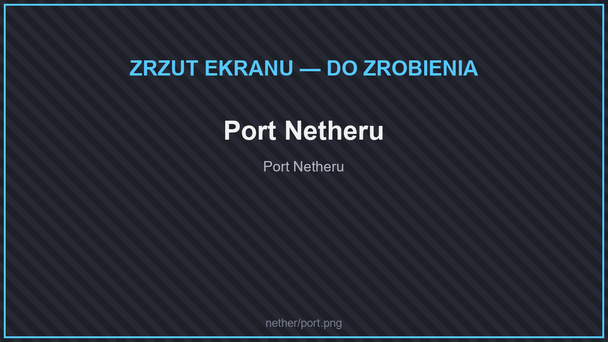

# 🏯 Struktury

## Odnowione

* **Twierdza Netheru** — przebudowana, większa i groźniejsza.
* **Zniszczone portale** — nowe wersje w każdym wymiarze.

## Nowe struktury

<figure><figcaption>
Port Netheru
</figcaption></figure>

<figure><figcaption>
Świątynia w dżungli
</figcaption></figure>

* **Twierdza** (keep) i **port Netheru**.
* **Donżon** i **placówki piglinów**.
* **Wieże szkieletów** — w lasach karmazynowych, spaczonych, w dolinach dusz i przy twierdzach.
* **Świątynie w dżungli** — w netherowych dżunglach.
* **Piramidy** i **ołtarze**.
* **Ogrody** — wyspy roślinności wśród lawy.
* **Ul ghastów**.
* **Filary** — ogromne kolumny ze skał Netheru.
* **Przecieki** ze świata zwykłego — kawałki Świata Głównego, które trafiły do Netheru.
