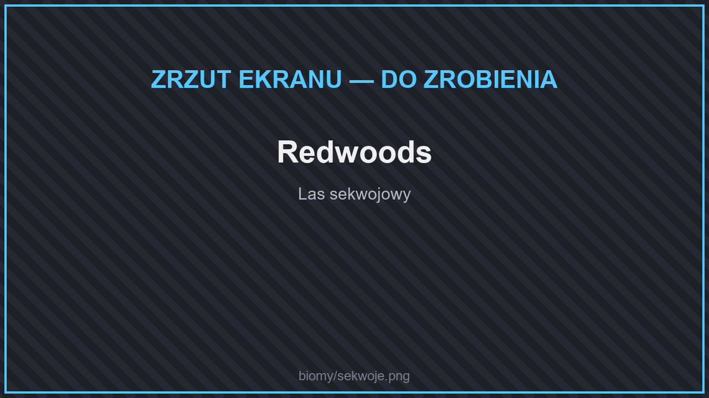
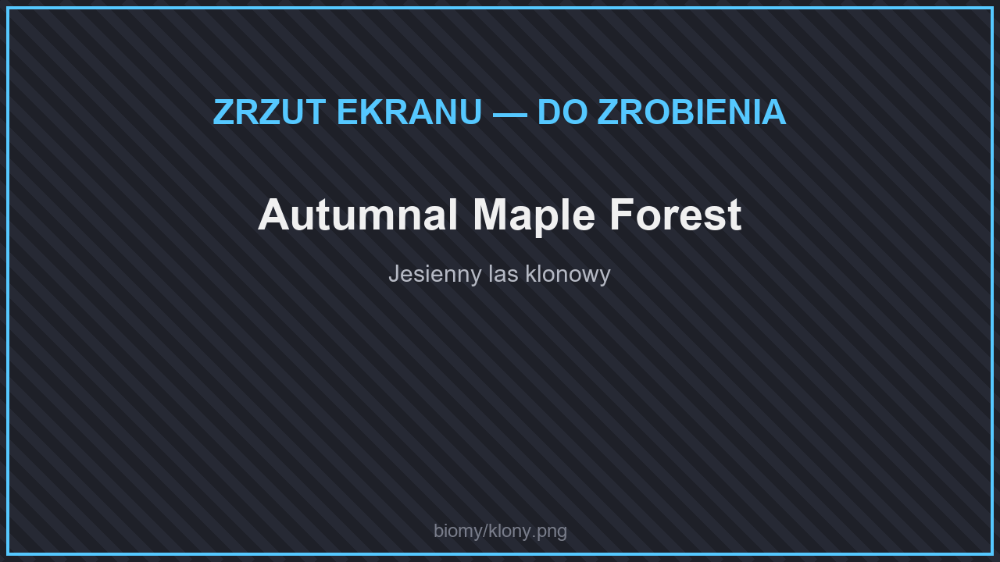
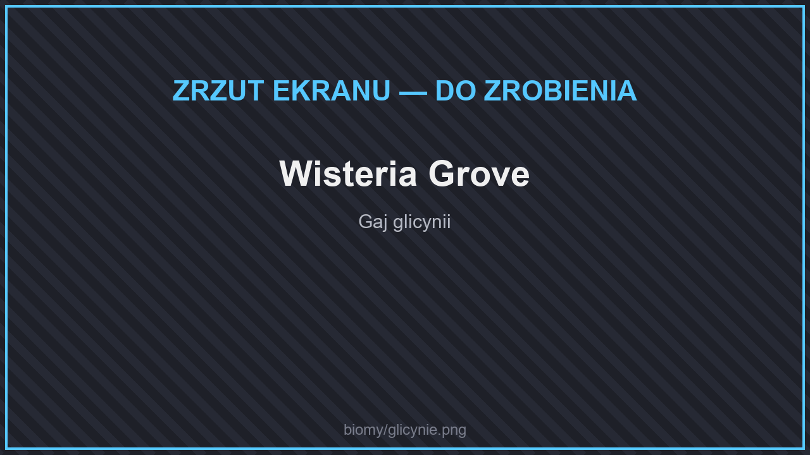
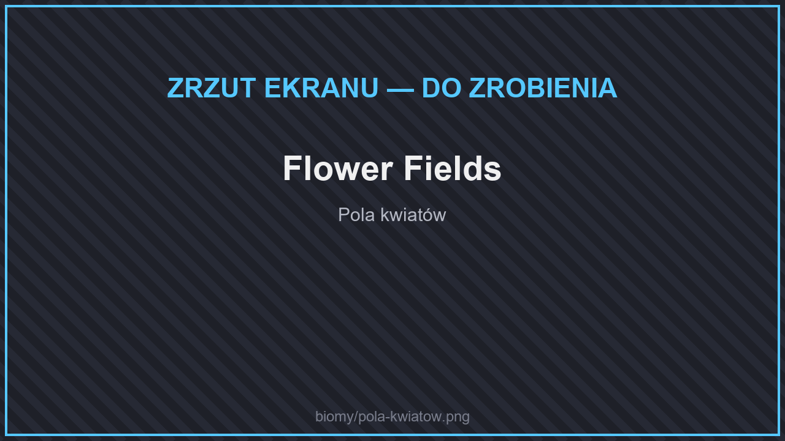
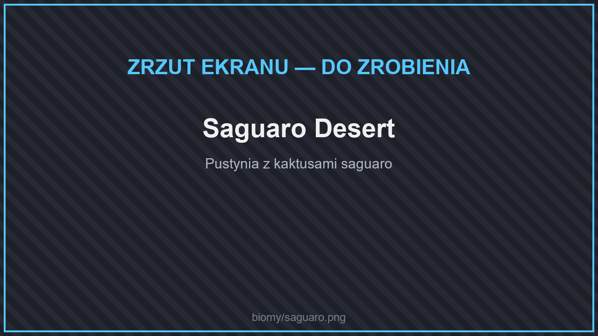
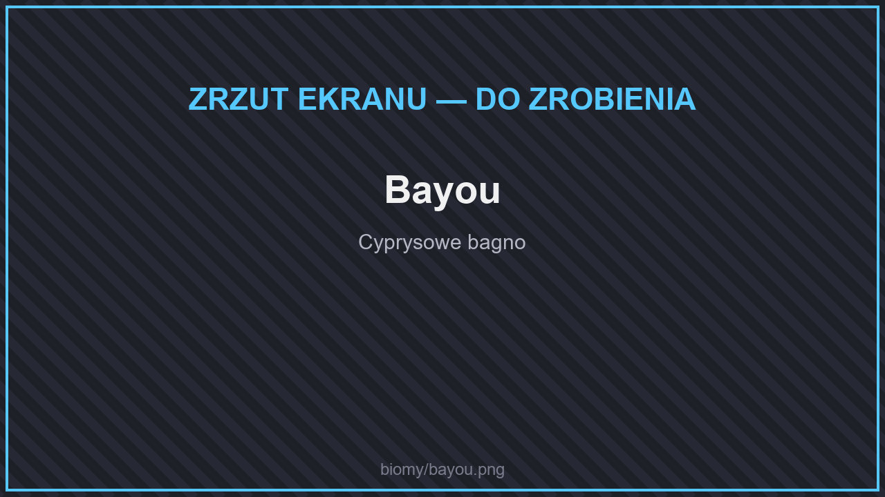
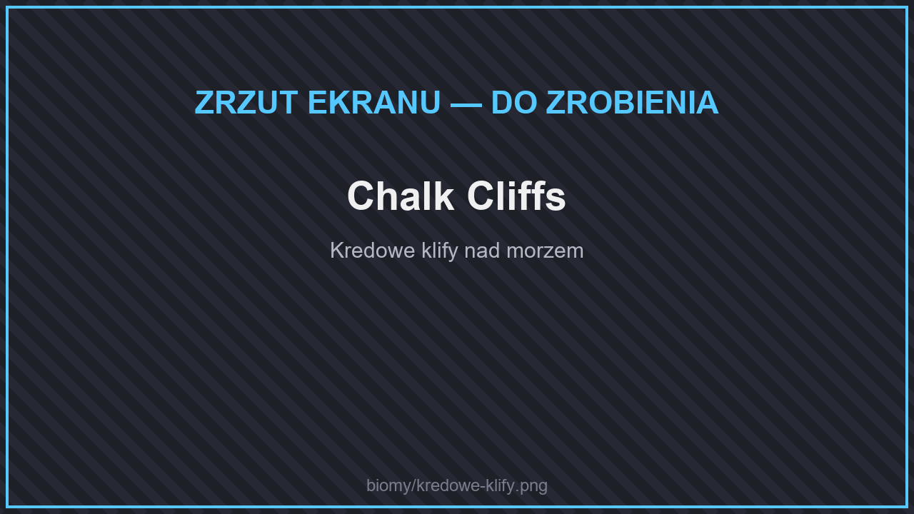
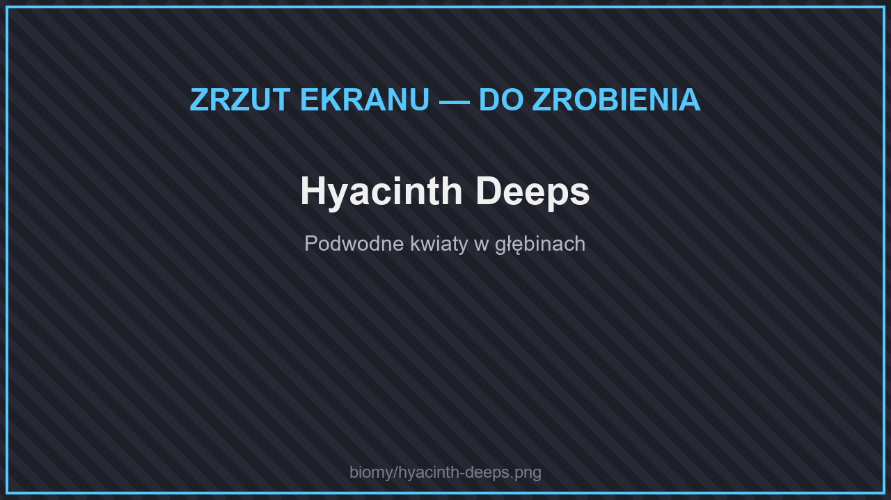
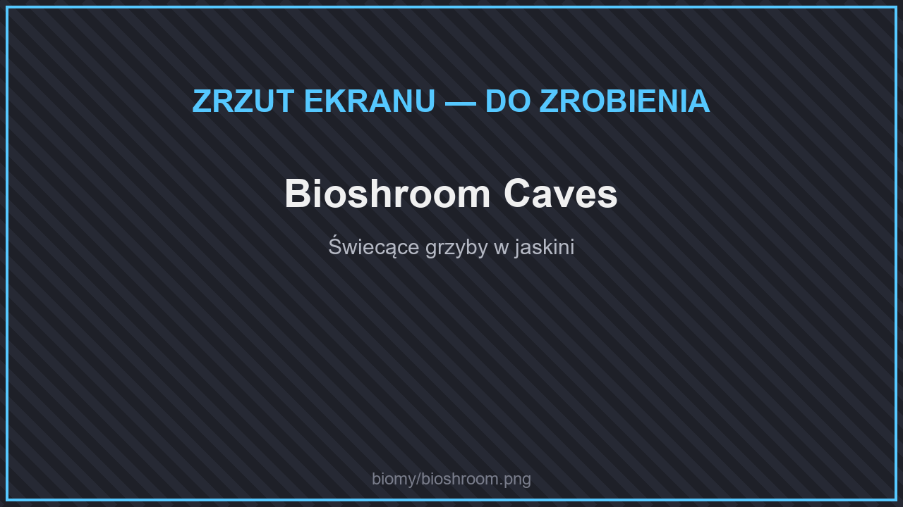
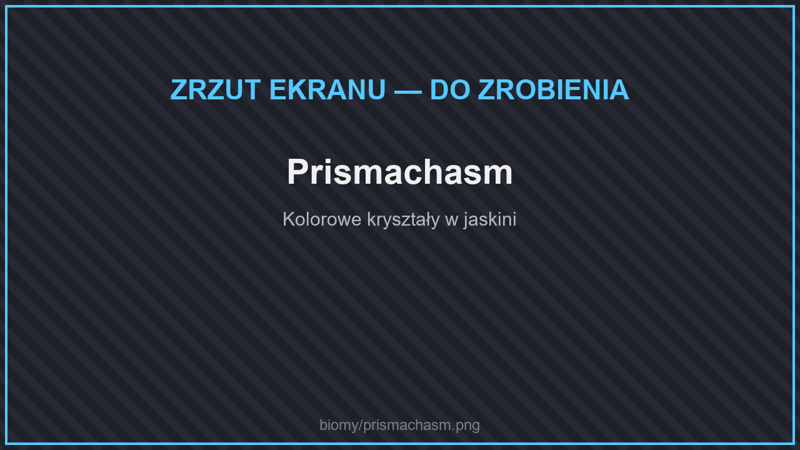

# 🌄 Biomy

Oprócz zwykłych biomów Minecrafta generator świata dodaje **ponad 60 nowych biomów**. Wiele z nich ma własne drzewa, kwiaty i kamienie. Nazwy biomów widzisz w grze po angielsku (np. na ekranie F3).

## Lasy

<figure><figcaption>
Redwoods
</figcaption></figure>

<figure><figcaption>
Autumnal Maple Forest
</figcaption></figure>

<figure><figcaption>
Wisteria Grove
</figcaption></figure>

| Biom | |
| --- | --- |
| **Maple Forest**, **Autumnal Maple Forest**, **Windswept Maple Forest** | Lasy klonowe — zielone albo w jesiennych kolorach. |
| **Redwoods**, **Sparse Redwoods** | Olbrzymie sekwoje. |
| **Boreal Taiga**, **Cold Boreal Taiga**, **Old Growth Boreal Taiga**, **Old Growth Golden Boreal Taiga** | Północne tajgi, także ze złotymi modrzewiami. |
| **Pine Taiga**, **Pine Slopes**, **Frozen Pine Taiga** | Lasy sosnowe na zboczach i w śniegu. |
| **Blackwood Taiga** | Mroczna tajga z czarnym drewnem. |
| **Silver Birch Forest** | Las srebrnych brzóz. |
| **Old Growth Forest** | Stary, gęsty las. |
| **Magnolia Woodland**, **Wisteria Grove** | Kwitnące magnolie i glicynie. |
| **Willow Forest** | Las wierzbowy. |
| **Alpha Grove** | Las w stylu starego Minecrafta. |
| **Orchard** | Sad pełen owocowych drzew. |
| **Ashen Woodland** | Las po pożarze, pokryty popiołem. |
| **Bamboo Forest** | Las bambusowy. |
| **Eucalyptus Forest** | Las eukaliptusowy. |
| **Rainforest**, **Sparse Rainforest**, **Tropics** | Lasy deszczowe i tropiki. |

## Równiny i łąki

<figure><figcaption>
Flower Fields
</figcaption></figure>

| Biom | |
| --- | --- |
| **Grassland**, **Prairie** | Rozległe trawiaste równiny. |
| **Clover Plains** | Równiny pełne koniczyny. |
| **Flower Fields**, **Poppy Fields** | Pola kwiatów i maków. |
| **Highland Fields** | Wyżynne łąki. |
| **Shrubland**, **Dry Bushland** | Zarośla i suche busze. |
| **Tundra** | Zimna, pusta równina. |

## Pustynie i sawanny

<figure><figcaption>
Saguaro Desert
</figcaption></figure>

<figure><figcaption>
Baobab Savanna
</figcaption></figure>

| Biom | |
| --- | --- |
| **Saguaro Desert** | Pustynia z wielkimi kaktusami. |
| **Joshua Desert** | Pustynia z drzewami Jozuego. |
| **Outback** | Czerwony australijski interior. |
| **Baobab Savanna** | Sawanna z baobabami. |

## Bagna i rzeki

<figure><figcaption>
Bayou
</figcaption></figure>

| Biom | |
| --- | --- |
| **Bayou**, **Old Growth Bayou** | Cyprysowe bagna. |
| **Fen**, **Marsh** | Torfowiska i mokradła. |
| **Fungal Fen** | Bagno porośnięte grzybami. |
| **Muddy River**, **Cold River**, **Tropical River** | Nowe rodzaje rzek. |

## Góry i klify

<figure><figcaption>
Chalk Cliffs
</figcaption></figure>

| Biom | |
| --- | --- |
| **Chalk Cliffs** | Białe kredowe klify nad morzem. |
| **Towering Cliffs** | Wysokie, strome urwiska. |
| **Spires** | Skalne iglice. |
| **Icy Heights** | Lodowe szczyty. |

## Wybrzeża i oceany

<figure><figcaption>
Hyacinth Deeps
</figcaption></figure>

| Biom | |
| --- | --- |
| **Grassy Beach**, **Gravel Beach** | Trawiaste i żwirowe plaże. |
| **Rocky Reef** | Skalista rafa. |
| **Hyacinth Deeps** | Głębiny pełne podwodnych kwiatów. |

## Jaskinie

<figure><figcaption>
Bioshroom Caves
</figcaption></figure>

<figure><figcaption>
Prismachasm
</figcaption></figure>

| Biom | |
| --- | --- |
| **Bioshroom Caves** | Jaskinie z wielkimi, świecącymi grzybami. |
| **Prismachasm** | Jaskinie z kolorowymi kryształami. |
| **Redstone Caves** | Jaskinie pełne czerwonego kamienia. |
| **Ancient Delta** | Prastara podziemna delta. |

Pod ziemią są też zwykłe jaskinie Minecrafta: bujne jaskinie, jaskinie naciekowe i mroczne głębiny.


Drewno, kamienie i rośliny z nowych biomów opisuje strona [Bloki budowlane](../../dodatki/bloki-budowlane.md#swiat-glowny). Każdy biom ma też swoje [zwierzęta](zwierzeta.md) i [ryby](../../dodatki/wedkarstwo.md#ryby-z-biomow).

