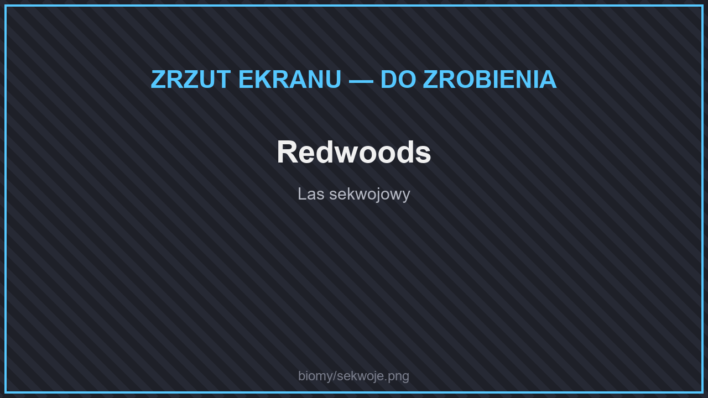
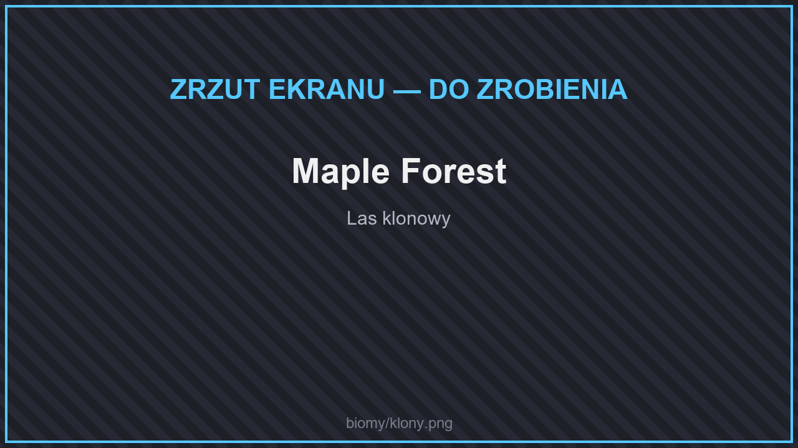
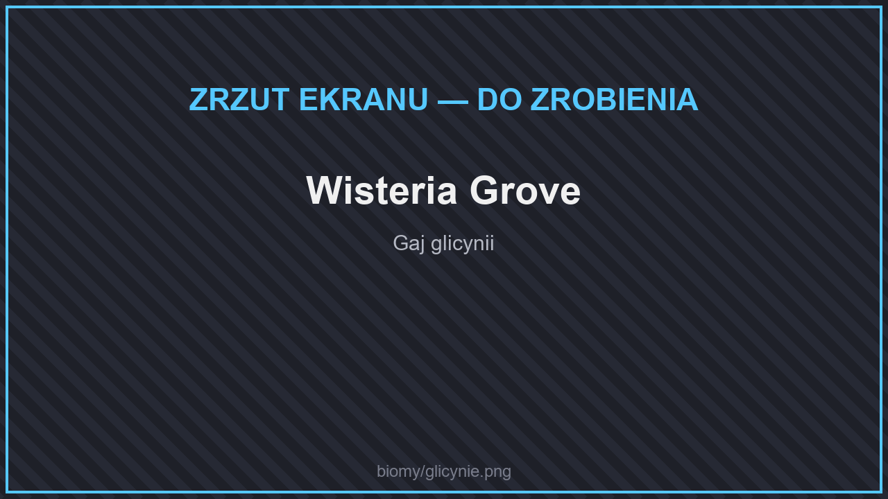
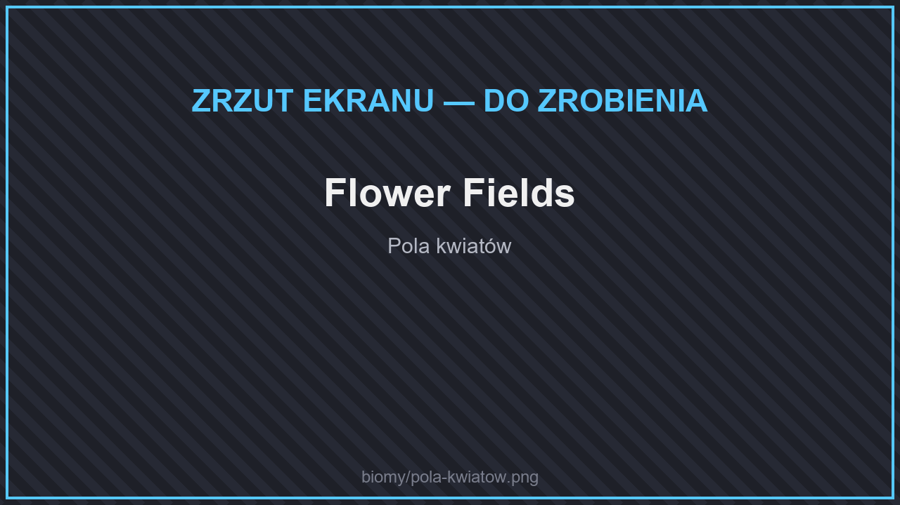
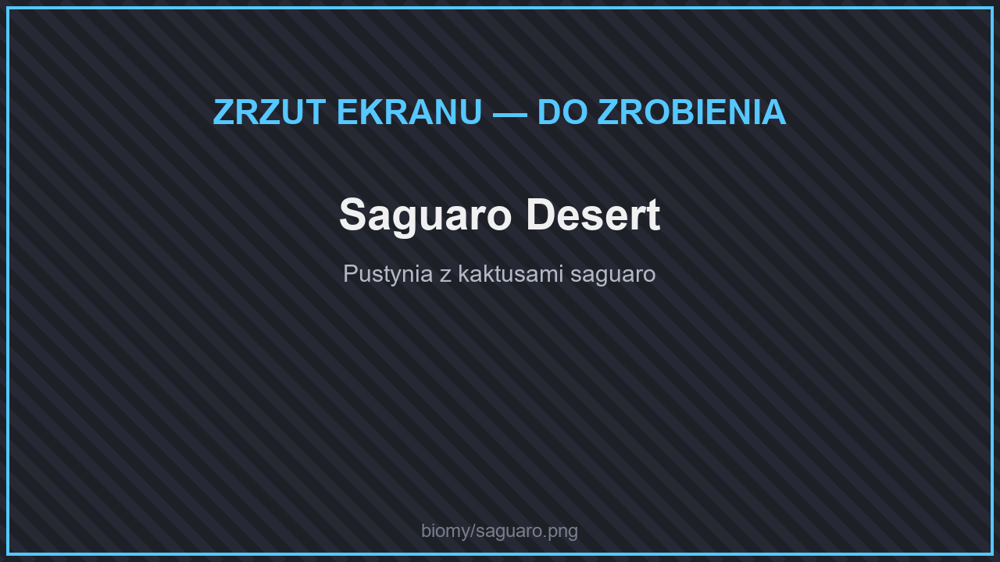
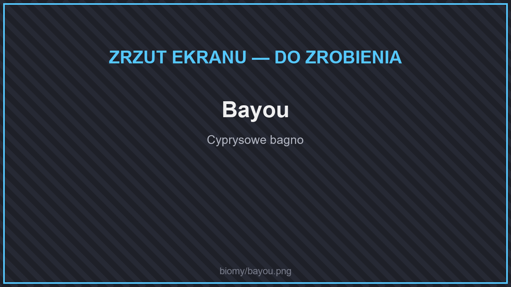
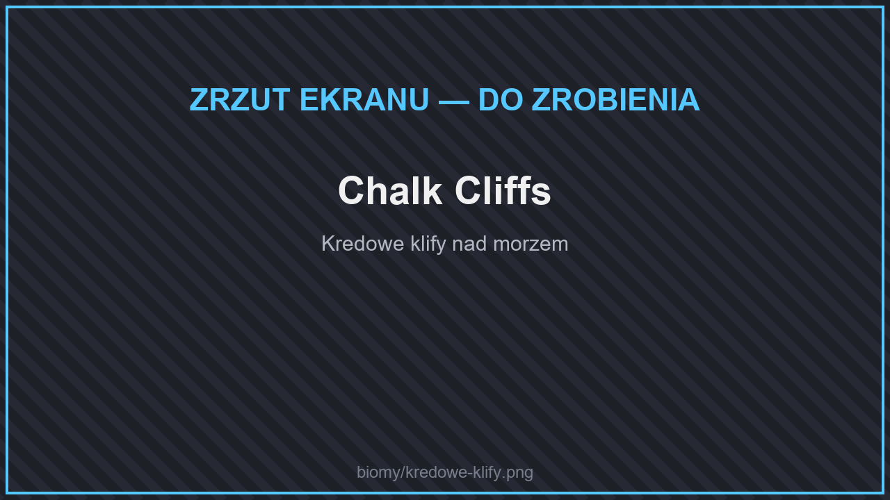
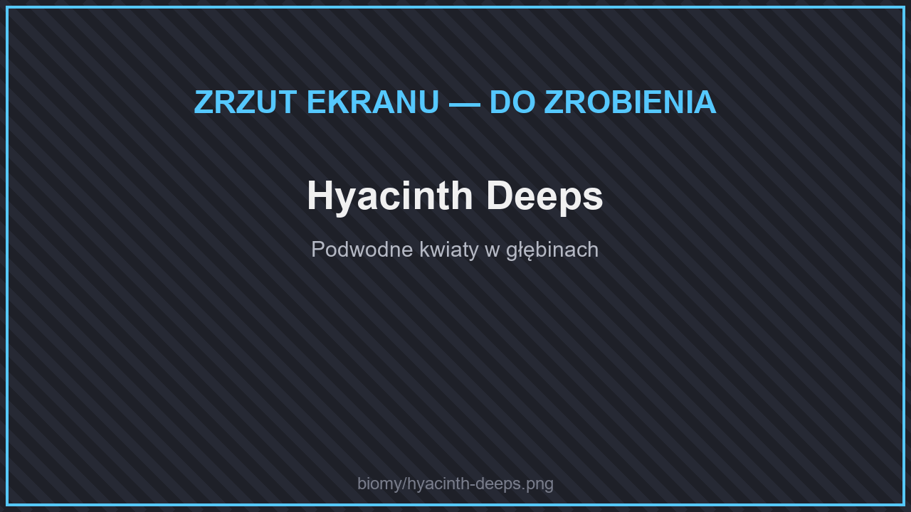
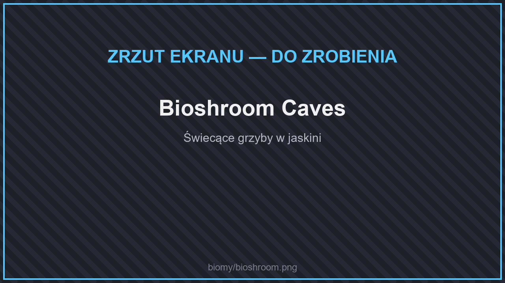
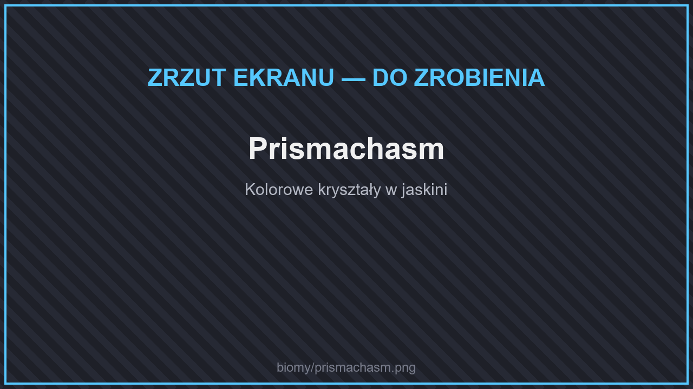

# 🌄 Biomy

W Świecie Głównym jest **114 biomów**: **70 nowych** i 44 zwykłe biomy Minecrafta. Wiele nowych biomów ma własne drzewa, kwiaty i kamienie. Nazwy biomów widzisz w grze po angielsku (np. na ekranie F3) — w tabelach nowe biomy mają nazwy angielskie, a zwykłe także polskie.


Część zwykłych biomów **nie występuje** — zastąpiły je nowe odpowiedniki: równiny, las, tajga (także śnieżna i stare tajgi), dżungla (także rzadka), sawanna (także płaskowyż) i bagno.


## Lasy

<figure><figcaption>
Redwoods
</figcaption></figure>

<figure><figcaption>
Maple Forest
</figcaption></figure>

<figure><figcaption>
Wisteria Grove
</figcaption></figure>

| Biom | |
| --- | --- |
| **Maple Forest**, **Windswept Maple Forest** | Lasy klonowe, także na wietrznych wzgórzach. |
| **Deciduous Forest**, **Cold Deciduous Forest** | Lasy liściaste, także w zimnej odmianie. |
| **Old Growth Forest** | Stary, gęsty las z wielkimi drzewami. |
| **Temperate Grove** | Gaj strefy umiarkowanej. |
| **Redwoods**, **Sparse Redwoods** | Olbrzymie sekwoje. |
| **Boreal Taiga**, **Cold Boreal Taiga**, **Golden Boreal Taiga**, **Old Growth Boreal Taiga**, **Old Growth Golden Boreal Taiga** | Północne tajgi, także ze złotymi modrzewiami. |
| **Pine Taiga**, **Pine Slopes**, **Frozen Pine Taiga** | Lasy sosnowe na zboczach i w śniegu. |
| **Blackwood Taiga** | Mroczna tajga z czarnym drewnem. |
| **Silver Birch Forest** | Las srebrnych brzóz. |
| **Magnolia Woodland**, **Wisteria Grove** | Kwitnące magnolie i glicynie. |
| **Willow Forest** | Las wierzbowy. |
| **Alpha Grove** | Las w stylu starego Minecrafta. |
| **Orchard** | Sad pełen owocowych drzew. |
| **Ashen Woodland** | Las po pożarze, pokryty popiołem. |
| **Bamboo Forest** | Las bambusowy. |
| **Eucalyptus Forest** | Las eukaliptusowy. |
| **Rainforest**, **Sparse Rainforest**, **Tropics** | Lasy deszczowe i tropiki. |
| **Birch Forest** (las brzozowy), **Old Growth Birch Forest** (stary las brzozowy) | Zwykłe lasy brzozowe. |
| **Dark Forest** (mroczny las) | Gęsty las z ciemnego dębu. |
| **Pale Garden** (blady ogród) | Blady, mglisty las z bladych dębów. |
| **Cherry Grove** (wiśniowy gaj) | Różowe wiśnie w górach. |
| **Flower Forest** (las kwiatowy) | Las pełen kwiatów — bardzo rzadki. |
| **Windswept Forest** (wietrzny las) | Las na wietrznych wzgórzach. |
| **Grove** (gaj) | Ośnieżony gaj świerkowy u stóp gór. |
| **Bamboo Jungle** (bambusowa dżungla) | Dżungla porośnięta bambusem. |

## Równiny i łąki

<figure><figcaption>
Flower Fields
</figcaption></figure>

| Biom | |
| --- | --- |
| **Grassland**, **Prairie** | Rozległe trawiaste równiny. |
| **Clover Plains** | Równiny pełne koniczyny. |
| **Flower Fields**, **Poppy Fields** | Pola kwiatów i maków. |
| **Barley Fields**, **Pumpkin Fields** | Pola jęczmienia i dyń. |
| **Highland Fields**, **Rocky Meadow** | Wyżynne i kamieniste łąki. |
| **Steppe** | Suchy step. |
| **Shrubland**, **Dry Bushland** | Zarośla i suche busze. |
| **Tundra**, **Frozen Tundra** | Zimne, puste równiny. |
| **Meadow** (łąka) | Górska łąka pełna kwiatów. |
| **Sunflower Plains** (równiny słonecznikowe) | Równiny ze słonecznikami — bardzo rzadkie. |
| **Snowy Plains** (śnieżne równiny), **Ice Spikes** (lodowe kolce) | Zaśnieżone równiny, także z lodowymi iglicami. |
| **Mushroom Fields** (grzybowe pola) | Wyspy z grzybni i mooshroomami — rzadkie. |

## Pustynie, sawanny i badlandy

<figure><figcaption>
Saguaro Desert
</figcaption></figure>

<figure><figcaption>
Baobab Savanna
</figcaption></figure>

| Biom | |
| --- | --- |
| **Saguaro Desert** | Pustynia z wielkimi kaktusami. |
| **Joshua Desert** | Pustynia z drzewami Jozuego. |
| **Outback** | Czerwony australijski interior. |
| **Baobab Savanna** | Sawanna z baobabami. |
| **Desert** (pustynia) | Zwykła piaszczysta pustynia. |
| **Windswept Savanna** (wietrzna sawanna) | Poszarpana sawanna na wzgórzach. |
| **Badlands** (badlandy), **Wooded Badlands** (zalesione badlandy), **Eroded Badlands** (zerodowane badlandy) | Kolorowa terakota i iglice, także z drzewami. |

## Bagna i rzeki

<figure><figcaption>
Bayou
</figcaption></figure>

| Biom | |
| --- | --- |
| **Bayou**, **Old Growth Bayou** | Cyprysowe bagna. |
| **Fen**, **Marsh** | Torfowiska i mokradła. |
| **Fungal Fen** | Bagno porośnięte grzybami. |
| **Mangrove Swamp** (bagno namorzynowe) | Namorzyny z błotem. |
| **Muddy River**, **Cold River**, **Tropical River** | Nowe rodzaje rzek. |
| **River** (rzeka), **Frozen River** (zamarznięta rzeka) | Zwykłe rzeki. |

## Góry i klify

<figure><figcaption>
Chalk Cliffs
</figcaption></figure>

| Biom | |
| --- | --- |
| **Mountains**, **Arid Mountains** | Góry — zielone albo suche i skaliste. |
| **Mauve Hills** | Fioletowe wzgórza. |
| **Chalk Cliffs** | Białe kredowe klify nad morzem. |
| **Towering Cliffs** | Wysokie, strome urwiska. |
| **Spires** | Skalne iglice. |
| **Icy Heights** | Lodowe szczyty. |
| **Jagged Peaks** (postrzępione szczyty), **Frozen Peaks** (zamarznięte szczyty), **Stony Peaks** (kamieniste szczyty) | Najwyższe szczyty gór. |
| **Snowy Slopes** (ośnieżone zbocza) | Śnieżne zbocza z kozami. |
| **Windswept Hills** (wietrzne wzgórza), **Windswept Gravelly Hills** (wietrzne żwirowe wzgórza) | Poszarpane wzgórza, także żwirowe. |

## Wybrzeża i oceany

<figure><figcaption>
Hyacinth Deeps
</figcaption></figure>

| Biom | |
| --- | --- |
| **Grassy Beach**, **Gravel Beach** | Trawiaste i żwirowe plaże. |
| **Rocky Reef** | Skalista rafa. |
| **Hyacinth Deeps** | Głębiny pełne podwodnych kwiatów. |
| **Beach** (plaża), **Snowy Beach** (śnieżna plaża), **Stony Shore** (kamieniste wybrzeże) | Zwykłe wybrzeża. |
| **Ocean**, **Deep Ocean** (głęboki ocean) | Zwykły ocean. |
| **Warm Ocean** (ciepły ocean) | Rafy koralowe. |
| **Lukewarm Ocean** (letni ocean), **Deep Lukewarm Ocean** (głęboki letni ocean) | Ciepłe wody. |
| **Cold Ocean** (zimny ocean), **Deep Cold Ocean** (głęboki zimny ocean) | Zimne wody. |
| **Frozen Ocean** (zamarznięty ocean), **Deep Frozen Ocean** (głęboki zamarznięty ocean) | Ocean pokryty lodem i górami lodowymi. |

## Jaskinie

<figure><figcaption>
Bioshroom Caves
</figcaption></figure>

<figure><figcaption>
Prismachasm
</figcaption></figure>

| Biom | |
| --- | --- |
| **Bioshroom Caves** | Jaskinie z wielkimi, świecącymi grzybami. |
| **Prismachasm** | Jaskinie z kolorowymi kryształami. |
| **Scorching Caves** | Rozgrzane jaskinie z lawospadami i kominami popiołu. |
| **Inferno** | Głęboka, ognista jaskinia pełna lawy i popiołu. |
| **Lush Caves** (bujne jaskinie) | Jaskinie z azaliami, pnączami i aksolotlami. |
| **Dripstone Caves** (jaskinie naciekowe) | Stalaktyty i stalagmity. |
| **Sulfur Caves** (jaskinie siarkowe) | Jaskinie pełne siarki. |
| **Deep Dark** (mroczne głębiny) | Sculk i starożytne miasta — uważaj na Wardena! |


Drewno, kamienie i rośliny z nowych biomów opisuje strona [Bloki budowlane](../../dodatki/bloki-budowlane.md#swiat-glowny). Każdy biom ma też swoje [zwierzęta](zwierzeta.md) i [ryby](../../dodatki/wedkarstwo.md#ryby-z-biomow).

