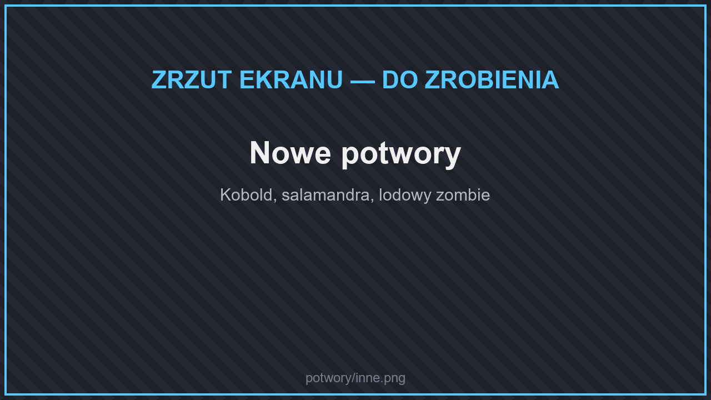

# 🧟 Potwory

Oprócz zwykłych potworów spotkasz w świecie nowe, silniejsze odmiany i zupełnie nowe stwory.

## Szkielety

<figure><figcaption>
Szkielety
</figcaption></figure>

| Potwór | |
| --- | --- |
| Szkielet | Odmieniony szkielet. |
| Elitarny szkielet | Rzadki, silniejszy szkielet. |
| Trujący szkielet | Zatruwa swoimi strzałami. |
| Wither szkielet | Nakłada efekt uschnięcia. |
| Sculkowy szkielet | Rzadki szkielet pokryty sculkiem. |

## Zombie

| Potwór | |
| --- | --- |
| Wzmocniony zombie | Wytrzymalszy zombie. |
| Gigantyczny zombie | Rzadki, ogromny zombie. |
| Nieznajomy w płaszczu | Rzadki, dziwny przybysz. |

## Inne potwory

<figure><figcaption>
Nowe potwory
</figcaption></figure>

| Potwór | |
| --- | --- |
| Kobold wojownik i Kobold łucznik | Małe stworzenia walczące wręcz i z łuku. |
| Roślinny potwór | Mięsożerna roślina. |
| Salamandra i Lawowa salamandra | Ogniste jaszczurki. |
| Lodowy zombie i lodowy pająk | Lodowe odmiany zombie i pająka. |
| Czaszkowy pająk | Pająk z czaszką. |
| Mroczna dusza | Rzadki, latający duch. |
| Golem doświadczenia | Bardzo rzadki golem — po pokonaniu daje dużo doświadczenia. |

## Potwory z nowych biomów

| Potwór | Gdzie |
| --- | --- |
| Pustynny Piaskun | Pustynie i badlandy — wiruje w piaskowej burzy. |
| Skelewag | Głębokie oceany — szkieletowa ryba. |

Uważaj też na duże [zwierzęta](zwierzeta.md): niedźwiedź grizzly, tygrys, krokodyl, słoń i nosorożec bronią się, gdy je zaatakujesz.

## Bossowie

<figure><figcaption>
Walka z bossem
</figcaption></figure>

Bossowie czekają w lochach i na arenach (**`/warp`**). Zobacz też [Misje](../../informacje/zadania.md#misje).

## Piniata

Piniata pojawia się, gdy gracze zagłosują na serwer. Rozbijcie ją razem, aby zdobyć odłamki kluczy i nagrody.
